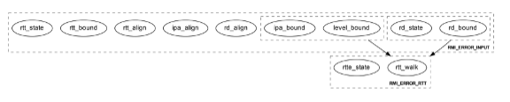
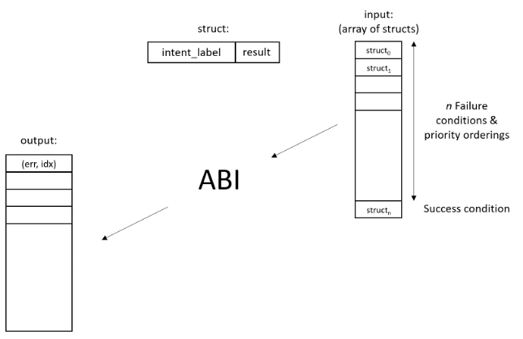

.. Copyright [C] 2023-2026, Arm Limited or its affiliates. All rights reserved.
      SPDX-License-Identifier: BSD-3-Clause

*************************
Command Scenario document
*************************
.. raw:: pdf

   PageBreak

.. section-numbering::

.. contents::
      :depth: 3

Introduction
============

In this document the test scenarios for all RMM ABI commands are detailed.
First, an overview of the general test strategy is provided, which forms the
basis of the overall flow and rationale of the various scenarios. Unless otherwise specified,
this scenario doc is compliant to bet1 of `Realm Management Monitor (RMM) Specification`_ v2.0.

Arm Realm Management Monitor Specification
==========================================
The Realm Management Monitor (RMM) is a software component which forms part of a system which
implements the Arm Confidential Compute Architecture (Arm CCA). `Arm CCA`_ is an architecture which
provides protected execution environments called Realms.

CCA-RMM-ACS Command Suite
=========================

The Command Suite in the CCA-RMM ACS tests the Interface section of
`Realm Management Monitor (RMM) Specification`_. The RMM exposes three interfaces of which one is
facing the Host (RMI), and two are facing the Realm (RSI and PSCI). For each of the commands a set
of input stimuli with which all the failure conditions can be verified, and instructions to observe
the command footprint are provided.
The tests are classified as.

* RMI - Realm Management Interface
* RSI - Realm Services Interface
* PSCI - Power State Coordination Interface

Test strategy
-------------

ABI command testing can be regarded as the 'unit-level like' testing of each ABI command. The goal
here is to verify whether execution of the command produces the expected outcome. For RMM ABI
command testing there are three aspects that require elaboration:

1.      The scope and generation of input stimuli
2.      The observability of the command footprints
3.      The general test flow

Each of the aforementioned aspects will be discussed in a dedicated sections below.

Stimulus
^^^^^^^^

In order to properly exercise the commands, sets of input arguments must be selected such that all
corner cases are covered.
Each command will be tested on failure conditions, failure priority ordering, and finally,
successful execution.

.. list-table::

   * - Failure conditon testing
   * - Typically, each ABI command has a set of failure conditions that can arise from invalid
       input argument values. Such conditions have an associated error code, and the same error
       can often be triggered by multiple values of that input argument. In this part of the test,
       we will explore all the input values with which the failure condition can be triggered. For
       example, we might test whether an address is out of bounds by testing boundary conditions,
       but not all possible regions that would meet the criteria. In each case we then provide a set
       of input arguments that should trigger only a single failure condition at a time:

       Exceptions :

       Although the strategy is to cover all corner cases in failure condition testing, there are
       exceptions:

         * Circular Dependencies: Here we would require ABI commands that are yet to be verified to
           generate the stimulus (note that these are sometimes unavoidable)
         * Multi-causal Stimuli: This is unavoidable in certain cases. For example, an out-of-bound
           rd in RMI_RTT_DATA_MAP_INIT ABI would also result in granule(rd).state error. However, we will
           exclude stimuli that trigger multiple failure conditions which have both: I) different
           error codes, and II) no architected priority ordering relative to each other.

.. raw:: pdf

   PageBreak

.. list-table::

   * - Failure priority ordering
   * - It is also important to test that the correct order is maintained between these failure
       conditions. To test this, we trigger multiple failure conditions on one or multiple input
       arguments, and verify that the error code of the higher priority condition is observed.
       In contrast to failure condition testing, each condition will only be triggered in a single
       way to limit the problem size. This methodology of triggering multiple faults at a time will
       be referred to as Pairwise Failure Ordering Testing (PFOT).

       A failure condition ordering A < B can be grouped into two categories:

         * Well-formedness (Not Tested)

           These orderings exist because failure condition B can only be evaluated if failure
           condition A is false. In the figure below [rd_state, rd_bound] < [rtte_state, rtt_walk]
           are well-formedness orderings as we cannot define an RTT walk if the RD granule is not
           an actual Realm Descriptor granule. As the name suggests, these orderings exist to
           ensure the mathematical "well-formedness" of the RMM specification and we will not
           verify these.

            |Priority orderings|

         * Behavioural (Tested)

           These orderings exist to prevent security leaks and to ensure that the returned error
           code is deterministic across RMM implementations and will be verified, An example in the
           figure above is level_bound < rtt_walk, which implies that an out-of-bounds level
           parameter should be reported ahead of an RTT walk failure. Furthermore, while it is
           mathematically acceptable to derive the order between failure conditions based on
           hierarchy (i.e. if A < B and B < C, then A < C), we will also verify these transitive
           priority relationships (i.e. A < C) as these orderings must be honoured by the
           implementer, but are not explicitly mentioned in the specification

.. list-table::

   * - Success conditon testing
   * - At the end of each ABI command test we will execute the command with valid input parameters
       to check that the command executed successfully.

Observability
^^^^^^^^^^^^^

At the end of each ABI command test we will execute the command with valid input parameters to check
that the command executed successfully.

.. table::

  +---------------+------------------------+---------------------------------+
  |Footprint      |Category                |Can it be queried by the host    |
  +===============+========================+=================================+
  |Properties of  | state                  |No                               |
  |a granule      |                        |                                 |
  |               | (UNDELEGATE, DELEGATED,|                                 |
  |               | RD, REC, REC_AUX, DATA,|                                 |
  |               | RTT)                   |                                 |
  |               +------------------------+---------------------------------+
  |               | substate               |In general not, except           |
  |               |                        |RTTE.state/ripas through         |
  |               | (RD - New/Active/ NULL,|RMI_RTT_READ_ENTRY               |
  |               | REC - Ready/Running,   |                                 |
  |               | RTTE.state/ripas)      |                                 |
  |               +------------------------+---------------------------------+
  |               | ownership              |No                               |
  |               |                        |                                 |
  |               | (RD)                   |                                 |
  |               +------------------------+---------------------------------+
  |               | GPT entry              |No                               |
  |               |                        |                                 |
  |               | (GPT_NS, GPT_ROOT,     |                                 |
  |               | GPT_REALM, GPT_SECURE) |                                 |
  +---------------+------------------------+---------------------------------+
  |Contents of    | (RD / REC / DATA / RTT |No these are provisioned by the  |
  |a granule      | / NS)                  |host but outside of Realm's TCB  |
  |               |                        |(except for NS granules)         |
  +---------------+------------------------+---------------------------------+

As many of these properties and contents of Granules cannot directly by queried by the Host, we
need to detect these indirectly. For example, we can determine the Granule states and substates by
ascertaining which state transitions are possible, or not possible. Since each state transition is
associated with a successful ABI call, some of which would still be subject to verification, this
gives rise to so called circular dependencies. The general strategy here is to prevent circular
dependencies as much as possible and defer the residual observation of command footprints to other
ACS test scenarios. Hence, we will employ the following strategies where the properties and contents
of Granules cannot be queried by the Host.

Observing Properties of a granule
~~~~~~~~~~~~~~~~~~~~~~~~~~~~~~~~~

.. table::

  +-------------------+----------------------------------------------------------------+
  |Scenario           |Strategy                                                        |
  +===================+================================================================+
  |When the command   |In general, we will not check for changes in properties of      |
  |fails              |a Granule. We will only check the error code in command         |
  |                   |ACS. The expectation that a failing command must not cause      |
  |                   |footprint changes is validated indirectly, to a large           |
  |                   |extent, as part of testing the command for success criteria.    |
  |                   |This is because of the valid arguments being same across        |
  |                   |failure testing (other than the argument that causes a          |
  |                   |particular failure condition) and successful execution of       |
  |                   |the command. Consider also checking rtte_state & rtte_addr      |
  |                   |for applicable commands.                                        |
  |                   +----------------------------------------------------------------+
  |                   |state                                                           |
  |                   |                                                                |
  |                   |We will not test this in CCA-RMM-ACS as the logic to ascertain  |
  |                   |that the state is unchanged (due to command failure) is not     |
  |                   |trivial and typically falls in DV space. Also see above comment |
  |                   +----------------------------------------------------------------+
  |                   |substate                                                        |
  |                   |                                                                |
  |                   |Where they can be queried, we will execute the query ABI (i.e.  |
  |                   |RTT_READ_ENTRY). Where it cannot be queried, we will follow the |
  |                   |same strategy for granule states listed above.                  |
  |                   +----------------------------------------------------------------+
  |                   |ownership                                                       |
  |                   |                                                                |
  |                   |We will follow the same strategy as for granule state.          |
  |                   +----------------------------------------------------------------+
  |                   |GPT entry                                                       |
  |                   |                                                                |
  |                   |For GPT entry checks we will do testing in memory management ACS|
  |                   |scenarios to ensure that the GPI encodings in the GPT has not   |
  |                   |changed.                                                        |
  +-------------------+----------------------------------------------------------------+
  |Summary            |When command fails, ACS will check for return error code, and   |
  |                   |RTTE for some of the failure conditions.                        |
  +-------------------+----------------------------------------------------------------+
  |When the command   |In general, we will check that the returned error code is equal |
  |succeeds           |to zero.                                                        |
  |                   +----------------------------------------------------------------+
  |                   |state                                                           |
  |                   |                                                                |
  |                   |We will not test this in command ACS as it doesn't fit into a   |
  |                   |typical command ACS test flow. This is covered outside of the   |
  |                   |command ACS, for example, as part of typical realm creation     |
  |                   |flow or winding the state of RMM/Realm as part of rollback logic|
  |                   |by VAL that's needed to run ACS as a single ELF.                |
  |                   +----------------------------------------------------------------+
  |                   |substate                                                        |
  |                   |                                                                |
  |                   |Where they can be queried, we will execute the query ABI. Where |
  |                   |it cannot be queried, we will follow the strategy for observing |
  |                   |granule states listed above.                                    |
  |                   +----------------------------------------------------------------+
  |                   |ownership                                                       |
  |                   |                                                                |
  |                   |Unless otherwise specified we will follow the same strategy as  |
  |                   |specified for granule state.                                    |
  |                   +----------------------------------------------------------------+
  |                   |GPT entry                                                       |
  |                   |                                                                |
  |                   |There will be testing in memory management ACS scenarios to     |
  |                   |probe the GPI encodings in the GPT.                             |
  +-------------------+----------------------------------------------------------------+
  |Summary            |When command succeeds, ACS will check for return status, and    |
  |                   |RTTE wherever applicable                                        |
  +-------------------+----------------------------------------------------------------+

Observing contents of a granule
~~~~~~~~~~~~~~~~~~~~~~~~~~~~~~~
.. list-table::
  :widths: 25 75

  * - Scenario
    - Strategy
  * - When the command fails
    - We will, in general, not check for forbidden changes in contents of a Granule. There is an
      exception for NS Granules. For example, while testing REC_ENTER, we can check whether the
      exit_ptr remains unchanged and does not contain the fields populated in entry_ptr through
      testing outside of the ACS command scenarios.
  * - When the command succeeds
    - * Host Provisioned

        For contents that are provisioned by the Host through parameters we do know the expected
        value, but still need to verify whether the RMM correctly handled the parameters. These will
        be verified through testing outside of the command ACS.
      * Non-Host Provisioned

        For contents that are not provisioned by the Host, if the expected values are architected,
        we will verify this through testing outside of the ACS command scenarios.

General Test flow
^^^^^^^^^^^^^^^^^
Having defined the overall test strategy and scoping, the general flow of ABI command tests is as
follows:

1.      Enter the test from NS-EL2 or R-EL1
2.      Initialize the input structure (as depicted in the figure below)
3.      Iteratively load the intent labels from the input structure and perform the corresponding
        parameter preparation sequence
4.      Execute the ABI command with the prepared set of parameters and check for the expected
        error code
5.      If all reported error codes are as expected, check the command footprint
6.      Undo any footprint changes caused by the successful ABI execution and observability tests
7.      Return to the test dispatcher

|Intent to sequence structure|

Disclaimer: Only invalid values that cause a failure condition are specified. All other attributes
of an input argument must be set to valid values, if applicable, as defined in argument list table
above.

RMI Commands
------------

RMI_RTT_DATA_MAP_INIT
^^^^^^^^^^^^^^^^^^^^^

Argument list
~~~~~~~~~~~~~

.. list-table::
  :widths: 25 75

  * - Input parameters
    - Valid Values
  * - rd
    - | rd = RMI_GRANULE_ALIGNED
      | granule(rd).state = RD
      | Realm(rd).state = New
      | granule(rd).tracking_region_state = TRACKING_FINE/TRACKING_COARSE

  * - data
    - | granule(data) = RMI_GRANULE_ALIGNED
      | granule(data).category = RMI_MEM_CATEGORY_CONVENTIONAL
      | granule(data).tracking_region_state = TRACKING_FINE
      | granule(data).state = DELEGATED
      | data < 2^48 if Realm(rd).feat_lpa2 == FALSE
  * - ipa
    - | ipa = RMI_GRANULE_ALIGNED
      | ipa = Protected
      | walk(ipa).level = LEAF_LEVEL
      | RTTE(ipa).state = RTTE_VOID
      | RTTE(ipa).ripas = RAM
  * - src
    - | granule(src) = RMI_GRANULE_ALIGNED
      | granule(src).gpt = GPT_NS
  * - flags
    - | flags = RMI_MEASURE_CONTENT

Failure condition testing
~~~~~~~~~~~~~~~~~~~~~~~~~

.. list-table::
  :widths: 20 20 30 30

  * - Failure condition ID
    - Input parameters
    - Input Values
    - Remarks
  * - src_align
    - src
    - src = not_rmi_granule_aligned_addr
    -
  * - src_pas
    - src
    - src = GPT_REALM, GPT_SECURE
    -
  * - data_align
    - data
    - data = not_rmi_granule_aligned_addr
    -
  * - data_pop
    - data
    - PaIsPopulatedConventional(data) = FALSE
    - This condition is not independently validated by CCA-RMM-ACS.
  * - data_track
    - data
    - PaIsTrackedFine(data) = FALSE
    - ACS supplies a delegated granule in a separate 2 MB COARSE DRAM region,
      checks RMI_ERROR_TRACKING with level 0 and the shifted data address, and
      restores the region afterward. This check is skipped in 1 GB mode.
  * - data_state
    - data
    - granule(data).state = UNDELEGATED, RD, REC, RTT, DATA
    -
  * - data_bound2
    - data
    - data >= 2^48 with Realm(rd).feat_lpa2 = FALSE
    - The address also may fail data_pop and data_state; this stimulus is not isolated.
  * - rd_align
    - rd
    - rd = not_rmi_granule_aligned_addr
    -
  * - rd_state
    - rd
    - granule(rd).state = UNDELEGATED, DELEGATED, REC, RTT, DATA
    - A destroyed Realm RD is also passed and expected to return RMI_ERROR_INPUT.
  * - ipa_align
    - ipa
    - ipa = not_rmi_granule_aligned_addr
    -
  * - ipa_bound
    - ipa
    - ipa = unprotected_ipa, outside_permitted_ipa
    -
  * - realm_state
    - rd
    - Realm(rd).state = REALM_ACTIVE, REALM_SYSTEM_OFF
    - Both state stimuli are active in the test.
  * - rtt_walk
    - ipa
    - walk(ipa).level < RMM_RTT_PAGE_LEVEL
    - The test checks RMI_ERROR_RTT and the returned walk level.
  * - rtte_state
    - ipa
    - walk.rtte.state = RTTE_DATA
    - The test checks RMI_ERROR_RTT and the returned walk level.
  * - dpt
    - rd, data
    - ATS is enabled for the Realm and required PSMMU or Level 1 DPT setup is missing
    - This condition is not validated by CCA-RMM-ACS. The command table and
      memory-management text specify different errors for a missing Level 1 DPT.

Failure Priority ordering
~~~~~~~~~~~~~~~~~~~~~~~~~

.. list-table::
  :widths: 20 40 40

  * - Failure condition IDs
    - Input Values
    - Remarks
  * - ipa_bound < rtt_walk, rtte_state
    - | unprotected_ipa && walk(ipa).level < RMM_RTT_PAGE_LEVEL
      | unprotected_ipa && walk.rtte.state = RTTE_MAPPED_NS
    - ACS executes two combined-failure stimuli and checks RMI_ERROR_INPUT.
  * - rd_state < realm_state, rtt_walk, rtte_state
    - Invalid RD combined with a later Realm-state or RTT failure
    - These ordering combinations are not exercised by this test.

Observability
~~~~~~~~~~~~~

.. list-table::
  :widths: 25 75

  * - Footprint
    - Verification
  * - Command Failure
    -
  * - result
    - Check the expected error status and RTT walk level, where applicable,
      for each active failure stimulus.
  * - data_state, rim, rtte
    - The failure footprint is not directly checked after each failed command.
  * - Command Success
    -
  * - result
    - Complete any Stateful RMI Operation and require RMI_SUCCESS.
  * - rtte_state, rtte_addr, rtte_ripas
    - Execute RMI_RTT_READ_ENTRY and check RTTE_DATA, the target data PA and RIPAS_RAM.
  * - data_state, data_content, rtte_memattr, rtte_sh
    - These success effects are not directly checked by this command test.
  * - rim
    - The resulting RIM is not checked by this command test.

RMI_RTT_DATA_MAP
^^^^^^^^^^^^^^^^

Argument list
~~~~~~~~~~~~~

.. list-table::
  :widths: 25 75

  * - Input parameters
    - Valid Values
  * - rd
    - | granule(rd) = RMI_GRANULE_ALIGNED
      | granule(rd).state = RD
      | granule(rd).tracking_region_state = TRACKING_FINE/TRACKING_COARSE
      | Realm(rd).state = New, Active
  * - base
    - | base = RMI_GRANULE_ALIGNED
      | base = Protected IPA
      | walk(base).level = RMM_RTT_PAGE_LEVEL or a level whose block size is <= top - base
      | RTTE(base).state = RTTE_VOID
  * - top
    - | top = RMI_GRANULE_ALIGNED
      | top > base
      | range [base, top) = Protected IPA range
  * - flags
    - | flags.oaddr_type = RMI_ADDR_TYPE_SINGLE, RMI_ADDR_TYPE_LIST
      | flags.list_count = number of valid entries in oaddr list if flags.oaddr_type == RMI_ADDR_TYPE_LIST
      | flags[63:16] = 0
  * - oaddr
    - | if flags.oaddr_type == RMI_ADDR_TYPE_SINGLE:
      |   oaddr = descriptor for a contiguous output PA range
      |   decoded output PA base = RMI_GRANULE_ALIGNED
      | if flags.oaddr_type == RMI_ADDR_TYPE_LIST:
      |   oaddr.gpt = GPT_NS
      |   oaddr = PA of a granule containing an RMI Address Range List
      |   oaddr = 8-byte aligned
      | first output PA granule state = GRAN_DELEGATED
      | first output PA < 2^48 if Realm(rd).feat_lpa2 == FALSE
      | first output PA tracking region = tracked and granularity <= top - base
      | DPT entry can describe first output PA if Realm(rd).feat_ats == TRUE

Failure condition testing
~~~~~~~~~~~~~~~~~~~~~~~~~

.. list-table::
  :widths: 20 20 30 30

  * - Failure condition ID
    - Input parameters
    - Input Values
    - Remarks
  * - rd_align
    - rd
    - granule(rd) = not_rmi_granule_aligned_addr
    -
  * - rd_state
    - rd
    - granule(rd).state = UNDELEGATED, DELEGATED, REC, RTT, DATA
    -
  * - base_align
    - base
    - base = not_rmi_granule_aligned_addr
    -
  * - ipa_bound
    - base, top
    - | base = unprotected_ipa, outside_of_permitted_ipa (info)
      | range [base, top) is not fully Protected IPA space
    - unprotected_ipa := base >= 2**(IPA_WIDTH - 1)

      IPA_WIDTH = RmiFeatureRegister0.S2SZ

      (info) Must cover statement - IFBZPQ The input address to an RTT walk is always less than
      2^w, where w is the IPA width of the target Realm.
  * - rtte_state
    - base
    - RTTE[base].state != RTTE_VOID
    - The rtte_state failure condition is checked in this test using an
      RTTE_NARCH_DEV entry created by RMI_RTT_DEV_MAP. This check requires
      Device Assignment support and is skipped when that feature is absent.
  * - rtte_size
    - base
    - RttLevelSize(walk(base).level) > top - base
    -
  * - top_align
    - top
    - top = not_rmi_granule_aligned_addr
    -
  * - size_valid
    - top
    - top <= base
    -
  * - oaddr_type
    - flags
    - flags.oaddr_type = RMI_ADDR_TYPE_NONE, reserved encoding

      flags[63:16] != 0
    -
  * - oaddr_single_align
    - oaddr
    - | if flags.oaddr_type == RMI_ADDR_TYPE_SINGLE:
      |   decoded output PA base = not_rmi_granule_aligned_addr [D]
    - [D] CCA-RMM-ACS sets the lowest address-field bit below RMI Granule alignment in
      the SINGLE descriptor, making the decoded output PA unaligned.
  * - oaddr_list_align
    - oaddr
    - | if flags.oaddr_type == RMI_ADDR_TYPE_LIST:
      |   oaddr = not_8_byte_aligned
    -
  * - oaddr_list_pas
    - oaddr
    - oaddr.gpt = GPT_REALM, GPT_SECURE, GPT_ROOT
    -
  * - gran_state
    - oaddr
    - | first output PA granule state = UNDELEGATED
      | first output PA >= 2^48 when Realm(rd).feat_lpa2 == FALSE
    -
  * - trk_untracked
    - oaddr
    - first output PA tracking region = untracked
    -
  * - trk_gran
    - oaddr
    - first output PA tracking region = tracked and granularity > top - base
    - The tracking-granularity condition is tested with a delegated 2 MB
      COARSE region as the output PA and a 4 KB IPA mapping. ACS checks
      RMI_ERROR_TRACKING, level 0, and the output PA address, then restores
      the region. This check is skipped in 1 GB tracking-region mode.
  * - dpt_gran
    - oaddr
    - DPT entry cannot describe first output PA when Realm(rd).feat_ats == TRUE
    -

Failure Priority ordering
~~~~~~~~~~~~~~~~~~~~~~~~~

This command has no failure priority orderings.

Observability
~~~~~~~~~~~~~
.. list-table::
  :widths: 25 75

  * - Footprint
    - Verification
  * - Command Failure
    -
  * - | RTTE.state,
      | RTTE.addr
    - Refer Observing Properties of a Granule and Observing Contents of a Granule for details
  * - | output address set granule state
      | output address set granule content
    - This is outside the scope of CCA-RMM-ACS. Refer Observing Properties of a Granule and
      Observing Contents of a Granule for details
  * - Command Success
    -
  * - | RTTE.state,
      | RTTE.addr,
      | RTTE.memattr,
      | RTTE.shareability
    - Execute RTT_READ_ENTRY and verify [base, out_top) has RTTE_DATA entries with cacheable
      memory attributes, inner shareability, and expected output addresses.
  * - out_top
    - Check out_top is valid when result.status == RMI_SUCCESS.
  * - | output address set granule state
      | output address set granule content
    - This is outside the scope of CCA-RMM-ACS.

RMI_RTT_DATA_UNMAP
^^^^^^^^^^^^^^^^^^

Argument list
~~~~~~~~~~~~~

.. list-table::
  :widths: 25 75

  * - Input parameters
    - Valid Values
  * - rd
    - | granule(rd) = RMI_GRANULE_ALIGNED
      | granule(rd).state = RD
      | granule(rd).tracking_region_state = TRACKING_FINE/TRACKING_COARSE
  * - base
    - | base = RMI_GRANULE_ALIGNED
      | base = Protected IPA
      | walk(base).level = RMM_RTT_PAGE_LEVEL or a level whose block size is <= top - base
      | RTTE(base).state = RTTE_DATA
  * - top
    - | top = RMI_GRANULE_ALIGNED
      | top > base
      | range [base, top) = Protected IPA range
  * - flags
    - | flags.oaddr_type = RMI_ADDR_TYPE_SINGLE, RMI_ADDR_TYPE_LIST
      | flags.list_count = number of valid entries in oaddr list if flags.oaddr_type == RMI_ADDR_TYPE_LIST
      | flags[63:16] = 0
  * - oaddr
    - | if flags.oaddr_type == RMI_ADDR_TYPE_SINGLE:
      |   oaddr = 0
      | if flags.oaddr_type == RMI_ADDR_TYPE_LIST:
      |   oaddr.gpt = GPT_NS
      |   oaddr = PA of a granule containing an RMI Address Range List
      |   oaddr = 8-byte aligned
      | DPT entry can describe first output PA if Realm(rd).feat_ats == TRUE

Failure condition testing
~~~~~~~~~~~~~~~~~~~~~~~~~

.. list-table::
  :widths: 20 20 30 30

  * - Failure condition ID
    - Input parameters
    - Input Values
    - Remarks
  * - rd_align
    - rd
    - granule(rd) = not_rmi_granule_aligned_addr
    -
  * - rd_state
    - rd
    - granule(rd).state = UNDELEGATED, DELEGATED, REC, RTT, DATA
    -
  * - base_align
    - base
    - base = not_rmi_granule_aligned_addr
    -
  * - ipa_bound
    - base, top
    - | base = unprotected_ipa, outside_of_permitted_ipa (info)
      | range [base, top) is not fully Protected IPA space
    - unprotected_ipa := base >= 2**(IPA_WIDTH - 1)
  * - rtte_state
    - base
    - RTTE[base].state != RTTE_DATA
    -
  * - rtte_size
    - base
    - RttLevelSize(walk(base).level) > top - base
    -
  * - top_align
    - top
    - top = not_rmi_granule_aligned_addr
    -
  * - size_valid
    - top
    - top <= base
    -
  * - oaddr_align
    - oaddr
    - | if flags.oaddr_type == RMI_ADDR_TYPE_LIST:
      |   oaddr = not_8_byte_aligned
    -
  * - oaddr_list_pas
    - oaddr
    - oaddr.gpt = GPT_REALM, GPT_SECURE, GPT_ROOT
    -
  * - trk_gran
    - oaddr
    - first output PA tracking region = tracked and granularity > top - base
    -
  * - dpt_gran
    - oaddr
    - DPT entry cannot describe first output PA when Realm(rd).feat_ats == TRUE
    -

Failure Priority ordering
~~~~~~~~~~~~~~~~~~~~~~~~~

This command has no failure priority orderings.

Observability
~~~~~~~~~~~~~
.. list-table::
  :widths: 25 75

  * - Footprint
    - Verification
  * - Command Failure
    -
  * - | RTTE.state,
      | RTTE.addr
    - Refer Observing Properties of a Granule and Observing Contents of a Granule for details.
  * - Command Success
    -
  * - result
    - Check result.status = RMI_SUCCESS.
  * - | RTTE.state,
      | RTTE.ripas
    - Execute RTT_READ_ENTRY and verify [base, out_top) has RTTE_VOID entries with expected RIPAS.
  * - out_top
    - Check out_top is valid when result.status == RMI_SUCCESS.
  * - output address set granule state
    - After successful SINGLE and LIST unmapping, undelegate the returned
      output granules to verify that they became GRAN_DELEGATED.

RMI_FEATURES
^^^^^^^^^^^^

Argument list
~~~~~~~~~~~~~

.. list-table::
  :widths: 25 75

  * - Input parameters
    - Valid Values
  * - index
    - index = Any integer (64b)

Failure condition testing
~~~~~~~~~~~~~~~~~~~~~~~~~

This command has no failure conditions.

Failure Priority ordering
~~~~~~~~~~~~~~~~~~~~~~~~~

This command has no failure priority values.

Observability
~~~~~~~~~~~~~
.. list-table::
  :widths: 25 75

  * - Footprint
    - Verification
  * - Command Success
    -
  * - X1 (Command return Value)
    - | For index = 0, check X1 = RmiFeatureRegisterEncode(index) and X1[63:32] MBZ field is zero
      | For index = 1, check X1 = RmiFeatureRegisterEncode(index) and X1[63:17] MBZ field is zero
      | For index = 2, check X1 = RmiFeatureRegisterEncode(index) and X1[63:15] MBZ field is zero
      | For index = 3, check X1 = RmiFeatureRegisterEncode(index) and X1[63:7] MBZ field is zero
      | For index = 4, check X1 = RmiFeatureRegisterEncode(index)
      | For index > 4, check X1 = RmiFeatureRegisterEncode(index)

RMI_GPT_L1_CREATE
^^^^^^^^^^^^^^^^^

Argument list
~~~~~~~~~~~~~

.. list-table::
  :widths: 25 75

  * - Input parameters
    - Valid Values
  * - addr
    - | addr < rmm.static.pasz
      | addr = aligned to rmm.static.l0gptsz
      | GptL0Walk(addr).state = GPT_L0_ENTRY_BLOCK
      | Unfolding of this L0GPT is permitted
      | Memory donated for L1GPT has NS PAS and DRAM category

Failure condition testing
~~~~~~~~~~~~~~~~~~~~~~~~~

.. list-table::
  :widths: 20 20 30 30

  * - Failure condition ID
    - Input parameters
    - Input Values
    - Remarks
  * - addr_bound
    - addr
    - addr >= rmm.static.pasz
    -
  * - addr_align
    - addr
    - addr is not aligned to rmm.static.l0gptsz
    -
  * - entry_state
    - addr
    - GptL0Walk(addr).state = GPT_L0_ENTRY_TABLE
    -
  * - unfold_denied
    - addr
    - Unfolding of this L0GPT is denied
    -
  * - gran
    - Memory donated for L1GPT
    - A donated Granule has PAS != NS or category != DRAM
    -

Failure Priority ordering
~~~~~~~~~~~~~~~~~~~~~~~~~

This command has no failure priority orderings.

Observability
~~~~~~~~~~~~~
.. list-table::
  :widths: 25 75

  * - Footprint
    - Verification
  * - Command Failure
    -
  * - l0gpt_entry.state
    - | For entry_state, successful destruction after the failed second create
        indirectly shows that the entry remained a Table. The other failure
        paths do not directly verify the entry state.
  * - l0gpt_entry.addr
    - The entry address is not directly verified by this test.
  * - Command Success
    -
  * - result
    - Require RMI_SUCCESS after completing any Stateful and memory-transferring operation.
  * - l0gpt_entry.state
    - Successful RMI_GPT_L1_DESTROY indirectly shows that the entry became a Table.
  * - l0gpt_entry.addr
    - The entry address is not directly verified by this test.

RMI_GPT_L1_DESTROY
^^^^^^^^^^^^^^^^^^

Argument list
~~~~~~~~~~~~~

.. list-table::
  :widths: 25 75

  * - Input parameters
    - Valid Values
  * - addr
    - | addr < rmm.static.pasz
      | addr = aligned to rmm.static.l0gptsz
      | GptL0Walk(addr).state = GPT_L0_ENTRY_TABLE
      | GptL1IsHomogeneous(addr) = TRUE

Failure condition testing
~~~~~~~~~~~~~~~~~~~~~~~~~

.. list-table::
  :widths: 20 20 30 30

  * - Failure condition ID
    - Input parameters
    - Input Values
    - Remarks
  * - addr_bound
    - addr
    - addr >= rmm.static.pasz
    -
  * - addr_align
    - addr
    - addr is not aligned to rmm.static.l0gptsz
    -
  * - entry_state
    - addr
    - GptL0Walk(addr).state = GPT_L0_ENTRY_BLOCK
    -
  * - gpt_l1_homo
    - addr
    - GptL1IsHomogeneous(addr) = FALSE
    - Create an L1 GPT, delegate one granule in its region, then attempt to destroy it.

Failure Priority ordering
~~~~~~~~~~~~~~~~~~~~~~~~~

This command has no failure priority orderings.

Observability
~~~~~~~~~~~~~

.. list-table::
  :widths: 25 75

  * - Footprint
    - Verification
  * - Command Failure
    -
  * - l0gpt_entry.state
    - After gpt_l1_homo fails, undelegate the granule and destroy the same L1 GPT successfully.
  * - Command Success
    -
  * - result
    - Check result.status = RMI_SUCCESS after any Stateful and memory-transferring operation
      completes.
  * - l0gpt_entry.state
    - A second RMI_GPT_L1_DESTROY must return RMI_ERROR_INPUT, confirming that the L0 entry is a
      Block.

RMI_GRANULE_RANGE_DELEGATE
^^^^^^^^^^^^^^^^^^^^^^^^^^

Argument list
~~~~~~~~~~~~~

.. list-table::
  :widths: 25 75

  * - Input parameters
    - Valid Values
  * - base
    - | base = RMI_GRANULE_ALIGNED
      | memory in range [base, top) is populated
      | tracking region state permits progress
      | Granules in range [base, top) are GRAN_UNDELEGATED or GRAN_DELEGATED
      | rmm.dynamic.state = RMM_STATE_ACTIVE
  * - top
    - | top = RMI_GRANULE_ALIGNED
      | top > base

Failure condition testing
~~~~~~~~~~~~~~~~~~~~~~~~~

.. list-table::
  :widths: 20 20 30 30

  * - Failure condition ID
    - Input parameters
    - Input Values
    - Remarks
  * - rmm_state
    - -
    - rmm.dynamic.state != RMM_STATE_ACTIVE
    - This condition cannot be exercised after framework activation.
  * - base_align
    - base
    - base = not_rmi_granule_aligned_addr
    -
  * - top_align
    - top
    - top = not_rmi_granule_aligned_addr
    -
  * - top_bound
    - | base
      | top
    - top <= base
    -
  * - populated
    - | base
      | top
    - memory in range [base, top) is unpopulated
    - This condition is exercised with a device-memory range.
  * - tracking
    - | base
      | top
    - tracking region containing base is TRACKING_NONE
    - Use one granule in the separate DRAM2 tracking region. Check
      RMI_ERROR_TRACKING and the reported failure address, then restore the
      region's original tracking state.
  * - state
    - | base
      | top
    - granule in range state is GRAN_RD
    -

Failure Priority ordering
~~~~~~~~~~~~~~~~~~~~~~~~~

This command has no failure priority orderings.

Observability
~~~~~~~~~~~~~
.. list-table::
  :widths: 25 75

  * - Footprint
    - Verification
  * - Command Failure
    -
  * - gran_state
    - This is outside the scope of CCA-RMM-ACS. Refer Observing Properties of a Granule and
      Observing Contents of a Granule for details.
  * - Command Success
    -
  * - gran_state
    - This is outside the scope of CCA-RMM-ACS. Refer Observing Properties of a Granule and
      Observing Contents of a Granule for details.
  * - X1(out_top)
    - Check out_top is the top PA of range whose state is GRAN_DELEGATED.

RMI_GRANULE_RANGE_UNDELEGATE
^^^^^^^^^^^^^^^^^^^^^^^^^^^^

Argument list
~~~~~~~~~~~~~

.. list-table::
  :widths: 25 75

  * - Input parameters
    - Valid Values
  * - base
    - | base = RMI_GRANULE_ALIGNED
      | tracking region state permits progress
      | Granules in range [base, top) are GRAN_DELEGATED or GRAN_UNDELEGATED
  * - top
    - | top = RMI_GRANULE_ALIGNED
      | top > base

Failure condition testing
~~~~~~~~~~~~~~~~~~~~~~~~~

.. list-table::
  :widths: 20 20 30 30

  * - Failure condition ID
    - Input parameters
    - Input Values
    - Remarks
  * - base_align
    - base
    - base = not_rmi_granule_aligned_addr
    -
  * - top_align
    - top
    - top = not_rmi_granule_aligned_addr
    -
  * - top_bound
    - | base
      | top
    - top <= base
    -
  * - tracking
    - | base
      | top
    - tracking region containing base is TRACKING_NONE
    - Use one granule in the separate DRAM2 tracking region. Check
      RMI_ERROR_TRACKING and the reported failure address, then restore the
      region's original tracking state.
  * - state
    - | base
      | top
    - granule in range state is neither GRAN_DELEGATED nor GRAN_UNDELEGATED
    -

Failure Priority ordering
~~~~~~~~~~~~~~~~~~~~~~~~~

This command has no failure priority orderings.

Observability
~~~~~~~~~~~~~
.. list-table::
  :widths: 25 75

  * - Footprint
    - Verification
  * - Command Failure
    -
  * - gran_state
    - This is outside the scope of CCA-RMM-ACS. Refer Observing Properties of a Granule and
      Observing Contents of a Granule for details.
  * - Command Success
    -
  * - result
    - Check result.status = RMI_SUCCESS.
  * - gran_state
    - This is outside the scope of CCA-RMM-ACS. Refer Observing Properties of a Granule and
      Observing Contents of a Granule for details.
  * - granule.content
    - Initialize a DATA Granule from a known source pattern, unmap and undelegate it, then check
      that its contents differ from the source. This detects unchanged content but does not prove
      that the content was wiped by undelegation rather than an earlier transition.
  * - X1(out_top)
    - Check out_top is the top PA of range whose state is GRAN_UNDELEGATED.

RMI_GRANULE_TRACKING_GET
^^^^^^^^^^^^^^^^^^^^^^^^

Argument list
~~~~~~~~~~~~~

.. list-table::
  :widths: 25 75

  * - Input parameters
    - Valid Values
  * - base
    - | base = RMI_GRANULE_ALIGNED
      | base <= rmm.static.pasz
  * - top
    - | top = RMI_GRANULE_ALIGNED
      | top <= rmm.static.pasz
      | base < top

Failure condition testing
~~~~~~~~~~~~~~~~~~~~~~~~~

.. list-table::
  :widths: 20 20 30 30

  * - Failure condition ID
    - Input parameters
    - Input Values
    - Remarks
  * - base_align
    - base
    - base = not_rmi_granule_aligned_addr
    -
  * - top_align
    - top
    - top = not_rmi_granule_aligned_addr
    -
  * - base_bound
    - base
    - base > rmm.static.pasz
    - A valid range requires top > base. Therefore, if base is above PASZ, top must also be above
      PASZ. Both base_bound and top_bound are then true in the same call, so ACS cannot trigger
      base_bound by itself.
  * - top_bound
    - top
    - top > rmm.static.pasz
    -
  * - base_top
    - base, top
    - base >= top
    -

Failure Priority ordering
~~~~~~~~~~~~~~~~~~~~~~~~~

This command has no failure priority orderings.

Observability
~~~~~~~~~~~~~

.. list-table::
  :widths: 25 75

  * - Footprint
    - Verification
  * - Command Success
    -
  * - X1(category)
    - | Check X1 = region.category
      | Check X1[63:2] MBZ field is zero.
  * - X2(state)
    - | Check X2 = region.state
      | Check X2[63:3] MBZ field is zero.
  * - X3(out_top)
    - Check X3 equals top for the single-RMI-Granule target range.

RMI_GRANULE_TRACKING_SET
^^^^^^^^^^^^^^^^^^^^^^^^

Argument list
~~~~~~~~~~~~~

.. list-table::
  :widths: 25 75

  * - Input parameters
    - Valid Values
  * - addr
    - | addr = tracking_region_aligned
      | addr <= rmm.static.pasz
      | rmm.dynamic.state = RMM_STATE_ACTIVE
  * - category
    - | category = compatible with addr
      | category = RMI_MEM_CATEGORY_CONVENTIONAL/RMI_MEM_CATEGORY_DEV_NCOH/RMI_MEM_CATEGORY_DEV_COH
  * - state
    - state = RMI_TRACKING_NONE/RMI_TRACKING_FINE/RMI_TRACKING_COARSE

Failure condition testing
~~~~~~~~~~~~~~~~~~~~~~~~~

.. list-table::
  :widths: 20 20 30 30

  * - Failure condition ID
    - Input parameters
    - Input Values
    - Remarks
  * - rmm_state
    - -
    - rmm.dynamic.state != RMM_STATE_ACTIVE
    - This is outside the scope of CCA-RMM-ACS because the command test runs after RMM activation.
  * - state_valid
    - state
    - state = RMI_TRACKING_RESERVED
    -
  * - addr_align
    - addr
    - addr is not tracking-region aligned
    -
  * - addr_bound
    - addr
    - addr > rmm.static.pasz
    -
  * - category
    - category
    - category is incompatible with the conventional-memory address
    -
  * - reserved
    - addr
    - region.state = TRACKING_RESERVED
    - If PLATFORM_TRACKING_RESERVED_REGION_BASE is defined in the platform configuration, check
      the region is Reserved with RMI_GRANULE_TRACKING_GET, then check that SET returns
      RMI_ERROR_INPUT with a valid requested state. Otherwise, skip this check.

Failure Priority ordering
~~~~~~~~~~~~~~~~~~~~~~~~~

This command has no failure priority orderings.

Observability
~~~~~~~~~~~~~

.. list-table::
  :widths: 25 75

  * - Footprint
    - Verification
  * - Command Failure
    -
  * - num_tracked
    - This is outside the scope of CCA-RMM-ACS because num_tracked is not exposed by an RMI
      command.
  * - Command Success
    -
  * - result
    - Check result.status = RMI_SUCCESS after any Stateful or memory-transferring operation
      completes.
  * - num_tracked
    - This is outside the scope of CCA-RMM-ACS because num_tracked is not exposed by an RMI
      command. The test sets the region to its current tracking state, so tracked_inc and
      tracked_dec are not exercised.
  * - region.state
    - Read the region with RMI_GRANULE_TRACKING_GET and check the state matches the requested
      state.

RMI_OP_CANCEL
^^^^^^^^^^^^^

Argument list
~~~~~~~~~~~~~

.. list-table::
  :widths: 25 75

  * - Input parameters
    - Valid Values
  * - handle
    - | OperationIncomplete(handle) = TRUE
      | OperationCanCancel(handle) = RMM_OP_CAN_CANCEL

Failure condition testing
~~~~~~~~~~~~~~~~~~~~~~~~~

.. list-table::
  :widths: 20 20 30 30

  * - Failure condition ID
    - Input parameters
    - Input Values
    - Remarks
  * - complete
    - handle
    - OperationIncomplete(handle) = FALSE
    -
  * - can_cancel
    - handle
    - OperationCanCancel(handle) != RMM_OP_CAN_CANCEL
    - Requires an active Stateful RMI Operation handle.

Failure Priority ordering
~~~~~~~~~~~~~~~~~~~~~~~~~

This command has no failure priority orderings.

Observability
~~~~~~~~~~~~~

This command has no footprint and no success conditions.

RMI_OP_CONTINUE
^^^^^^^^^^^^^^^

Argument list
~~~~~~~~~~~~~

.. list-table::
  :widths: 25 75

  * - Input parameters
    - Valid Values
  * - handle
    - OperationIncomplete(handle) = TRUE
  * - flags
    - | flags.beyond = RMI_CONTINUE_KEEP_GOING/RMI_CONTINUE_STOP
      | flags[63:1] = 0

Failure condition testing
~~~~~~~~~~~~~~~~~~~~~~~~~

.. list-table::
  :widths: 20 20 30 30

  * - Failure condition ID
    - Input parameters
    - Input Values
    - Remarks
  * - complete
    - handle
    - OperationIncomplete(handle) = FALSE
    -
  * - fail
    - resumed command
    - resumed command fails
    - Start REC_CREATE with an MPIDR already used by the Realm. If REC_CREATE starts an SRO,
      complete its memory donation, resume it and check that its terminal result is
      RMI_ERROR_INPUT. The check is skipped if REC_CREATE reports the error immediately.

Failure Priority ordering
~~~~~~~~~~~~~~~~~~~~~~~~~

This command has no failure priority orderings.

Observability
~~~~~~~~~~~~~
.. list-table::
  :widths: 25 75

  * - Footprint
    - Verification
  * - Command Success
    -
  * - result
    - | If operation completes, check output values match completed command.
      | If operation remains incomplete, check result.status = RMI_INCOMPLETE.
  * - X2(donate_req)
    - | If RMI_OP_CONTINUE returns RMI_INCOMPLETE with
        result.mem = RMI_OP_MEM_REQ_DONATE, use the donation request to complete
        the required memory-transfer flow.
      | Otherwise, check donate_req is RES0.

RMI_OP_MEM_DONATE
^^^^^^^^^^^^^^^^^

Argument list
~~~~~~~~~~~~~

.. list-table::
  :widths: 25 75

  * - Input parameters
    - Valid Values
  * - handle
    - OperationIncomplete(handle) = TRUE
  * - list_addr
    - | list_addr = 8-byte aligned
      | list_addr.gpt = GPT_NS
  * - list_count
    - | Amount of memory described by RMI Address Range List <= amount required by the RMI operation
      | Memory described by RMI Address Range List meets contiguity requirement
      | Memory described by RMI Address Range List meets alignment requirement
      | State of each described Granule matches expected state

Failure condition testing
~~~~~~~~~~~~~~~~~~~~~~~~~

.. list-table::
  :widths: 20 20 30 30

  * - Failure condition ID
    - Input parameters
    - Input Values
    - Remarks
  * - complete
    - handle
    - OperationIncomplete(handle) = FALSE
    -
  * - list_align
    - list_addr
    - list_addr = not 8-byte aligned
    -
  * - list_pas
    - list_addr
    - list_addr.gpt = GPT_REALM, GPT_SECURE, GPT_ROOT
    -
  * - mem_gt
    - list_count
    - Amount of memory described by RMI Address Range List > amount required by the RMI operation
    -
  * - mem_contig
    - list_count
    - Memory described by RMI Address Range List does not meet contiguity requirement
    -
  * - mem_align
    - list_count
    - Memory described by RMI Address Range List does not meet alignment requirement
    -
  * - mem_state
    - list_count
    - State of a Granule described by RMI Address Range List does not match expected state
    -

Failure Priority ordering
~~~~~~~~~~~~~~~~~~~~~~~~~

This command has no failure priority orderings.

Observability
~~~~~~~~~~~~~
.. list-table::
  :widths: 25 75

  * - Footprint
    - Verification
  * - Command Failure
    -
  * - RMI Address Range List
    - Check contents are not modified.
  * - Command Success
    -
  * - X1(donated_count)
    - Check donated_count is the number of Granules consumed from the RMI Address Range List.
  * - gran_state
    - Check first donated_count Granules described by the list are GRAN_INTERNAL.
  * - X2(donate_req)
    - | If result.status = RMI_INCOMPLETE and result.mem = RMI_OP_MEM_DONATE, check donate_req describes memory donation requirements.
      | Otherwise, check donate_req is RES0.

RMI_OP_MEM_RECLAIM
^^^^^^^^^^^^^^^^^^

Argument list
~~~~~~~~~~~~~

.. list-table::
  :widths: 25 75

  * - Input parameters
    - Valid Values
  * - handle
    - OperationIncomplete(handle) = TRUE
  * - list_addr
    - | list_addr = 8-byte aligned
      | list_addr.gpt = GPT_NS
  * - list_count
    - RMI Address Range List has enough entries for reclaim descriptors

Failure condition testing
~~~~~~~~~~~~~~~~~~~~~~~~~

.. list-table::
  :widths: 20 20 30 30

  * - Failure condition ID
    - Input parameters
    - Input Values
    - Remarks
  * - complete
    - handle
    - OperationIncomplete(handle) = FALSE
    -
  * - list_align
    - list_addr
    - list_addr = not 8-byte aligned
    -
  * - list_pas
    - list_addr
    - list_addr.gpt = GPT_SECURE
    -

Failure Priority ordering
~~~~~~~~~~~~~~~~~~~~~~~~~

This command has no failure priority orderings.

Observability
~~~~~~~~~~~~~
.. list-table::
  :widths: 25 75

  * - Footprint
    - Verification
  * - Command Success
    - Check result.status = RMI_INCOMPLETE and result.mem = RMI_OP_MEM_REQ_NONE.
  * - X1(reclaim_count)
    - Check reclaim_count does not exceed the supplied list capacity.
  * - RMI Address Range List
    - Validate every returned descriptor's size, count, state, address range,
      and reserved bits, then release the returned memory before continuing
      the operation.
  * - gran_state
    - Undelegate each returned range whose descriptor specifies
      RMI_OP_MEM_DELEGATED.

RMI_PDEV_STREAM_COMPLETE
^^^^^^^^^^^^^^^^^^^^^^^^

Argument list
~~~~~~~~~~~~~

.. list-table::
  :widths: 25 75

  * - Input parameters
    - Valid Values
  * - pdev_1_ptr
    - | pdev_1_ptr = RMI_GRANULE_ALIGNED
      | granule(pdev_1_ptr).state = PDEV
      | granule(pdev_1_ptr).tracking_region_state = TRACKING_FINE/TRACKING_COARSE
      | pdev(pdev_1_ptr).state = PDEV_READY
      | pdev(pdev_1_ptr).comm_state = DEV_COMM_IDLE
      | pdev(pdev_1_ptr).op = PDEV_OP_STREAM_COMPLETE
  * - pdev_2_ptr
    - | pdev_2_ptr conditions apply only for stream types requiring a second PDEV
      | pdev_2_ptr = RMI_GRANULE_ALIGNED
      | granule(pdev_2_ptr).state = PDEV
      | granule(pdev_2_ptr).tracking_region_state = TRACKING_FINE/TRACKING_COARSE
      | pdev(pdev_2_ptr).state = PDEV_READY
      | pdev(pdev_2_ptr).comm_state = DEV_COMM_IDLE
      | pdev(pdev_2_ptr).op = PDEV_OP_STREAM_COMPLETE
  * - stream_hnd
    - | stream_result.valid = TRUE
      | stream.state = PDEV_STREAM_CONNECTING, PDEV_STREAM_DISCONNECTING,
        PDEV_STREAM_KEY_REFRESHING, PDEV_STREAM_KEY_PURGING

Failure condition testing
~~~~~~~~~~~~~~~~~~~~~~~~~

.. list-table::
  :widths: 20 20 30 30

  * - Failure condition ID
    - Input parameters
    - Input Values
    - Remarks
  * - feat
    - feat_da
    -
    - | This is outside the scope of CCA-RMM-ACS. With DA disabled, ACS cannot
        create the valid PDEV stream needed to keep the other command inputs
        valid.
  * - stream_valid
    - stream_hnd
    - stream_result.valid = FALSE
    -
  * - stream_state
    - stream_hnd
    - stream.state = PDEV_STREAM_DISCONNECTED, PDEV_STREAM_CONNECTED
    - | This cannot be independently validated by CCA-RMM-ACS. A connected
        stream has no pending completion, so the complete condition is also
        active. A disconnected stream may no longer have a valid handle.
  * - pdev_1_align
    - pdev_1_ptr
    - pdev_1_ptr = not_rmi_granule_aligned_addr
    -
  * - pdev_1_gran_state
    - pdev_1_ptr
    - granule(pdev_1_ptr).state = UNDELEGATED
    -
  * - pdev_1_state
    - pdev_1_ptr
    - pdev(pdev_1_ptr).state = PDEV_NEW
    - | This cannot be independently validated by CCA-RMM-ACS. Substituting
        a PDEV_NEW object does not preserve the stream association and can
        also activate stream_valid. Stopping the associated PDEV changes its
        operation and also activates complete.
  * - pdev_1_comm_state
    - pdev_1_ptr
    - pdev(pdev_1_ptr).comm_state != DEV_COMM_IDLE
    - | This cannot be independently validated by CCA-RMM-ACS. While device
        communication is pending, the PDEV operation is not ready for stream
        completion, so the complete condition is also active.
  * - pdev_2_align
    - pdev_2_ptr
    - pdev_2_ptr = not_rmi_granule_aligned_addr
    -
  * - pdev_2_gran_state
    - pdev_2_ptr
    - granule(pdev_2_ptr).state = UNDELEGATED
    -
  * - pdev_2_state
    - pdev_2_ptr
    - pdev(pdev_2_ptr).state = PDEV_NEW
    - | This cannot be independently validated by CCA-RMM-ACS. Substituting
        a PDEV_NEW object does not preserve the stream association and can
        also activate stream_valid. Stopping the associated PDEV changes its
        operation and also activates complete.
  * - pdev_2_comm_state
    - pdev_2_ptr
    - pdev(pdev_2_ptr).comm_state != DEV_COMM_IDLE
    - | This cannot be independently validated by CCA-RMM-ACS. While device
        communication is pending, the PDEV operation is not ready for stream
        completion, so the complete condition is also active.
  * - complete
    - pdev_1_ptr, pdev_2_ptr
    - pdev(pdev_1_ptr).op != PDEV_OP_STREAM_COMPLETE or
      pdev(pdev_2_ptr).op != PDEV_OP_STREAM_COMPLETE
    - | This cannot be independently validated by CCA-RMM-ACS through the
        normal stream lifecycle. Before communication completes, the affected
        PDEV also has a non-idle comm_state.

The pdev_2 conditions apply only to stream types requiring a second PDEV.

Failure Priority ordering
~~~~~~~~~~~~~~~~~~~~~~~~~

This command has no failure priority orderings.

Observability
~~~~~~~~~~~~~
.. list-table::
  :widths: 25 75

  * - Footprint
    - Verification
  * - Command Success
    -
  * - stream.state
    - Indirectly check by issuing a subsequent stream command valid for the expected state.
  * - pdev(pdev_1_ptr).op
    - Indirectly check by issuing a subsequent PDEV command that requires pdev(pdev_1_ptr).op = PDEV_OP_NONE.
  * - pdev(pdev_2_ptr).op
    - Indirectly check by issuing a subsequent PDEV command that requires pdev(pdev_2_ptr).op = PDEV_OP_NONE for stream types requiring a second PDEV.

RMI_PDEV_STREAM_CONNECT
^^^^^^^^^^^^^^^^^^^^^^^

Argument list
~~~~~~~~~~~~~

.. list-table::
  :widths: 25 75

  * - Input parameters
    - Valid Values
  * - params_ptr
    - | params_ptr = RMI_GRANULE_ALIGNED
      | granule(params_ptr).gpt = GPT_NS
      | granule(params_ptr).content(stream_type) = valid supported stream type
      | granule(params_ptr).content(ide_sid) = valid IDE stream identifier
      | granule(params_ptr).content(addr_range) = granule aligned ranges
      | granule(params_ptr).content(addr_range) = within permitted system memory ranges
      | granule(params_ptr).content(addr_range) = non-overlapping ranges for either PDEV
      | granule(params_ptr).content(addr_range) = not overlapping address ranges of another PDEV
      | granule(params_ptr).content(stream_type) is supported for the selected PDEV relationship
      | stream.state = PDEV_STREAM_DISCONNECTED
      | granule(params_ptr).content(pdev_1) has no existing stream of granule(params_ptr).content(stream_type)
      | granule(params_ptr).content(pdev_1) = RMI_GRANULE_ALIGNED
      | granule(params_ptr).content(pdev_1).state = PDEV
      | granule(params_ptr).content(pdev_1).tracking_region_state = TRACKING_FINE/TRACKING_COARSE
      | pdev(granule(params_ptr).content(pdev_1)).category = PDEV_ENDPOINT_ACCEL_OFF_CHIP/PDEV_ENDPOINT_ACCEL_ON_CHIP
      | pdev(granule(params_ptr).content(pdev_1)).state = PDEV_READY
      | pdev(granule(params_ptr).content(pdev_1)).op = PDEV_OP_NONE
      | pdev(granule(params_ptr).content(pdev_1)).comm_state = DEV_COMM_IDLE
      | pdev_2 conditions apply only for stream types requiring a second PDEV
      | granule(params_ptr).content(pdev_2) = RMI_GRANULE_ALIGNED
      | granule(params_ptr).content(pdev_2).state = PDEV
      | granule(params_ptr).content(pdev_2).tracking_region_state = TRACKING_FINE/TRACKING_COARSE
      | pdev(granule(params_ptr).content(pdev_2)).category = required second-PDEV category for granule(params_ptr).content(stream_type)
      | pdev(granule(params_ptr).content(pdev_2)).state = PDEV_READY
      | pdev(granule(params_ptr).content(pdev_2)).op = PDEV_OP_NONE
      | pdev(granule(params_ptr).content(pdev_2)).comm_state = DEV_COMM_IDLE

Failure condition testing
~~~~~~~~~~~~~~~~~~~~~~~~~

.. list-table::
  :widths: 20 20 30 30

  * - Failure condition ID
    - Input parameters
    - Input Values
    - Remarks
  * - feat_da
    - feat_da
    -
    - A DA-disabled configuration cannot retain valid PDEV objects, and this
      command has no failure ordering that makes feat_da independently observable.
  * - params_align
    - params_ptr
    - params_ptr = not_rmi_granule_aligned_addr
    -
  * - params_pas
    - params_ptr
    - granule(params_ptr).gpt = GPT_REALM, GPT_SECURE
    -
  * - params_valid
    - params_ptr
    - | num_addr_range > 16
      | addr_range.base = not_rmi_granule_aligned_addr
      | addr_range.top = not_rmi_granule_aligned_addr
      | addr_range = outside_of_permitted_pa
      | two addr_range entries overlap
      | ide_sid = invalid platform stream identifier (A)
      | addr_range overlaps another PDEV stream (B)
      | selected PDEV relationship is unsupported (C)
    - | [A] This is outside the current CCA-RMM-ACS scope because the platform
        does not expose the valid IDE stream-ID set to ACS.
      | [B] This is outside the current CCA-RMM-ACS scope because ACS cannot
        deterministically create a second otherwise-valid PDEV stream with an
        overlapping permitted device address range.
      | [C] This is outside the current CCA-RMM-ACS scope because supported
        PDEV relationships are IMPLEMENTATION DEFINED and not discoverable
        through RMI.
  * - feat_non_tee_stream
    - params.stream_type
    - stream_type = RMI_PDEV_STREAM_NON_TEE when FEAT_NON_TEE_STREAM is false
    - The check is not applicable when FEAT_NON_TEE_STREAM is supported.
  * - pdev_1_align
    - params.pdev_1
    - params.pdev_1 = not_rmi_granule_aligned_addr
    -
  * - pdev_1_gran_state
    - params.pdev_1
    - granule(params.pdev_1).state = UNDELEGATED
    -
  * - pdev_1_category
    - params.pdev_1
    - pdev(params.pdev_1).category = PDEV_ROOT_PORT
    -
  * - pdev_1_state
    - params.pdev_1
    - pdev(params.pdev_1).state = PDEV_NEW
    - This also activates pdev_1_comm_state, so the condition is not independently isolated.
  * - pdev_1_op
    - params.pdev_1
    - pdev(params.pdev_1).op != PDEV_OP_NONE
    - ACS cannot retain a non-NONE PDEV operation without also changing comm_state.
  * - pdev_1_comm_state
    - params.pdev_1
    - pdev(params.pdev_1).comm_state != DEV_COMM_IDLE
    - ACS cannot independently control the internal operation and communication states.
  * - pdev_2_align
    - params.pdev_2
    - params.pdev_2 = not_rmi_granule_aligned_addr
    - Checked with a stream type for which the second PDEV is required.
  * - pdev_2_gran_state
    - params.pdev_2
    - granule(params.pdev_2).state = UNDELEGATED
    -
  * - pdev_2_category
    - params.pdev_2
    - pdev(params.pdev_2).category != PDEV_ROOT_PORT
    -
  * - pdev_2_state
    - params.pdev_2
    - pdev(params.pdev_2).state = PDEV_NEW
    - This also activates pdev_2_comm_state, so the condition is not independently isolated.
  * - pdev_2_op
    - params.pdev_2
    - pdev(params.pdev_2).op != PDEV_OP_NONE
    - ACS cannot retain a non-NONE PDEV operation without also changing comm_state.
  * - pdev_2_comm_state
    - params.pdev_2
    - pdev(params.pdev_2).comm_state != DEV_COMM_IDLE
    - ACS cannot independently control the internal operation and communication states.
  * - disconnected
    - stream.state
    - stream.state != PDEV_STREAM_DISCONNECTED
    - | This is outside the current CCA-RMM-ACS scope for independent validation.
        PdevStreamAlloc selects a free disconnected stream; ACS cannot make it
        select an existing stream in another state. Retaining such a stream can
        also activate PDEV operation, communication-state, or stream_type_exists
        conditions, which can return the same error.
  * - stream_type_exists
    - params.stream_type
    - pdev_1 already has a stream of the requested type
    -
  * - stream_alloc_failed
    - stream_result.valid
    - stream_result.valid = FALSE
    - | This is outside the scope of CCA-RMM-ACS. The available stream-handle
        count is not architecturally discoverable, and ACS cannot force or
        independently identify a stream allocation failure.

Failure Priority ordering
~~~~~~~~~~~~~~~~~~~~~~~~~

This command has no failure priority orderings.

Observability
~~~~~~~~~~~~~
.. list-table::
  :widths: 25 75

  * - Footprint
    - Verification
  * - Command Success
    -
  * - X1(stream_hnd)
    - Check stream_hnd is valid by using it in subsequent PDEV stream commands.
  * - | pdev(granule(params_ptr).content(pdev_1)).op
      | pdev(granule(params_ptr).content(pdev_1)).comm_state
    - Indirectly check through RMI_PDEV_COMMUNICATE on pdev_1.
  * - | pdev(granule(params_ptr).content(pdev_2)).op
      | pdev(granule(params_ptr).content(pdev_2)).comm_state
    - Indirectly check through RMI_PDEV_COMMUNICATE on pdev_2 for stream types requiring a second PDEV.
  * - stream.state
    - Indirectly check by completing the stream connection flow using RMI_PDEV_STREAM_COMPLETE.
  * - | stream.stream_type
      | stream.ide_sid
      | stream.num_addr_range
      | stream.addr_range
    - This is outside the scope of CCA-RMM-ACS.

RMI_PDEV_STREAM_DISCONNECT
^^^^^^^^^^^^^^^^^^^^^^^^^^

Argument list
~~~~~~~~~~~~~

.. list-table::
  :widths: 25 75

  * - Input parameters
    - Valid Values
  * - pdev_1_ptr
    - | pdev_1_ptr = RMI_GRANULE_ALIGNED
      | granule(pdev_1_ptr).state = PDEV
      | granule(pdev_1_ptr).tracking_region_state = TRACKING_FINE/TRACKING_COARSE
      | pdev(pdev_1_ptr).state = PDEV_READY/PDEV_ERROR
      | pdev(pdev_1_ptr).comm_state = DEV_COMM_IDLE
      | pdev(pdev_1_ptr).num_vdevs = 0
  * - pdev_2_ptr
    - | pdev_2_ptr conditions apply only for stream types requiring a second PDEV
      | pdev_2_ptr = RMI_GRANULE_ALIGNED
      | granule(pdev_2_ptr).state = PDEV
      | granule(pdev_2_ptr).tracking_region_state = TRACKING_FINE/TRACKING_COARSE
      | pdev(pdev_2_ptr).state = PDEV_READY/PDEV_ERROR
      | pdev(pdev_2_ptr).comm_state = DEV_COMM_IDLE
  * - stream_hnd
    - | stream_result.valid = TRUE
      | stream.state = PDEV_STREAM_CONNECTED

Failure condition testing
~~~~~~~~~~~~~~~~~~~~~~~~~

.. list-table::
  :widths: 20 40 40

  * - Failure condition ID
    - Input values
    - Remarks
  * - feat
    -
    - ACS skips the test when DA is unavailable; it does not check RMI_ERROR_NOT_SUPPORTED.
  * - pdev_1_align
    - pdev_1_ptr = not_rmi_granule_aligned_addr
    - Active. Changing the PDEV pointer can also make stream_valid false, so this is not isolated.
  * - pdev_1_gran_state
    - granule(pdev_1_ptr).state = UNDELEGATED
    - Active, but substituting an undelegated granule can also make stream_valid false.
  * - pdev_1_state
    - pdev(pdev_1_ptr).state = PDEV_NEW
    - Not checked. A PDEV in this state cannot retain the valid connected stream needed to isolate this condition.
  * - pdev_1_comm_state
    - pdev(pdev_1_ptr).comm_state != DEV_COMM_IDLE
    - Not currently checked; it requires a pending-communication setup with the stream still connected.
  * - pdev_1_num_vdevs
    - pdev(pdev_1_ptr).num_vdevs != 0
    - Active. ACS creates a VDEV before calling RMI_PDEV_STREAM_DISCONNECT.
  * - pdev_2_align
    - pdev_2_ptr = not_rmi_granule_aligned_addr
    - Active for a stream requiring a second PDEV, but not isolated from stream_valid.
  * - pdev_2_gran_state
    - granule(pdev_2_ptr).state = UNDELEGATED
    - Active for a stream requiring a second PDEV, but not isolated from stream_valid.
  * - pdev_2_state
    - pdev(pdev_2_ptr).state = PDEV_NEW
    - Not checked. A PDEV in this state cannot retain the valid connected stream needed to isolate this condition.
  * - pdev_2_comm_state
    - pdev(pdev_2_ptr).comm_state != DEV_COMM_IDLE
    - Not currently checked; it requires a pending-communication setup with the stream still connected.
  * - stream_valid
    - stream_result.valid = FALSE
    - Active. ACS supplies an invalid stream handle.
  * - stream_state
    - stream.state != PDEV_STREAM_CONNECTED
    - Active. ACS calls the command again after initiating stream disconnection.

Failure Priority ordering
~~~~~~~~~~~~~~~~~~~~~~~~~

This command has no failure priority orderings.

Observability
~~~~~~~~~~~~~
.. list-table::
  :widths: 25 75

  * - Footprint
    - Verification
  * - Command Success
    - Check RMI_SUCCESS for a connected stream.
  * - stream.state
    - Indirectly check by completing the stream disconnection flow using RMI_PDEV_STREAM_COMPLETE.
  * - | pdev(pdev_1_ptr).op
      | pdev(pdev_1_ptr).comm_state
    - Indirectly check through RMI_PDEV_COMMUNICATE on pdev_1_ptr.
  * - | pdev(pdev_2_ptr).op
      | pdev(pdev_2_ptr).comm_state
    - Indirectly check through RMI_PDEV_COMMUNICATE on pdev_2_ptr for stream types requiring a second PDEV.

RMI_PDEV_STREAM_KEY_PURGE
^^^^^^^^^^^^^^^^^^^^^^^^^

Argument list
~~~~~~~~~~~~~

.. list-table::
  :widths: 25 75

  * - Input parameters
    - Valid Values
  * - pdev_1_ptr
    - | pdev_1_ptr = RMI_GRANULE_ALIGNED
      | granule(pdev_1_ptr).state = PDEV
      | granule(pdev_1_ptr).tracking_region_state = TRACKING_FINE/TRACKING_COARSE
      | pdev(pdev_1_ptr).state = PDEV_READY
      | pdev(pdev_1_ptr).op = PDEV_OP_NONE
      | pdev(pdev_1_ptr).comm_state = DEV_COMM_IDLE
  * - pdev_2_ptr
    - | pdev_2_ptr conditions apply only for stream types requiring a second PDEV
      | pdev_2_ptr = RMI_GRANULE_ALIGNED
      | granule(pdev_2_ptr).state = PDEV
      | granule(pdev_2_ptr).tracking_region_state = TRACKING_FINE/TRACKING_COARSE
      | pdev(pdev_2_ptr).state = PDEV_READY
      | pdev(pdev_2_ptr).op = PDEV_OP_NONE
      | pdev(pdev_2_ptr).comm_state = DEV_COMM_IDLE
  * - stream_hnd
    - | stream_result.valid = TRUE
      | stream.state = PDEV_STREAM_CONNECTED
      | stream.stream_type = PDEV_STREAM_NCOH/PDEV_STREAM_COH

Failure condition testing
~~~~~~~~~~~~~~~~~~~~~~~~~

.. list-table::
  :widths: 20 20 30 30

  * - Failure condition ID
    - Input parameters
    - Input Values
    - Remarks
  * - feat
    - feat_da
    -
    - This is outside the scope of CCA-RMM-ACS because DA-disabled ACS cannot create a valid PDEV stream.
  * - stream_valid
    - stream_hnd
    - stream_result.valid = FALSE
    -
  * - stream_state
    - stream_hnd
    - stream.state != PDEV_STREAM_CONNECTED
    -
  * - stream_type
    - stream_hnd
    - stream.stream_type = PDEV_STREAM_NCOH_SYS
    -
  * - pdev_1_align
    - pdev_1_ptr
    - pdev_1_ptr = not_rmi_granule_aligned_addr
    - Changing the PDEV pointer can also invalidate the stream lookup.
  * - pdev_1_bound
    - pdev_1_ptr
    - PaIsTracked(pdev_1_ptr) = FALSE
    -
  * - pdev_1_gran_state
    - pdev_1_ptr
    - granule(pdev_1_ptr).state = UNDELEGATED
    - Changing the PDEV pointer can also invalidate the stream lookup.
  * - pdev_1_state
    - pdev_1_ptr
    - pdev(pdev_1_ptr).state = PDEV_NEW
    -
  * - pdev_1_op
    - pdev_1_ptr
    - pdev(pdev_1_ptr).op != PDEV_OP_NONE
    -
  * - pdev_1_comm_state
    - pdev_1_ptr
    - pdev(pdev_1_ptr).comm_state != DEV_COMM_IDLE
    -
  * - pdev_2_align
    - pdev_2_ptr
    - pdev_2_ptr = not_rmi_granule_aligned_addr
    -
  * - pdev_2_bound
    - pdev_2_ptr
    - PaIsTracked(pdev_2_ptr) = FALSE
    -
  * - pdev_2_gran_state
    - pdev_2_ptr
    - granule(pdev_2_ptr).state = UNDELEGATED
    -
  * - pdev_2_state
    - pdev_2_ptr
    - pdev(pdev_2_ptr).state = PDEV_NEW
    -
  * - pdev_2_op
    - pdev_2_ptr
    - pdev(pdev_2_ptr).op != PDEV_OP_NONE
    -
  * - pdev_2_comm_state
    - pdev_2_ptr
    - pdev(pdev_2_ptr).comm_state != DEV_COMM_IDLE
    -

Failure Priority ordering
~~~~~~~~~~~~~~~~~~~~~~~~~

.. list-table::
  :widths: 20 40 40

  * - Input parameters
    - Input Values
    - Remarks
  * - pdev_1_ptr, pdev_2_ptr, stream_hnd
    - | [feat] < [stream_valid, stream_state, stream_type, pdev_1_align,
        pdev_1_bound, pdev_1_gran_state, pdev_1_state, pdev_1_op,
        pdev_1_comm_state, pdev_2_align, pdev_2_bound, pdev_2_gran_state,
        pdev_2_state, pdev_2_op, pdev_2_comm_state]
      | [stream_valid] < [stream_state, stream_type]
      | [stream_type] < [pdev_2_align, pdev_2_bound, pdev_2_gran_state]
      | [pdev_1_gran_state] < [pdev_1_state, pdev_1_op, pdev_1_comm_state]
      | [pdev_2_gran_state] < [pdev_2_state, pdev_2_op, pdev_2_comm_state]
    - This failure priority ordering is outside the scope of CCA-RMM-ACS.

Observability
~~~~~~~~~~~~~

.. list-table::
  :widths: 25 75

  * - Footprint
    - Verification
  * - Command Success
    -
  * - stream.state
    - Indirectly check by completing the key purge flow using RMI_PDEV_STREAM_COMPLETE.
  * - | pdev(pdev_1_ptr).op
      | pdev(pdev_1_ptr).comm_state
    - Indirectly check through RMI_PDEV_COMMUNICATE on pdev_1_ptr.
  * - | pdev(pdev_2_ptr).op
      | pdev(pdev_2_ptr).comm_state
    - Indirectly check through RMI_PDEV_COMMUNICATE on pdev_2_ptr.

RMI_PDEV_STREAM_KEY_REFRESH
^^^^^^^^^^^^^^^^^^^^^^^^^^^

Argument list
~~~~~~~~~~~~~

.. list-table::
  :widths: 25 75

  * - Input parameters
    - Valid Values
  * - pdev_1_ptr
    - | pdev_1_ptr = RMI_GRANULE_ALIGNED
      | granule(pdev_1_ptr).state = PDEV
      | granule(pdev_1_ptr).tracking_region_state = TRACKING_FINE/TRACKING_COARSE
      | pdev(pdev_1_ptr).state = PDEV_READY
      | pdev(pdev_1_ptr).op = PDEV_OP_NONE
      | pdev(pdev_1_ptr).comm_state = DEV_COMM_IDLE
  * - pdev_2_ptr
    - | pdev_2_ptr conditions apply only for stream types requiring a second PDEV
      | pdev_2_ptr = RMI_GRANULE_ALIGNED
      | granule(pdev_2_ptr).state = PDEV
      | granule(pdev_2_ptr).tracking_region_state = TRACKING_FINE/TRACKING_COARSE
      | pdev(pdev_2_ptr).state = PDEV_READY
      | pdev(pdev_2_ptr).op = PDEV_OP_NONE
      | pdev(pdev_2_ptr).comm_state = DEV_COMM_IDLE
  * - stream_hnd
    - | stream_result.valid = TRUE
      | stream.state = PDEV_STREAM_CONNECTED
      | stream.stream_type = PDEV_STREAM_NON_TEE/PDEV_STREAM_NCOH/PDEV_STREAM_COH

Failure condition testing
~~~~~~~~~~~~~~~~~~~~~~~~~

.. list-table::
  :widths: 20 20 30 30

  * - Failure condition ID
    - Input parameters
    - Input Values
    - Remarks
  * - feat
    - feat_da
    -
    - This is outside the scope of CCA-RMM-ACS because DA-disabled ACS cannot create a valid PDEV stream.
  * - stream_valid
    - stream_hnd
    - stream_result.valid = FALSE
    -
  * - stream_type
    - stream_hnd
    - stream.stream_type = PDEV_STREAM_NCOH_SYS or PDEV_STREAM_COH_SYS
    - | ACS prepares a connected NCOH_SYS stream when a system-protected
        integrated endpoint is available. Otherwise, ACS skips this check
        and continues with the remaining checks.
  * - stream_state
    - stream_hnd
    - stream.state != PDEV_STREAM_CONNECTED
    - | This is outside the scope of CCA-RMM-ACS. Changing the stream state through the
        normal lifecycle also changes a PDEV operation or communication state. With no
        failure ordering, ACS cannot attribute the returned result to stream_state alone.
  * - pdev_1_align
    - pdev_1_ptr
    - pdev_1_ptr = not_rmi_granule_aligned_addr
    -
  * - pdev_1_gran_state
    - pdev_1_ptr
    - granule(pdev_1_ptr).state = UNDELEGATED
    -
  * - pdev_1_state
    - pdev_1_ptr
    - pdev(pdev_1_ptr).state = PDEV_NEW
    - | This is outside the scope of CCA-RMM-ACS. Substituting a PDEV_NEW object
        does not retain the stream association; stopping the associated PDEV while
        its stream is connected is blocked.
  * - pdev_1_op
    - pdev_1_ptr
    - pdev(pdev_1_ptr).op != PDEV_OP_NONE
    - This is outside the scope of CCA-RMM-ACS because ACS cannot retain a non-NONE PDEV
      operation without also changing comm_state.
  * - pdev_1_comm_state
    - pdev_1_ptr
    - pdev(pdev_1_ptr).comm_state != DEV_COMM_IDLE
    - | This is outside the scope of CCA-RMM-ACS. Starting device communication
        also sets a non-NONE PDEV operation, so pdev_1_op is active as well.
  * - pdev_2_align
    - pdev_2_ptr
    - pdev_2_ptr = not_rmi_granule_aligned_addr
    -
  * - pdev_2_gran_state
    - pdev_2_ptr
    - granule(pdev_2_ptr).state = UNDELEGATED
    -
  * - pdev_2_state
    - pdev_2_ptr
    - pdev(pdev_2_ptr).state = PDEV_NEW
    - | This is outside the scope of CCA-RMM-ACS. Substituting a PDEV_NEW object
        breaks the stream association; stopping the associated PDEV while its stream
        is connected is blocked.
  * - pdev_2_op
    - pdev_2_ptr
    - pdev(pdev_2_ptr).op != PDEV_OP_NONE
    - | This is outside the scope of CCA-RMM-ACS. An isolated setup needs another
        supported stream on the second PDEV while the target stream remains connected.
  * - pdev_2_comm_state
    - pdev_2_ptr
    - pdev(pdev_2_ptr).comm_state != DEV_COMM_IDLE
    - | This is outside the scope of CCA-RMM-ACS. Starting device communication
        also sets a non-NONE PDEV operation, so pdev_2_op is active as well.

Failure Priority ordering
~~~~~~~~~~~~~~~~~~~~~~~~~

This command has no failure priority orderings.

Observability
~~~~~~~~~~~~~

.. list-table::
  :widths: 25 75

  * - Footprint
    - Verification
  * - Command Success
    -
  * - stream.state
    - Indirectly check by completing the key refresh flow using RMI_PDEV_STREAM_COMPLETE.
  * - | pdev(pdev_1_ptr).op
      | pdev(pdev_1_ptr).comm_state
    - Indirectly check through RMI_PDEV_COMMUNICATE on pdev_1_ptr.
  * - | pdev(pdev_2_ptr).op
      | pdev(pdev_2_ptr).comm_state
    - Indirectly check through RMI_PDEV_COMMUNICATE on pdev_2_ptr for stream types requiring a second PDEV.

RMI_RMM_ACTIVATE
^^^^^^^^^^^^^^^^

Argument list
~~~~~~~~~~~~~

.. list-table::
  :widths: 25 75

  * - Input parameters
    - Valid Values
  * - RMM context
    - rmm.dynamic.state = RMM_STATE_INIT

Failure condition testing
~~~~~~~~~~~~~~~~~~~~~~~~~

.. list-table::
  :widths: 20 20 30 30

  * - Failure condition ID
    - Context
    - Input Values
    - Remarks
  * - state
    - rmm
    - rmm.dynamic.state != RMM_STATE_INIT
    - The command test invokes RMI_RMM_ACTIVATE after framework activation and verifies
      RMI_ERROR_GLOBAL.

Failure Priority ordering
~~~~~~~~~~~~~~~~~~~~~~~~~

This command has no failure priority orderings.

Observability
~~~~~~~~~~~~~
.. list-table::
  :widths: 25 75

  * - Footprint
    - Verification
  * - Command Failure
    -
  * - result
    - Invoke RMI_RMM_ACTIVATE while the RMM is ACTIVE and verify RMI_ERROR_GLOBAL.
  * - Command Success
    -
  * - result
    - Invoke RMI_RMM_ACTIVATE, complete any initiated operation, and verify RMI_SUCCESS.
  * - rmm.dynamic.state
    - Execute RMI_RMM_STATE_GET and verify that it returns RMI_SUCCESS and RMM_STATE_ACTIVE.

RMI_RMM_CONFIG_GET
^^^^^^^^^^^^^^^^^^

Argument list
~~~~~~~~~~~~~

.. list-table::
  :widths: 25 75

  * - Input parameters
    - Valid Values
  * - cfg_ptr
    - | cfg_ptr = RMI_GRANULE_ALIGNED
      | granule(cfg_ptr).gpt = GPT_NS
  * - RMM context
    - rmm.dynamic.state = RMM_STATE_ACTIVE

Failure condition testing
~~~~~~~~~~~~~~~~~~~~~~~~~

.. list-table::
  :widths: 20 20 30 30

  * - Failure condition ID
    - Input parameters
    - Input Values
    - Remarks
  * - rmm_state
    - RMM context
    - rmm.dynamic.state != RMM_STATE_ACTIVE
    - The rmm_state failure condition cannot be exercised because the command test runs after
      framework activation.
  * - cfg_align
    - cfg_ptr
    - cfg_ptr = not_rmi_granule_aligned_addr
    -
  * - cfg_pas
    - cfg_ptr
    - granule(cfg_ptr).gpt = GPT_REALM, GPT_SECURE
    -

Failure Priority ordering
~~~~~~~~~~~~~~~~~~~~~~~~~

This command has no failure priority orderings.

Observability
~~~~~~~~~~~~~
.. list-table::
  :widths: 25 75

  * - Footprint
    - Verification
  * - Command Success
    -
  * - cfg.tracking_region_size
    - Check that cfg.tracking_region_size is a valid encoding for the returned
      cfg.rmi_granule_size.

RMI_RMM_CONFIG_SET
^^^^^^^^^^^^^^^^^^

Argument list
~~~~~~~~~~~~~

.. list-table::
  :widths: 25 75

  * - Input parameters
    - Valid Values
  * - cfg_ptr
    - | cfg_ptr = RMI_GRANULE_ALIGNED
      | granule(cfg_ptr).gpt = GPT_NS
      | granule(cfg_ptr).content(rmi_granule_size) = supported RmiGranuleSize
      | granule(cfg_ptr).content(tracking_region_size) = supported for rmi_granule_size
      | rmm.dynamic.state = RMM_STATE_INIT
      | rmm.dynamic.num_tracked = 0

Failure condition testing
~~~~~~~~~~~~~~~~~~~~~~~~~

.. list-table::
  :widths: 20 20 30 30

  * - Failure condition ID
    - Input parameters
    - Input Values
    - Remarks
  * - rmm_state
    - RMM context
    - rmm.dynamic.state = RMM_STATE_ACTIVE
    -
  * - cfg_align
    - cfg_ptr
    - cfg_ptr = not_rmi_granule_aligned_addr
    - This condition cannot be isolated because the command test runs after RMM activation.
  * - cfg_pas
    - cfg_ptr
    - granule(cfg_ptr).gpt = GPT_REALM, GPT_SECURE
    - This condition cannot be isolated because the command test runs after RMM activation.
  * - cfg_supp
    - cfg_ptr
    - | granule(cfg_ptr).content(rmi_granule_size) = unsupported
      | granule(cfg_ptr).content(tracking_region_size) = reserved encoding
    - This condition cannot be isolated because the command test runs after RMM activation.
  * - tracked
    - RMM context
    - rmm.dynamic.num_tracked != 0
    - This condition cannot be independently stimulated because configuration requires INIT,
      whereas changing tracking state requires ACTIVE.

Failure Priority ordering
~~~~~~~~~~~~~~~~~~~~~~~~~

This command has no failure priority orderings.

Observability
~~~~~~~~~~~~~
.. list-table::
  :widths: 25 75

  * - Footprint
    - Verification
  * - Command Failure
    -
  * - | rmm.dynamic.rmi_granule_size
      | rmm.dynamic.tracking_region_size
    - Read the configuration before and after the failing command and check both values are
      unchanged.
  * - Command Success
    - A successful call requires RMM_STATE_INIT and cannot be exercised by the post-activation
      command test.

RMI_RMM_STATE_GET
^^^^^^^^^^^^^^^^^

Argument list
~~~~~~~~~~~~~

This command has no input parameters.

Failure condition testing
~~~~~~~~~~~~~~~~~~~~~~~~~

This command has no failure conditions.

Failure Priority ordering
~~~~~~~~~~~~~~~~~~~~~~~~~

This command has no failure priority orderings.

Observability
~~~~~~~~~~~~~
.. list-table::
  :widths: 25 75

  * - Footprint
    - Verification
  * - Command Success
    -
  * - result
    - Check result.status = RMI_SUCCESS.
  * - X1(state)
    - | Check X1[7:0] = RMM_STATE_ACTIVE after the framework activates RMM.
      | Check X1[63:8] MBZ field is zero.

RMI_PSCI_COMPLETE
^^^^^^^^^^^^^^^^^
To test this command, the calling REC first executes PSCI_CPU_ON and exits to the Host with a pending
PSCI request.

Argument list
~~~~~~~~~~~~~

.. list-table::
  :widths: 25 75

  * - Input parameters
    - Valid Values
  * - calling_rec_ptr
    - | granule(calling_rec_ptr) = RMI_GRANULE_ALIGNED
      | granule(calling_rec_ptr).state = REC
      | granule(calling_rec_ptr).tracking_region_state = TRACKING_FINE/TRACKING_COARSE
      | Rec(calling_rec_ptr).pending = REC_PENDING_PSCI
  * - status
    - Valid PSCI status code which is permitted.

Failure condition testing
~~~~~~~~~~~~~~~~~~~~~~~~~

.. list-table::
  :widths: 20 20 35 25

  * - Failure condition ID
    - Input parameters
    - Input Values
    - Remarks
  * - calling_align
    - calling_rec_ptr
    - not_rmi_granule_aligned_addr
    -
  * - calling_state
    - calling_rec_ptr
    - granule state = UNDELEGATED, DELEGATED, RD, RTT or DATA
    -
  * - pending
    - calling_rec_ptr
    - REC has no pending PSCI request
    - This can be achieved in two ways.

      [1] Execute RMI_PSCI_COMPLETE without a request from Realm.

      [2] Provide an incorrect calling_rec_ptr, such as a REC in the same Realm which did not
      initiate the PSCI request or a REC belonging to a different Realm.
  * - status
    - status
    - PSCI_NOT_SUPPORTED
    -

Failure Priority ordering
~~~~~~~~~~~~~~~~~~~~~~~~~
This command has no failure priority ordering.

Observability
~~~~~~~~~~~~~

.. list-table::
  :widths: 25 75

  * - Footprint
    - Verification
  * - Command Failure
    -
  * - | target_rec.content,
      | calling_rec.content
    - Refer Observing Properties of a Granule and Observing Contents of a Granule for details
  * - Command Success
    -
  * - | target_rec.content,
      | calling_rec.content
    - Tested outside of ACS command scenarios.

      Overlap with a scenario in Exception Model module - exception_rec_exit_due_to_psci

RMI_REALM_ACTIVATE
^^^^^^^^^^^^^^^^^^

Argument list
~~~~~~~~~~~~~

.. list-table::
  :widths: 25 75

  * - Input parameters
    - Valid Values
  * - rd
    - | granule(rd) = RMI_GRANULE_ALIGNED
      | granule(rd).state = RD
      | granule(rd).tracking_region_state = TRACKING_FINE/TRACKING_COARSE
      | Realm(rd).state = New

Failure condition testing
~~~~~~~~~~~~~~~~~~~~~~~~~

.. list-table::
  :widths: 20 20 30 30

  * - Failure condition ID
    - Input parameters
    - Input Values
    - Remarks
  * - rd_align
    - rd
    - granule(rd) = not_rmi_granule_aligned_addr
    -
  * - rd_state
    - rd
    - granule(rd).state = UNDELEGATED, DELEGATED, REC, RTT, DATA
    -
  * - realm_state
    - rd
    - Realm(rd).state = Active, System off, Zombie
    - | Active is checked by invoking RMI_REALM_ACTIVATE again after a successful activation.

Failure Priority ordering
~~~~~~~~~~~~~~~~~~~~~~~~~

.. list-table::
  :widths: 20 40 40

  * - Input parameters
    - Input Values
    - Remarks
  * - rd
    - granule(rd).state DELEGATED & Realm(rd).state = NULL
    - This is already covered with Realm(rd).state = NULL in the failure condition stimulus above

Observability
~~~~~~~~~~~~~
.. list-table::
  :widths: 25 75

  * - Footprint
    - Verification
  * - Command Failure
    -
  * - Realm(rd).state
    - This is outside the scope of CCA-RMM-ACS. Refer Observing Properties of a Granule and
      Observing Contents of a Granule for details
  * - Command Success
    -
  * - Realm(rd).state
    - This is already tested outside of ACS command scenarios(as part of Realm entry test flows)

RMI_REALM_CREATE
^^^^^^^^^^^^^^^^

Argument list
~~~~~~~~~~~~~

.. list-table::
  :widths: 25 75

  * - Input parameters
    - Valid Values
  * - RMM context
    - | rmm.dynamic.pat_valid = RMM_TRUE
      | VmidsAvailable(params.num_aux_planes + 1)
      | MecidAvailable(params.flags0.mec_policy)
  * - rd
    - | granule(rd) = RMI_GRANULE_ALIGNED
      | granule(rd).category = RMI_MEM_CATEGORY_CONVENTIONAL
      | granule(rd).tracking_region_state = TRACKING_FINE
      | granule(rd).state = DELEGATED
  * - params_ptr
    - | granule(params_ptr) = RMI_GRANULE_ALIGNED
      | granule(params_ptr).gpt = GPT_NS
      | granule(params_ptr).content(rtt_base) = RMI_GRANULE_ALIGNED
      | granule(params_ptr).content(rtt_base).state = DELEGATED
      | granule(params_ptr).content(flags, s2sz, sve_vl, num_bps, num_wps, pmu_num_ctrs) = supported
      | granule(params_ptr).content(hash_algo) = valid, supported
      | granule(params_ptr).content(rtt_level_start, rtt_num_start) = consistent with features0.S2SZ
      | !(granule(rd) >= granule(params_ptr).content(rtt_base) && granule(rd) <=
        granule(params_ptr).content(rtt_base+rtt size))

Failure condition testing
~~~~~~~~~~~~~~~~~~~~~~~~~

.. list-table::
  :widths: 20 20 30 30

  * - Failure condition ID
    - Input parameters
    - Input Values
    - Remarks
  * - pat_valid
    - RMM context
    - rmm.dynamic.pat_valid != RMM_TRUE
    - PAT state cannot be controlled by the command test.
  * - params_align
    - params_ptr
    - granule(params_ptr) = not_rmi_granule_aligned_addr
    -
  * - params_pas
    - params_ptr
    - granule(params_ptr) = GPT_REALM, GPT_SECURE, GPT_ROOT
    - GPT_ROOT may be outside the scope of ACS as we may not get to know Root memory from
      platform memory map.
  * - params_valid
    - params_ptr
    - granule(params_ptr).content(hash_algo) = encoding_reserved [E]
    - [E] encoding_reserved refers to values that are reserved for future implementations (i.e.,
      not in the table in spec). The active invalid-hash stimulus tests params_valid.
  * - params_supp
    - params_ptr
    - granule(params_ptr).content(hash_algo) = not_supported [F]
    - | [F] not_supported refers to a valid encoding that is not supported by current implementation.
        This tests params_supp when such an encoding is available.
      | To achieve this error, perform following sequence read RMI Featureregister0.HASH_SHA_256
        and HASH_SHA_512 and figure out which one of these is supported by the underlying platform
        Provide the unsupported value from previous step in granule(params_ptr).hash_algo
      | An S2SZ value above the advertised maximum also tests params_supp.
  * - alias
    - rd
    - params_ptr.content(rtt_base)
    -
  * - rd_align
    - rd
    - granule(rd) = not_rmi_granule_aligned_addr
    -
  * - rd_track
    - rd
    - granule(rd).tracking = COARSE
    - In 2 MB mode, use a separate DRAM2 tracking region; delegate the whole
      region, then pass its base as rd. Restore its original tracking state
      after the check. Skip this case in 1 GB mode.
  * - rd_state
    - rd
    - granule(rd).state = UNDELEGATED, REC, RTT, DATA
    -
  * - rtt_align
    - params_ptr
    - granule(params_ptr).content(rtt_base) = not_rmi_granule_aligned_addr
    -
  * - rtt_num_level
    - params_ptr
    - granule(params_ptr).content(rtt_num_start, rtt_level_start) = incompatible [G]
    - | [G] params_ptr.content(rtt_num_start, rtt_level_start) = incompatible with
        RMIFeatureregister0.S2SZ
      | Scenario: Host to choose rtt_level_start and ipa_width such that number of starting
        level RTTs is greater than one. Host to populate correct rtt_num_start value in realmParam,
        expect SUCCESS.
      | Host to choose rtt_level_start and ipa_width such that number of starting level RTTs is
        greater than one. Host to populate incorrect rtt_num_start value in realmParam and expect ERROR
      | Perform following steps in argument preparation phase (intent to sequence block) to achieve
        above conditions (for generating ERROR):
      | read RMIFeatureregister0.S2SZ
      | if S2SZ ~ [12-15], set RMIRealmparams.rtt_level_start ~ 1/2/3 or set
        RMIRealmparams.rtt_num_start ~ >16
      | if S2SZ ~ [16-24], set RMIRealmparams.rtt_level_start ~ 2/3 or set
        RMIRealmparams.rtt_num_start ~ >16
      | if S2SZ ~ [25-33], set RMIRealmparams.rtt_level_start ~ 3 or set
        RMIRealmparams.rtt_num_start ~ >16
      | if S2SZ ~ [34-42], set RMIRealmparams.rtt_num_start ~ >16
      | Note that S2SZ format in RMIFeatureregister0 is different from VTCR_EL2.T0SZ in that the
        former expects the actual IPA width to be programmed (or returned during querying) as against
        specifying the equivalent of T0SZ value.
  * - rtt_state
    - params_ptr
    - granule(params_ptr).content(rtt_base, rttsize(*)).state = UNDELEGATED
    - | (*)rtt size = rtt base<addr<rtt_num_start*RMM granule size so, cover
        RMIRealmparams.rtt_num_start =1 and >1.
      | For the latter, for example, if read of RMIFeatureregister0.S2SZ=16 (that is implementation
        supports 48-bit PA/IPA), program RMIRealmparams.features0.S2SZ= 24 (that is 40- bit IPA),
        RMIRealmparams.rtt_num_start ~2, RMIRealmparams.rtt_level_start ~1, choose rtt_base ~ 8K
        aligned address with first 4KB in delegate state and the next 4KB in undelegate state
  * - ats_plane
    - params_ptr
    - params.ats_plane > params.num_aux_planes
    -
  * - vmid
    - RMM context
    - !VmidsAvailable(params.num_aux_planes + 1)
    - The vmid condition is outside the scope of CCA-RMM-ACS because the Host cannot select a
      VMID and ACS cannot keep enough valid Realms live to exhaust the available VMIDs.
  * - mec_policy
    - RMM context
    - !MecidAvailable(params.flags0.mec_policy)
    -

Failure Priority ordering
~~~~~~~~~~~~~~~~~~~~~~~~~
This command has no failure priority orderings.

Observability
~~~~~~~~~~~~~
.. list-table::
  :widths: 25 75

  * - Footprint
    - Verification
  * - Command Failure
    -
  * - | rd.state
      | rd.substate
      | rd.content
    - This is outside the scope of CCA-RMM-ACS. Refer Observing Properties of a Granule and
      Observing Contents of a Granule for details
  * - Command Success
    -
  * - | rd.state
      | rd.substate
      | rd.content
    - This is already tested outside of ACS command scenarios(as part of realm creation flow).

RMI_REALM_DESTROY
^^^^^^^^^^^^^^^^^

Argument list
~~~~~~~~~~~~~

.. list-table::
  :widths: 25 75

  * - Input parameters
    - Valid Values
  * - rd
    - | granule(rd) = RMI_GRANULE_ALIGNED
      | granule(rd).state = RD
      | granule(rd).tracking_region_state = TRACKING_FINE
      | Realm(rd).state = REALM_ZOMBIE
      | Realm Liveliness = FALSE

Failure condition testing
~~~~~~~~~~~~~~~~~~~~~~~~~

.. list-table::
  :widths: 20 20 30 30

  * - Failure condition ID
    - Input parameters
    - Input Values
    - Remarks
  * - rd_align
    - rd
    - rd = not_rmi_granule_aligned_addr
    -
  * - rd_tracking
    - rd
    - granule(rd).state = RD and tracking_region(rd).state != TRACKING_FINE
    - This condition is outside the scope of CCA-RMM-ACS.
  * - rd_state
    - rd
    - granule(rd).state = UNDELEGATED, DELEGATED, REC, RTT, DATA
    - For DELEGATED, create and destroy a Realm, then reuse its delegated RD.
  * - realm_state
    - rd
    - Realm(rd).state = REALM_NEW
    -
  * - realm_live
    - rd
    - | Realm(rd).state = REALM_ZOMBIE
      | Realm Liveliness = TRUE
    - Terminate a Realm while it still owns a REC, RTTs and a Data Granule.

Failure Priority ordering
~~~~~~~~~~~~~~~~~~~~~~~~~

.. list-table::
  :widths: 20 40 40

  * - Input parameters
    - Input Values
    - Remarks
  * - rd
    - Orderings between granule(rd) & granule(rd).tracking_region_state or granule(rd).state & Realm liveliness
    - These are outside the scope of CCA-RMM-ACS as these fall under well formedness orderings.

Observability
~~~~~~~~~~~~~

.. list-table::
  :widths: 25 75

  * - Footprint
    - Verification
  * - Command Failure
    -
  * - | granule(rd).state
      | granule(rtt).state
    - Refer Observing Properties of a Granule and Observing Contents of a Granule for details.
  * - Command Success
    -
  * - | vmid
      | granule(rd).state
      | Ream(rd).state
    - All of this is already tested outside of ACS command scenarios . For example, VMID being
      freed up is tested as part of running ACS as a single ELF (that is, VAL winds up state of RMM
      test before start of another test).

      For granule(rd).state, Realm(rd).state, verify this is command ACS by performing
      RMI_REALM_CREATE again with identical attributes.

RMI_REALM_TERMINATE
^^^^^^^^^^^^^^^^^^^

Argument list
~~~~~~~~~~~~~

.. list-table::
  :widths: 25 75

  * - Input parameters
    - Valid Values
  * - rd
    - | granule(rd) = RMI_GRANULE_ALIGNED
      | granule(rd).state = RD
      | granule(rd).tracking_region_state = TRACKING_FINE
      | any_rec.state != REC_RUNNING

Failure condition testing
~~~~~~~~~~~~~~~~~~~~~~~~~

.. list-table::
  :widths: 20 20 30 30

  * - Failure condition ID
    - Input parameters
    - Input Values
    - Remarks
  * - rd_align
    - rd
    - rd = not_rmi_granule_aligned_addr
    -
  * - rd_tracking
    - rd
    - granule(rd).tracking_region_state != TRACKING_FINE
    - This condition is outside the scope of CCA-RMM-ACS.
  * - rd_state
    - rd
    - granule(rd).state = UNDELEGATED
    -
  * - rec_running
    - rd
    - AnyRecRunning(RealmAt(rd))
    - Outside the scope of CCA-RMM-ACS; requires a REC executing concurrently with
      RMI_REALM_TERMINATE.

Failure Priority ordering
~~~~~~~~~~~~~~~~~~~~~~~~~

.. list-table::
  :widths: 20 40 40

  * - Input parameters
    - Input Values
    - Remarks
  * - rd
    - [rd_tracking, rd_state] < [rec_running]
    - This failure priority ordering is outside the scope of CCA-RMM-ACS.

Observability
~~~~~~~~~~~~~

.. list-table::
  :widths: 25 75

  * - Footprint
    - Verification
  * - Command Failure
    -
  * - Realm(rd).state
    - After the rd_align and rd_state failures, terminate the valid Realm successfully.
  * - Command Success
    -
  * - result
    - Check result.status = RMI_SUCCESS after any Stateful operation completes.
  * - Realm(rd).state
    - Verify the Zombie state by executing RMI_REALM_DESTROY with Realm Liveliness = FALSE.

RMI_REC_CREATE
^^^^^^^^^^^^^^

Argument list
~~~~~~~~~~~~~

.. list-table::
  :widths: 25 75

  * - Input parameters
    - Valid Values
  * - rd
    - | granule(rd) = RMI_GRANULE_ALIGNED
      | granule(rd).state = GRAN_RD
      | granule(rd).tracking_region_state = TRACKING_FINE/TRACKING_COARSE
      | Realm(rd).state = New
      | Realm(rd).num_recs < (2 ^ rmm.static.max_recs_order) - 1
  * - rec_ptr
    - | granule(rec_ptr) = RMI_GRANULE_ALIGNED
      | granule(rec_ptr).category = RMI_MEM_CATEGORY_CONVENTIONAL
      | granule(rec_ptr).tracking_region_state = TRACKING_FINE
      | granule(rec_ptr).state = GRAN_DELEGATED
  * - params_ptr
    - | granule(params_ptr) = RMI_GRANULE_ALIGNED
      | granule(params_ptr).gpt = GPT_NS
      | granule(params_ptr).content(mpidr) is valid and is not used by another REC in Realm(rd)
      | granule(params_ptr).content/content(name).MBZ/SBZ = 0, where name can be flags. Try with
        flag = runnable and not runnable.

Failure condition testing
~~~~~~~~~~~~~~~~~~~~~~~~~

.. list-table::
  :widths: 20 20 30 30

  * - Failure condition ID
    - Input parameters
    - Input Values
    - Remarks
  * - params_align
    - params_ptr
    - granule(params_ptr) = not_rmi_granule_aligned_addr
    -
  * - params_pas
    - params_ptr
    - granule(params_ptr).gpt = GPT_REALM, GPT_SECURE
    -
  * - rec_align
    - rec_ptr
    - granule(rec_ptr) = not_rmi_granule_aligned_addr
    -
  * - rec_track
    - rec_ptr
    - | granule(rec_ptr).state = GRAN_DELEGATED
      | tracking_region(rec_ptr).state = TRACKING_COARSE
    - Delegate the separate 2 MB tracking region, then check RMI_ERROR_TRACKING
      with the expected tracking level and REC address. Skip in 1 GB mode.
  * - rec_state
    - rec_ptr
    - granule(rec_ptr).state = GRAN_UNDELEGATED, GRAN_RD, GRAN_REC, GRAN_RTT or GRAN_DATA
    -
  * - rd_align
    - rd
    - granule(rd) = not_rmi_granule_aligned_addr
    -
  * - rd_state
    - rd
    - granule(rd).state = GRAN_UNDELEGATED, GRAN_DELEGATED, GRAN_REC, GRAN_RTT or GRAN_DATA
    -
  * - realm_state
    - rd
    - Realm(rd).state = Active, System off
    -
  * - num_recs
    - rd
    - Realm(rd).num_recs == (2 ^ rmm.static.max_recs_order) - 1
    - This is outside the scope of CCA-RMM-ACS.
  * - mpidr_used
    - params.mpidr
    - MpidrIsUsed(Realm(rd), params.mpidr) = TRUE
    - Create a REC, then attempt to create another REC in the same Realm using the same MPIDR.

Failure Priority ordering
~~~~~~~~~~~~~~~~~~~~~~~~~

.. list-table::
  :widths: 20 40

  * - Input parameters
    - Remarks
  * - rd
    - The priority ordering as defined in the spec is already covered with granule(rd) = mmio in
      the failure condition stimulus above.

Observability
~~~~~~~~~~~~~
.. list-table::
  :widths: 25 75

  * - Footprint
    - Verification
  * - Command Failure
    -
  * - | granule(rec_ptr).state
      | Realm(rd).num_recs
    - Refer Observing Properties of a Granule and Observing Contents of a Granule for details.
  * - rim
    - This is outside the scope of CCA-RMM-ACS.
  * - Command Success
    -
  * - Realm(rd).num_recs
    - This is already tested outside of command ACS (a Realm with multiple RECs).
  * - granule(rec_ptr).content
    - This is already tested outside of command ACS (a Realm entry).
  * - | granule(rec_ptr).ripas_addr
      | granule(rec_ptr).ripas_top
      | granule(rec_ptr).pending
    - This is already tested outside of command ACS in Exception Model scenarios.
  * - rim
    - This is already tested outside of command ACS (Attestation and Measurement Scenarios).
  * - granule(rec_ptr).attest
    - This is outside the scope of CCA-RMM-ACS.
  * - granule(rec_ptr).gic_owner
    - This is outside the current CCA-RMM-ACS scope.

RMI_REC_DESTROY
^^^^^^^^^^^^^^^

Argument list
~~~~~~~~~~~~~

.. list-table::
  :widths: 25 75

  * - Input parameters
    - Valid Values
  * - rec_ptr
    - | granule(rec_ptr) = RMI_GRANULE_ALIGNED
      | granule(rec_ptr).tracking_region_state = TRACKING_FINE
      | granule(rec_ptr).state = REC
      | Rec(rec_ptr).state = READY

Failure condition testing
~~~~~~~~~~~~~~~~~~~~~~~~~

.. list-table::
  :widths: 20 20 30 30

  * - Failure condition ID
    - Input parameters
    - Input Values
    - Remarks
  * - rec_align
    - rec_ptr
    - granule(rec_ptr) = not_rmi_granule_aligned_addr
    -
  * - rec_tracking
    - rec_ptr
    - granule(rec_ptr).tracking_region_state = TRACKING_NONE
    - This failure check requires changing the tracking state of a region
      containing a live REC. For a tracking-granularity change, all granules
      in the region must first have the same state. Preparing that region
      would require many granule-state transitions and is outside the scope
      of CCA-RMM-ACS.
  * - rec_gran_state
    - rec_ptr
    - granule(rec_ptr).state = DELEGATED, UNDELEGATED, RD, RTT, DATA
    -
  * - rec_state
    - rec_ptr
    - Rec(rec_ptr).state = Running [E]
    - [E] This can be verified only in an MP environment and need to be tested outside of
      command ACS.

Failure Priority ordering
~~~~~~~~~~~~~~~~~~~~~~~~~

.. list-table::
  :widths: 20 40

  * - Input parameters
    - Remarks
  * - rec_ptr
    - These cover [rec_tracking, rec_gran_state] < [rec_state]. These are outside the scope of
      CCA-RMM-ACS as these fall under well formedness orderings.

Observability
~~~~~~~~~~~~~
.. list-table::
  :widths: 25 75

  * - Footprint
    - Verification
  * - Command Failure
    -
  * - | granule(rec_ptr).state
      | granule(rec_aux).state
      | Realm num_recs
    - Refer Observing Properties of a Granule and Observing Contents of a Granule for details.
  * - Command Success
    -
  * - | granule(rec).state
      | granule(rec_aux).state
      | Realm num_recs
    - This is already tested outside of ACS command scenarios, as part of RMM/Realm state rollback
      that's needed to run ACS as a single ELF.

RMI_REC_ENTER
^^^^^^^^^^^^^

Argument list
~~~~~~~~~~~~~

.. list-table::
  :widths: 25 75

  * - Input parameters
    - Valid Values
  * - rec
    - | granule(rec) = RMI_GRANULE_ALIGNED
      | granule(rec).tracking_region_state = TRACKING_FINE/TRACKING_COARSE
      | granule(rec).state = REC
      | Rec(rec).state = READY
      | Rec(rec).content(flags.runnable) = RUNNABLE
      | Rec(rec).content(psci_pending) = NO_PSCI_REQUEST_PENDING
      | Realm(Rec(rec).owner).state = Active
  * - run_ptr
    - | granule(run_ptr) = RMI_GRANULE_ALIGNED
      | granule(run_ptr).gpt = GPT_NS
      | granule(run_ptr).content(entry.flags.emul_mmio) = NOT_RMI_EMULATED_MMIO
  * - Host PE GICv3 state
    - ICH_LR<n>_EL2.HW = 0 for all implemented list registers

Failure condition testing
~~~~~~~~~~~~~~~~~~~~~~~~~

.. list-table::
  :widths: 20 20 30 30

  * - Failure condition ID
    - Input parameters
    - Input Values
    - Remarks
  * - run_align
    - run_ptr
    - granule(run_ptr) = not_rmi_granule_aligned_addr
    -
  * - run_pas
    - run_ptr
    - | granule(run_ptr).gpt = GPT_REALM, GPT_SECURE, GPT_ROOT [A]
    - [A] GPT_ROOT may be outside the scope of ACS because the platform memory map may not
      identify Root memory.
  * - rec_align
    - rec
    - granule(rec) = not_rmi_granule_aligned_addr
    -
  * - rec_gran_state
    - rec
    - granule(rec).state = UNDELEGATED, DELEGATED, RD, RTT, DATA
    -
  * - realm_state
    - rec
    - Realm(Rec(rec).owner).state = New, System_Off
    -
  * - rec_state
    - rec
    - Rec(rec).state = Running [B]
    - [B] This is an MP scenario as one thread (REC) will be running inside the Realm,
      while another will attempt to enter into realm using the same REC. This needs to be tested
      outside of command ACS.
  * - rec_runnable
    - rec
    - Rec(rec).content(flags.runnable) = NOT_RUNNABLE
    -
  * - rec_mmio
    - run_ptr
    - granule(run_ptr).content(entry.flags.emul_mmio) = RMI_EMULATED_MMIO [C]
    - [C] Assumes rec.emulatable_abort = NOT_EMULATABLE_ABORT.
  * - rec_gicv3
    - Host PE GICv3 state
    - ICH_LR0_EL2.HW = 1 and State is not Invalid [D]
    - [D] The test saves ICH_LR0_EL2, sets HW and the Pending state bit for
      RMI_REC_ENTER, then restores the register.
  * - rec_pending
    - rec
    - Rec(rec).content(psci_pending) = PSCI_REQUEST_PENDING
    -

Failure Priority ordering
~~~~~~~~~~~~~~~~~~~~~~~~~

.. list-table::
  :widths: 20 40 40

  * - Input parameters
    - Input Values
    - Remarks
  * - rec, run_ptr
    - These cover [rec_align, rec_bound, rec_gran_state, run_pas, run_align] <
      [rec_state, rec_runnable, rec_mmio, realm_state, rec_pending]. These are outside the scope of
      CCA-RMM-ACS as these fall under well formedness orderings.

Observability
~~~~~~~~~~~~~

.. list-table::
  :widths: 25 75

  * - Footprint
    - Verification
  * - Command Failure
    -
  * - Rec(rec).content
    - Refer Observing Properties of a Granule and Observing Contents of a Granule for details.
  * - Command Success
    -
  * - Rec(rec).content
    - This is already tested outside of ACS command scenarios. (Exception scenarios)

RMI_RTT_AUX_CREATE
^^^^^^^^^^^^^^^^^^

Argument list
~~~~~~~~~~~~~

.. list-table::
  :widths: 25 75

  * - Input parameters
    - Valid Values
  * - rd
    - | granule(rd) = 4K_ALIGNED
      | granule(rd).state = RD
      | Realm(rd).state = New, Active, System_Off
  * - rtt
    - | granule(rtt) = 4K_ALIGNED
      | granule(rtt).state = DELEGATED
      | rtt < 2^48 if Realm(rd).feat_lpa2 == FALSE
  * - ipa
    - | ipa = (level-1)_aligned
      | ipa = within_permissible_ipa (< 2^features0.S2SZ)
      | walk(ipa).level = level - 1
      | RTTE[ipa].state = UNASSIGNED
  * - level
    - level = {1, 2, 3} if start level is level 0.
  * - index
    - 0 < index < realm.num_aux_planes, provided Realm(rd).rtt_tree_pp is TRUE.

Failure condition testing
~~~~~~~~~~~~~~~~~~~~~~~~~

.. list-table::
  :widths: 20 40 40

  * - Input parameters
    - Input Values
    - Remarks
  * - rd
    - granule(rd) = unaligned_addr, mmio_region [A], outside_of_permitted_pa [B],
      not_backed_by_encryption, raz or wi [C]

      granule(rd).state = UNDELEGATED, DELEGATED, REC, RTT, DATA
    -
  * - rtt
    - granule(rtt) = unaligned_addr (<4KB aligned), mmio_region [A], outside_of_permitted_pa [B],
      not_backed_by_encryption, raz or wi [C]

      granule(rtt).state = UNDELEGATED, DELEGATED, RD, REC, DATA

      rtt >= 2^48 when Realm(rd).feat_lpa2 == FALSE
    -
  * - ipa
    - ipa = unaligned_addr (for example, a 4KB aligned IPA to create level2 RTT),
      outside_permissible_ipa (*)

      walk(ipa).level < level - 1

      RTTE[ipa].state = TABLE (circular -> same as positive Observability check)
    - (*)Must cover statement - IFBZPQ The input address to an RTT walk is always less than
      2^w, where w is the IPA width of the target Realm as defined by RMIFeatureregister0.S2SZ
  * - level
    - level = start_level (for example 0 if S2SZ supports an IPA width compatible to level0), 4
    -
  * - index
    - index = 0, Realm(rd).num_aux_planes + 1

      index = X, Realm(rd).rtt_tree_pp = FALSE
    -

Failure Priority ordering
~~~~~~~~~~~~~~~~~~~~~~~~~
All failure priority ordering conditions specified in spec are tested as part of failure condition
testing (multi-causal stimuli)

Observability
~~~~~~~~~~~~~
.. list-table::
  :widths: 25 75

  * - Footprint
    - Verification
  * - Command Failure
    -
  * - | rtt.state
      | RTTE.state
      | RTTE.addr
      | RTT[ipa].content
    - Refer Observing Properties of a Granule and Observing Contents of a Granule for details.
  * - Command Success
    -
  * - | rtt.state
      | RTTE.state
      | RTTE.addr
      | RTT[ipa].content
    - Execute Valid RTT_AUX__CREATE --> success

RMI_RTT_AUX_DESTROY
^^^^^^^^^^^^^^^^^^^

Argument list
~~~~~~~~~~~~~

.. list-table::
  :widths: 25 75

  * - Input parameters
    - Valid Values
  * - rd
    - | granule(rd) = 4K_ALIGNED
      | granule(rd).state = RD
      | Realm(rd).state = New, Active, System_Off
  * - ipa
    - | ipa = (level-1)_aligned
      | ipa = within_permissible_ipa (< 2^ (features0.S2SZ))
      | walk(ipa).level = level - 1
      | RTTE[ipa].state = Table
      | Rtt(walk(ipa, level-1).addr) = Non live
  * - level
    - level = {1, 2, 3} if start level is level 0.
  * - index
    - 0 < index < realm.num_aux_planes, provided Realm(rd).rtt_tree_pp is TRUE.

Failure condition testing
~~~~~~~~~~~~~~~~~~~~~~~~~

.. list-table::
  :widths: 20 40 40

  * - Input parameters
    - Input Values
    - Remarks
  * - rd
    - granule(rd) = unaligned_addr, mmio_region [A], outside_of_permitted_pa [B],
      not_backed_by_encryption, raz or wi [C]

      granule(rd).state = UNDELEGATED, DELEGATED, REC, RTT, DATA
    -
  * - ipa
    - ipa = unaligned_addr(for example, a 4KB aligned IPA to destroy level2 RTT),
      outside_permissible_ipa,

      walk(ipa).level < level - 1

      RTTE[ipa].state = ASSIGNED, UNASSIGNED

      Rtt(walk(ipa, level-1).addr) = Live [E]
    - [E] Destroy a RTT with at least one live entry (ex RTTE[walk(ipa, level)] = ASSIGNED or TABLE)
  * - level
    - level = start_level (for example 0 if S2SZ supports an IPA width compatible to level0), 4
    -
  * - index
    - index = 0, Realm(rd).num_aux_planes + 1

      index = X, Realm(rd).rtt_tree_pp = FALSE
    -

Failure Priority ordering
~~~~~~~~~~~~~~~~~~~~~~~~~
All failure priority ordering conditions specified in spec are tested as part of failure condition
testing (multi-causal stimuli) and some fall under well-formed ordering

Observability
~~~~~~~~~~~~~
.. list-table::
  :widths: 25 75

  * - Footprint
    - Verification
  * - Command Failure
    -
  * - rtt.state, rtte
    - Refer Observing Properties of a Granule and Observing Contents of a Granule for details.
  * - Command Success
    -
  * - rtt.state, rtte
    - Execute Valid RTT_AUX_DESTROY --> success

RMI_RTT_AUX_FOLD
^^^^^^^^^^^^^^^^

Argument list
~~~~~~~~~~~~~

.. list-table::
  :widths: 25 75

  * - Input parameters
    - Valid Values
  * - rd
    - | granule(rd) = 4K_ALIGNED
      | granule(rd).state = RD
      | Realm(rd).state = New, Active, System_Off
  * - ipa
    - | ipa = (level-1)_aligned
      | ipa = within_permissible_ipa (< 2^Features0.S2SZ)
      | walk(ipa).level = level-1
      | RTTE[ipa].state = Table
      | RTT[walk(ipa, level-1).addr) = Homogeneous
  * - level
    - level = {1 when RMIFeatureregister0.LPA2 is True, 2, 3}
  * - index
    - 0 < index < realm.num_aux_planes, provided Realm(rd).rtt_tree_pp is TRUE.

Failure condition testing
~~~~~~~~~~~~~~~~~~~~~~~~~

.. list-table::
  :widths: 20 40 40

  * - Input parameters
    - Input Values
    - Remarks
  * - rd
    - granule(rd) = unaligned_addr, mmio_region [A], outside_of_permitted_ipa [B],
      not_backed_by_encryption, raz or wi [C]

      granule(rd).state = UNDELEGATED, DELEGATED, REC, RTT, DATA
    -
  * - ipa
    - ipa = unaligned_addr (for example, a 4KB aligned IPA to fold level3 RTT),
      outside_permissible_ipa.

      walk(ipa).level < level - 1

      RTTE[ipa].state = ASSIGNED, UNASSIGNED

      RTT[walk(ipa, level-1).addr) = not_homogeneous [E]
    - [E] not_homogeneous refers to an RTT that has RTTEs in different states. For example, an RTTE
      is in assigned state and another RTTE in destroyed state.
  * - level
    - level = SL (-1 when RMIFeatureregister0.LPA2 is supported, otherwise 0),4,1(when
      RMIFeatureregister0.LPA2 is not supported)
    -
  * - index
    - index = 0, Realm(rd).num_aux_planes + 1

      index = X, Realm(rd).rtt_tree_pp = FALSE
    -

Failure Priority ordering
~~~~~~~~~~~~~~~~~~~~~~~~~
All failure priority ordering conditions specified in spec are tested as part of failure condition
testing (multi-causal stimuli) and some fall under well-formed ordering

Observability
~~~~~~~~~~~~~
.. list-table::
  :widths: 25 75

  * - Footprint
    - Verification
  * - Command Failure
    -
  * - | rtt.state
      | RTTE.state
    - Refer Observing Properties of a Granule and Observing Contents of a Granule for details.
  * - Command Success
    -
  * - | rtt.state
      | RTTE.state
    - Execute Valid RTT_AUX_FOLD --> success

RMI_RTT_AUX_MAP_PROTECTED
^^^^^^^^^^^^^^^^^^^^^^^^^

Argument list
~~~~~~~~~~~~~

.. list-table::
  :widths: 25 75

  * - Input parameters
    - Valid Values
  * - rd
    - | granule(rd).state = RD
      | Realm(rd).state = New
  * - ipa
    - | ipa = 4K_ALIGNED
      | ipa = Protected
      | walk_aux(index, ipa).level = walk_pri(ipa).level
      | RTTE_PRI(ipa).state = ASSIGNED
      | RTTE_PRI(ipa).ripas = RAM
      | RTTE_AUX(index, ipa).state = UNASSIGNED
  * - index
    - 0 < index < realm.num_aux_planes, provided Realm(rd).rtt_tree_pp is TRUE.

Failure condition testing
~~~~~~~~~~~~~~~~~~~~~~~~~

.. list-table::
  :widths: 20 40 40

  * - Input parameters
    - Input Values
    - Remarks
  * - rd
    - granule(rd) = unaligned_addr, mmio_region [A], outside_of_permitted_pa [B],
      not_backed_by_encryption, raz or wi [C]

      granule(rd).state = UNDELEGATED, DELEGATED, REC, RTT, DATA

      Realm(rd).state = Active, Null, System_Off
    -
  * - ipa
    - ipa = unaligned_addr, unprotected_ipa, outside_of_permitted_ipa (info)

      walk_aux(index, ipa).level < walk_pri(ipa).level

      RTTE_PRI[ipa].state = UNASSIGNED, TABLE
      RTTE_PRI[ipa].ripas = EMPTY, DESTROYED

      RTTE_AUX[index][ipa].state = UNASSIGNED, AUX_DESTROYED

    - unprotected_ipa := ipa >= 2**(IPA_WIDTH - 1)

      IPA_WIDTH = RmiFeatureRegister0.S2SZ

      (info) Must cover statement - IFBZPQ The input address to an RTT walk is always less than
      2^w, where w is the IPA width of the target Realm.

      No way to prevent circular dependencies here
  * - index
    - index = 0, Realm(rd).num_aux_planes + 1

      index = X, Realm(rd).rtt_tree_pp = FALSE
    -

Failure Priority ordering
~~~~~~~~~~~~~~~~~~~~~~~~~

.. list-table::
  :widths: 20 40 40

  * - Input parameters
    - Input Values
    - Remarks
  * - index, ipa
    - | index = 0 && walk_pri(ipa).state = UNASSIGNED
      | unprotected_ipa && walk_aux(index, ipa).level != walk_pri(ipa).level
      | unprotected_ipa && RTTE[ipa].state = ASSIGNED_NS

    - All other priority orderings are tested as part of failure condition testing

Observability
~~~~~~~~~~~~~
.. list-table::
  :widths: 25 75

  * - Footprint
    - Verification
  * - Command Failure
    -
  * - | RTTE.state,
      | RTTE.addr
    - Refer Observing Properties of a Granule and Observing Contents of a Granule for details
  * - Command Success
    -
  * - | RTTE.state,
      | RTTE.addr
      | RTTE.ripas
    - Execute RTT_READ_ENTRY and compare the outcome with expected value (as defined by the
      architecture)

RMI_RTT_AUX_MAP_UNPROTECTED
^^^^^^^^^^^^^^^^^^^^^^^^^^^

Argument list
~~~~~~~~~~~~~

.. list-table::
  :widths: 25 75

  * - Input parameters
    - Valid Values
  * - rd
    - | granule(rd) = 4K_ALIGNED
      | granule(rd).state = RD
  * - ipa
    - | ipa = (level) aligned
      | ipa = unprotected_ipa and within_permissible_ipa (< 2^Features0.S2SZ)
      | walk_aux(index, ipa).level = walk_pri(ipa).level
      | RTTE_PRI[ipa].state = ASSIGNED
      | RTTE_AUX[ipa].state = UNASSIGNED_NS
  * - index
    - 0 < index < realm.num_aux_planes, provided Realm(rd).rtt_tree_pp is TRUE.

Failure condition testing
~~~~~~~~~~~~~~~~~~~~~~~~~

.. list-table::
  :widths: 20 40 40

  * - Input parameters
    - Input Values
    - Remarks
  * - rd
    - granule(rd) = unaligned_addr, mmio_region [A], outside_of_permitted_ipa [B],
      not_backed_by_encryption, raz or wi [C]

      granule(rd).state = UNDELEGATED, DELEGATED, REC, RTT, DATA
    -
  * - ipa
    - ipa = unaligned_addr(wrt "level" argument value supplied to the command. For example,
      if level = 3, provide an IPA that's < 4KB aligned),protected_ipa, outside_permissible_ipa

      walk(ipa).level != level

      RTTE[ipa].state = ASSIGNED_NS
    -
  * - index
    - index = 0, Realm(rd).num_aux_planes + 1

      index = X, Realm(rd).rtt_tree_pp = FALSE
    -

Failure Priority ordering
~~~~~~~~~~~~~~~~~~~~~~~~~

.. list-table::
  :widths: 20 40 40

  * - Input parameters
    - Input Values
    - Remarks
  * - index, ipa
    - | index = 0 && walk_pri(ipa).state = UNASSIGNED_NS
      | protected_ipa && walk_aux(index, ipa).level != walk_pri(ipa).level
      | protected_ipa && RTTE[ipa].state = ASSIGNED
    - All other priority orderings are tested as part of failure condition testing

Observability
~~~~~~~~~~~~~
.. list-table::
  :widths: 25 75

  * - Footprint
    - Verification
  * - Command Failure
    -
  * - | RTTE_AUX.state
      | RTTE_AUX.content
    - Refer Observing Properties of a Granule and Observing Contents of a Granule for details.
  * - Command Success
    -
  * - | RTTE_AUX.state
      | RTTE_AUX.content
    - Execute Valid RTT_AUX_MAP_UNPROTECTED -> success

RMI_RTT_AUX_UNMAP_PROTECTED
^^^^^^^^^^^^^^^^^^^^^^^^^^^

Argument list
~~~~~~~~~~~~~

.. list-table::
  :widths: 25 75

  * - Input parameters
    - Valid Values
  * - rd
    - | granule(rd).state = RD
      | Realm(rd).state = New, Active
  * - ipa
    - | ipa = 4K_ALIGNED
      | ipa = Protected
      | walk(index, ipa).level = LEAF_LEVEL
      | RTTE(index, ipa).state = ASSIGNED
      | RTTE(index, ipa).ripas = EMPTY, RAM, DESTROYED
  * - index
    - 0 < index < realm.num_aux_planes, provided Realm(rd).rtt_tree_pp is TRUE.

Failure condition testing
~~~~~~~~~~~~~~~~~~~~~~~~~

.. list-table::
  :widths: 20 40 40

  * - Input parameters
    - Input Values
    - Remarks
  * - rd
    - granule(rd) = unaligned_addr, mmio_region [A], outside_of_permitted_pa [B],
      not_backed_by_encryption, raz or wi [C]

      granule(rd).state = UNDELEGATED, DELEGATED, REC, RTT, DATA
    -
  * - ipa
    - ipa = unaligned_addr, unprotected_ipa, outside_of_permitted_ipa (info)

      walk(ipa).level != LEAF_LEVEL

      RTTE[index, ipa].state = UNASSIGNED

    - unprotected_ipa := ipa >= 2**(IPA_WIDTH - 1)

      IPA_WIDTH = RmiFeatureRegister0.S2SZ

      (info) Must cover statement - IFBZPQ The input address to an RTT walk is always less than
      2^w, where w is the IPA width of the target Realm.
  * - index
    - index = 0, Realm(rd).num_aux_planes + 1

      index = X, Realm(rd).rtt_tree_pp = FALSE
    -

Failure Priority ordering
~~~~~~~~~~~~~~~~~~~~~~~~~

.. list-table::
  :widths: 20 40 40

  * - Input parameters
    - Input Values
    - Remarks
  * - ipa, index
    - | index = 0 && RTTE[index, ipa].state = UNASSIGNED_NS
      | unprotected_ipa && walk(index, ipa).level != LEAF_LEVEL
      | unprotected_ipa && RTTE[index, ipa].state = UNASSIGNED_NS
    - All other priority orderings are tested as part of failure condition testing.

Observability
~~~~~~~~~~~~~
.. list-table::
  :widths: 25 75

  * - Footprint
    - Verification
  * - Command Failure
    -
  * - | RTTE.state,
      | RTTE.addr
    - Refer Observing Properties of a Granule and Observing Contents of a Granule for details
  * - Command Success
    -
  * - | RTTE.state,
      | RTTE.addr
    - Executing RTT_AUX_MAP_PROTECTED on the same IPA should succeed.

RMI_RTT_AUX_UNMAP_UNPROTECTED
^^^^^^^^^^^^^^^^^^^^^^^^^^^^^

Argument list
~~~~~~~~~~~~~

.. list-table::
  :widths: 25 75

  * - Input parameters
    - Valid Values
  * - rd
    - | granule(rd) = 4K_ALIGNED
      | granule(rd).state = RD
  * - ipa
    - | ipa = level_aligned, unprotected_ipa and within_permissible_ipa (< 2^Features0.S2SZ)
      | RTTE[index, ipa].state = ASSIGNED_NS
  * - index
    - 0 < index < realm.num_aux_planes, provided Realm(rd).rtt_tree_pp is TRUE.

Failure condition testing
~~~~~~~~~~~~~~~~~~~~~~~~~

.. list-table::
  :widths: 20 40 40

  * - Input parameters
    - Input Values
    - Remarks
  * - rd
    - rd = unaligned_addr, mmio_region [A], outside_of_permitted_ipa [B], not_backed_by_encryption,
      raz or wi [C]

      granule(rd).state = UNDELEGATED, DELEGATED, REC, RTT, DATA
    -
  * - ipa
    - ipa = unaligned_addr(wrt "level" argument value supplied to the command. For example,
      if level = 3, provide an IPA that's < 4KB aligned), protected_ipa, outside_permissible_ipa

      RTTE[ipa].state = UNASSIGNED_NS
    -
  * - index
    - index = 0, Realm(rd).num_aux_planes + 1

      index = X, Realm(rd).rtt_tree_pp = FALSE
    -

Failure Priority ordering
~~~~~~~~~~~~~~~~~~~~~~~~~

.. list-table::
  :widths: 20 40 40

  * - Input parameters
    - Input Values
    - Remarks
  * - ipa, index
    - index = 0 && RTTE[index, ipa].state = UNASSIGNED_NS
    - All other priority orderings are tested as part of failure condition testing.

Observability
~~~~~~~~~~~~~
.. list-table::
  :widths: 25 75

  * - Footprint
    - Verification
  * - Command Failure
    -
  * - RTTE.state
    - Refer Observing Properties of a Granule and Observing Contents of a Granule for details.
  * - Command Success
    -
  * - RTTE.state
    - Execute Valid RTT_AUX_UNMAP_UNPROTECTED --> success

RMI_RTT_CREATE
^^^^^^^^^^^^^^

Argument list
~~~~~~~~~~~~~

.. list-table::
  :widths: 25 75

  * - Input parameters
    - Valid Values
  * - rd
    - | granule(rd) = RMI_GRANULE_ALIGNED
      | granule(rd).state = RD
      | granule(rd).tracking_region_state = TRACKING_FINE/TRACKING_COARSE
      | Realm(rd).state = New, Active, System_Off
  * - rtt
    - | granule(rtt) = RMI_GRANULE_ALIGNED
      | granule(rtt).category = RMI_MEM_CATEGORY_CONVENTIONAL
      | granule(rtt).tracking_region_state = TRACKING_FINE
      | granule(rtt).state = DELEGATED
      | rtt < 2^48 if Realm(rd).feat_lpa2 == FALSE
  * - ipa
    - | ipa = (level-1)_aligned
      | ipa = within_permissible_ipa (< 2^features0.S2SZ)
      | walk(ipa).level = level - 1
      | RTTE[ipa].state != Table
  * - level
    - level = {1, 2, 3} if start level is level 0.

Failure condition testing
~~~~~~~~~~~~~~~~~~~~~~~~~

.. list-table::
  :widths: 20 20 30 30

  * - Failure condition ID
    - Input parameters
    - Input Values
    - Remarks
  * - rd_align
    - rd
    - granule(rd) = not_rmi_granule_aligned_addr
    -
  * - rd_state
    - rd
    - granule(rd).state = UNDELEGATED, DELEGATED, REC, RTT, DATA
    -
  * - level_bound
    - level
    - level = start_level (for example 0 if S2SZ supports an IPA width compatible to level0), 4
    -
  * - ipa_align
    - ipa
    - ipa = not_rmi_granule_aligned_addr
    -
  * - ipa_bound
    - ipa
    - ipa = outside_permissible_ipa (*)
    - (*)Must cover statement - IFBZPQ The input address to an RTT walk is always less than
      2^w, where w is the IPA width of the target Realm as defined by RMIFeatureregister0.S2SZ
  * - rtt_align
    - rtt
    - granule(rtt) = not_rmi_granule_aligned_addr
    -
  * - rtt_track
    - rtt
    - | granule(rtt).state = GRAN_DELEGATED
      | tracking_region(rtt).state = TRACKING_COARSE
    - Delegate the separate 2 MB tracking region, then check RMI_ERROR_TRACKING
      with the expected tracking level and RTT address. Skip in 1 GB mode.
  * - rtt_state
    - rtt
    - granule(rtt).state = UNDELEGATED, RD, REC, RTT, DATA
    -
  * - rtt_bound2
    - rtt
    - rtt >= 2^48 when Realm(rd).feat_lpa2 == FALSE
    -
  * - rtt_walk
    - ipa, level
    - walk(ipa).level < level - 1
    -
  * - rtte_state
    - ipa
    - RTTE[ipa].state = Table (circular -> same as positive Observability check)
    -

Failure Priority ordering
~~~~~~~~~~~~~~~~~~~~~~~~~

.. list-table::
  :widths: 20 40 40

  * - Input parameters
    - Input Values
    - Remarks
  * - rd, ipa
      | granule(rd).state = DELEGATED && RTTE[ipa].state = Table
    - These cover [rd_state] < [rtt_walk, rtte_state]. These are outside the scope of
      CCA-RMM-ACS as these fall under well formedness orderings.
  * - level, ipa
    - | level = start_level && walk(ipa).level < level - 1
      | outside_permissible_ipa && RTTE[ipa].state = Table
    - These cover [level_bound, ipa_bound] < [rtt_walk, rtte_state].

Observability
~~~~~~~~~~~~~
.. list-table::
  :widths: 25 75

  * - Footprint
    - Verification
  * - Command Failure
    -
  * - | rtt.state
      | RTTE.state
      | RTTE.addr
      | RTT[ipa].content
    - Refer Observing Properties of a Granule and Observing Contents of a Granule for details.
  * - Command Success
    -
  * - | rtt.state
      | RTTE.state
      | RTTE.addr
      | RTT[ipa].content
    - | Execute Valid RTT_CREATE --> success
      | Execute RTT_READ_ENTRY and verify the outcome is as expected by the architecture.

RMI_RTT_DESTROY
^^^^^^^^^^^^^^^

Argument list
~~~~~~~~~~~~~

.. list-table::
  :widths: 25 75

  * - Input parameters
    - Valid Values
  * - rd
    - | granule(rd) = RMI_GRANULE_ALIGNED
      | granule(rd).state = RD
      | granule(rd).tracking_region_state = TRACKING_FINE/TRACKING_COARSE
      | Realm(rd).state = New, Active, System_Off
  * - ipa
    - | ipa = (level-1)_aligned
      | ipa = within_permissible_ipa (< 2^ (features0.S2SZ))
      | walk(ipa).level = level - 1
      | RTTE[ipa].state = Table
      | Rtt(walk(ipa, level-1).addr) = Non live
  * - level
    - level = {1, 2, 3} if start level is level 0.

Failure condition testing
~~~~~~~~~~~~~~~~~~~~~~~~~

.. list-table::
  :widths: 20 20 30 30

  * - Failure condition ID
    - Input parameters
    - Input Values
    - Remarks
  * - rd_align
    - rd
    - granule(rd) = not_rmi_granule_aligned_addr
    -
  * - rd_state
    - rd
    - granule(rd).state = UNDELEGATED, DELEGATED, REC, RTT, DATA
    -
  * - level_bound
    - level
    - level = start_level (for example 0 if S2SZ supports an IPA width compatible to level0), 4
    -
  * - ipa_align
    - ipa
    - ipa = not_rmi_granule_aligned_addr
    -
  * - ipa_bound
    - ipa
    - ipa = outside_permissible_ipa
    -
  * - rtt_walk
    - ipa
    - walk(ipa).level < level - 1
    -
  * - rtte_state
    - ipa
    - RTTE[ipa].state = ASSIGNED, UNASSIGNED
    -
  * - rtt_live
    - ipa
    - Rtt(walk(ipa, level-1).addr) = Live
    - Destroy a RTT with at least one live entry (for example,
      RTTE[walk(ipa, level)].state = ASSIGNED or TABLE).

Failure Priority ordering
~~~~~~~~~~~~~~~~~~~~~~~~~

.. list-table::
  :widths: 20 40 40

  * - Input parameters
    - Input Values
    - Remarks
  * - ipa
    - [rtte_state] < [rtt_live]
    - This ordering cannot be independently stimulated. ``rtte_state`` requires the parent RTTE
      to be in a state other than ``RTTE_TABLE``, while a genuine live target RTT requires that
      parent RTTE to be ``RTTE_TABLE`` and point to the target RTT.

Observability
~~~~~~~~~~~~~
.. list-table::
  :widths: 25 75

  * - Footprint
    - Verification
  * - Command Failure
    -
  * - | rtt.state
      | RTTE.state
    - | Refer Observing Properties of a Granule and Observing Contents of a Granule for details.
      | Check top = walk_top for rtt_walk and rtte_state.
      | Check top = ipa for rtt_live.
      | Check top = 0 for all failures where an RTT walk is not performed.
  * - Command Success
    -
  * - | rtt.state
      | RTTE.state
    - | Execute Valid RTT_DESTROY --> success
      | Check result = RMI_SUCCESS, rtt = destroyed RTT address and top = walk_top.
      | Execute RTT_READ_ENTRY and verify the outcome is as expected by the architecture.
      | For Unprotected IPA, execute RTT_READ_ENTRY and check the RTTE reports RMI_RTTE_VOID,
        the architectural encoding used for RTTE_UNMAPPED_NS.
      | Execute RTT_CREATE using the returned rtt to verify it is GRAN_DELEGATED.

RMI_RTT_FOLD
^^^^^^^^^^^^

Argument list
~~~~~~~~~~~~~

.. list-table::
  :widths: 25 75

  * - Input parameters
    - Valid Values
  * - rd
    - | granule(rd) = RMI_GRANULE_ALIGNED
      | granule(rd).state = GRAN_RD
      | granule(rd).tracking_region_state = TRACKING_FINE/TRACKING_COARSE
      | Realm(rd).state = New, Active, System_Off
  * - ipa
    - | ipa = (level-1)_aligned
      | ipa = within_permissible_ipa (< 2^Features0.S2SZ)
      | walk(ipa).level = level-1
      | RTTE[ipa].state = RTTE_TABLE
      | RTT[walk(ipa, level-1).addr) = Homogeneous
  * - level
    - level = {1 when RMIFeatureregister0.LPA2 is True, 2, 3}

Failure condition testing
~~~~~~~~~~~~~~~~~~~~~~~~~

.. list-table::
  :widths: 20 15 35 30

  * - Failure condition ID
    - Input parameters
    - Input Values
    - Remarks
  * - rd_align
    - rd
    - rd = not_rmi_granule_aligned_addr
    -
  * - rd_state
    - rd
    - granule(rd).state = GRAN_UNDELEGATED, GRAN_DELEGATED, GRAN_REC, GRAN_RTT, GRAN_DATA
    -
  * - level_bound
    - level
    - level = starting level or 4
    -
  * - ipa_align
    - ipa
    - ipa is not aligned to level - 1
    -
  * - ipa_bound
    - ipa
    - ipa is outside the Realm IPA range
    -
  * - rtt_walk
    - ipa
    - walk(ipa).level < level - 1
    -
  * - rtte_state
    - ipa
    - walk(ipa).rtte.state != RTTE_TABLE
    - ACS tests an unmapped entry and an already folded entry.
  * - rtt_homo
    - ipa
    - RTT at the parent entry is not homogeneous
    - ACS prepares an RTT containing entries in different states.
  * - aux_ref
    - ipa
    - AddrIsAuxRef(ipa, Realm(rd))
    -

Failure Priority ordering
~~~~~~~~~~~~~~~~~~~~~~~~~
All failure priority ordering conditions specified in spec are tested as part of failure condition
testing (multi-causal stimuli) and some fall under well-formed ordering

Observability
~~~~~~~~~~~~~
.. list-table::
  :widths: 25 75

  * - Footprint
    - Verification
  * - Command Failure
    -
  * - | rtt.state
      | RTTE.state
    - Refer Observing Properties of a Granule and Observing Contents of a Granule for details.
  * - Command Success
    -
  * - | rtt.state
      | RTTE.state
    - | Execute Valid RTT_FOLD --> success
      | Execute RTT_READ_ENTRY and verify the outcome is as expected by the architecture.

RMI_RTT_INIT_RIPAS
^^^^^^^^^^^^^^^^^^

Argument list
~~~~~~~~~~~~~

.. list-table::
  :widths: 25 75

  * - Input parameters
    - Valid Values
  * - rd
    - | granule(rd) = RMI_GRANULE_ALIGNED
      | granule(rd).state = GRAN_RD
      | granule(rd).tracking_region_state = TRACKING_FINE/TRACKING_COARSE
      | Realm(rd).state =
      | Realm(rd).state = REALM_NEW
  * - base
    - | base = walk.level aligned
      | RTTE[base].state = RTTE_VOID or RTTE_DATA
      | RTTEs in range [base, top) have state RTTE_VOID or RTTE_DATA
  * - top
    - | top = RMI_GRANULE_ALIGNED protected IPA
      | top > base

Failure condition testing
~~~~~~~~~~~~~~~~~~~~~~~~~

.. list-table::
  :widths: 20 20 30 30

  * - Failure condition ID
    - Input parameters
    - Input Values
    - Remarks
  * - rd_align
    - rd
    - rd = not_rmi_granule_aligned_addr
    -
  * - rd_state
    - rd
    - granule(rd).state = GRAN_UNDELEGATED, GRAN_DELEGATED, GRAN_REC, GRAN_RTT or GRAN_DATA
    -
  * - size_valid
    - base, top
    - top <= base
    -
  * - top_bound
    - top
    - top is outside the Realm's Protected IPA range
    -
  * - realm_state
    - rd
    - Realm(rd).state = REALM_ACTIVE or REALM_SYSTEM_OFF
    -
  * - base_align
    - base
    - not_rmi_granule_aligned_addr
    -
  * - rtte_state
    - base
    - RTTE[base].state is neither RTTE_VOID nor RTTE_DATA
    - Must cover statement - IFBZPQ The input address to an RTT walk is always less than
      2^w, where w is the IPA width of the target Realm.
  * - top_gran_align
    - top
    - top = not_rmi_granule_aligned_addr
    - Also combined with no_progress to check failure priority.
  * - no_progress
    - base, top
    - base is level-2 aligned; granule-aligned top ends inside the first level-2 VOID entry
    - ACS confirms the walk level and VOID state before the call. No complete
      RTT entry fits in the range; expect RMI_ERROR_RTT with level 2.
  * - not_unassigned
    - base, top
    -
    - This is outside the scope of CCA-RMM-ACS. A command can return partial
      success before a later entry that is neither RTTE_VOID nor RTTE_DATA.
      Placing such an entry at base also triggers rtte_state and no_progress,
      which require the same error and level.

Failure Priority ordering
~~~~~~~~~~~~~~~~~~~~~~~~~

.. list-table::
  :widths: 20 40 40

  * - Input parameters
    - Input Values
    - Remarks
  * - top
    - top != GRANULE aligned & top != Rtt(walk.ipa) aligned.
    -

Observability
~~~~~~~~~~~~~
.. list-table::
  :widths: 25 75

  * - Footprint
    - Verification
  * - Command Failure
    -
  * - RTTE.ripas
    - Refer Observing Properties of a Granule and Observing Contents of a Granule for details.
  * - Command Success
    -
  * - out_top
    - Check each successful call advances out_top without passing top, until the
      two-entry VOID range is complete. Check out_top equals top for the DATA entry.
  * - RTTE.ripas
    - Read every entry in the two-entry VOID range and the DATA entry. Check the expected
      walk level and state, and verify RIPAS_RAM after successful initialization.

RMI_RTT_UNPROT_MAP
^^^^^^^^^^^^^^^^^^

Argument list
~~~~~~~~~~~~~

.. list-table::
  :widths: 25 75

  * - Input parameters
    - Valid Values
  * - rd
    - | granule(rd) = RMI_GRANULE_ALIGNED
      | granule(rd).state = RD
      | granule(rd).tracking_region_state = TRACKING_FINE/TRACKING_COARSE
  * - base
    - | base = RMI_GRANULE_ALIGNED
      | base = Unprotected IPA
      | walk(base).level = RMM_RTT_PAGE_LEVEL or a level whose block size is <= top - base
      | RTTE(base).state = RTTE_UNMAPPED_NS
  * - top
    - | top = RMI_GRANULE_ALIGNED
      | top > base
      | range [base, top) = Unprotected IPA range
  * - flags
    - | flags.oaddr_type = RMI_ADDR_TYPE_SINGLE, RMI_ADDR_TYPE_LIST
      | flags.list_count = number of valid entries in oaddr list if flags.oaddr_type == RMI_ADDR_TYPE_LIST
      | flags.memattr = valid memory attribute
      | flags.s2ap = valid S2AP
  * - oaddr
    - | if flags.oaddr_type == RMI_ADDR_TYPE_SINGLE:
      |   decoded output PA base = RMI_GRANULE_ALIGNED
      | if flags.oaddr_type == RMI_ADDR_TYPE_LIST:
      |   oaddr.gpt = GPT_NS
      |   oaddr = PA of a granule containing an RMI Address Range List
      |   oaddr = 8-byte aligned

Failure condition testing
~~~~~~~~~~~~~~~~~~~~~~~~~

.. list-table::
  :widths: 20 20 30 30

  * - Failure condition ID
    - Input parameters
    - Input Values
    - Remarks
  * - rd_align
    - rd
    - granule(rd) = not_rmi_granule_aligned_addr
    -
  * - rd_state
    - rd
    - granule(rd).state = UNDELEGATED, DELEGATED, REC, RTT, DATA
    -
  * - base_align
    - base
    - base = not_rmi_granule_aligned_addr
    -
  * - ipa_bound
    - base, top
    - | base = protected_ipa, outside_permissible_ipa
      | range [base, top) is not fully Unprotected IPA space
    -
  * - rtte_state
    - base
    - RTTE[base].state != RTTE_UNMAPPED_NS
    -
  * - rtte_size
    - base
    - RttLevelSize(walk(base).level) > top - base
    -
  * - top_align
    - top
    - top = not_rmi_granule_aligned_addr
    -
  * - size_valid
    - top
    - top <= base
    -
  * - oaddr_type
    - flags
    - | flags.oaddr_type = RMI_ADDR_TYPE_NONE, reserved encoding
    -
  * - oaddr_align
    - oaddr
    - | if flags.oaddr_type == RMI_ADDR_TYPE_LIST:
      |   oaddr = not_8_byte_aligned
    -
  * - oaddr_list_pas
    - oaddr
    - oaddr.gpt = GPT_REALM, GPT_SECURE, GPT_ROOT
    -

Failure Priority ordering
~~~~~~~~~~~~~~~~~~~~~~~~~

This command has no failure priority orderings.

Observability
~~~~~~~~~~~~~
.. list-table::
  :widths: 25 75

  * - Footprint
    - Verification
  * - Command Failure
    -
  * - | RTTE.state
      | RTTE.content
    - Refer Observing Properties of a Granule and Observing Contents of a Granule for details.
  * - Command Success
    -
  * - result
    - Check result.status = RMI_SUCCESS.
  * - | RTTE.state
      | RTTE.content
    - | Execute Valid RMI_RTT_UNPROT_MAP --> success
      | Execute RTT_READ_ENTRY for SINGLE and LIST mappings and verify
      | RTTE_MAPPED_NS, the output PA, memory attributes and S2AP.
  * - out_top
    - Check out_top is valid when result.status == RMI_SUCCESS.

RMI_RTT_READ_ENTRY
^^^^^^^^^^^^^^^^^^

Argument list
~~~~~~~~~~~~~

.. list-table::
  :widths: 25 75

  * - Input parameters
    - Valid Values
  * - rd
    - | granule(rd) = RMI_GRANULE_ALIGNED
      | granule(rd).state = GRAN_RD
      | granule(rd).tracking_region_state = TRACKING_FINE/TRACKING_COARSE
  * - ipa
    - | ipa = RTT-level aligned
      | ipa < 2^realm.ipa_width
  * - level
    - RttLevelIsValid(realm, level)

Failure condition testing
~~~~~~~~~~~~~~~~~~~~~~~~~

.. list-table::
  :widths: 20 20 30 30

  * - Failure condition ID
    - Input parameters
    - Input Values
    - Remarks
  * - rd_align
    - rd
    - rd = not_rmi_granule_aligned_addr
    -
  * - rd_state
    - rd
    - granule(rd).state = GRAN_UNDELEGATED, GRAN_DELEGATED, GRAN_REC, GRAN_RTT or GRAN_DATA
    -
  * - level_bound
    - level
    - RttLevelIsValid(realm, level) = FALSE
    -
  * - ipa_align
    - ipa
    - AddrIsRttLevelAligned(ipa, level) = FALSE
    -
  * - ipa_bound
    - ipa
    - ipa >= 2^realm.ipa_width
    -

Failure Priority ordering
~~~~~~~~~~~~~~~~~~~~~~~~~

This command has no failure priority orderings.

Observability
~~~~~~~~~~~~~

.. list-table::
  :widths: 25 75

  * - Footprint
    - Verification
  * - Command Success
    -
  * -
    - | Follow below steps for output values,
      | Execute Valid RTT_READ_ENTRY --> success
      | Execute RTT_READ_ENTRY and verify the outcome is as expected by the architecture.
  * - X1(walk_level)
    - Create a maximum RTT depth (say, till level3 mapping) and use the same IPA aligned to
      corresponding level to cover various walk levels.
  * - X2(state)
    - Although some of this is tested in other commands as part of their successful execution,
      we will do this for completeness' sake in this command. see last row in this table.
  * - X3(desc)
    - Although some of this is tested in other commands as part of their successful execution,
      we will do this for completeness' sake in this command. see last row in this table.
  * - X4(ripas)
    - Although some of this is tested in other commands as part of their successful execution,
      we will do this for completeness' sake in this command. see last row in this table.
  * - | rtte.state
      | rtte.ripas
    - | Provide a VOID IPA and validate X3(desc) = 0.
      | Provide a protected DATA IPA or TABLE entry and validate X3(desc)'s
        address and selected zero bits.
      | Provide an unprotected DATA IPA and validate X3(desc) equals the
        supplied descriptor.
      | Validate X4 = RIPAS_EMPTY for VOID and unprotected DATA entries, and
        X4 = RIPAS_RAM for the protected DATA entry.

RMI_RTT_SET_RIPAS
^^^^^^^^^^^^^^^^^

Argument list
~~~~~~~~~~~~~

.. list-table::
  :widths: 25 75

  * - Input parameters
    - Valid Values
  * - rd
    - | granule(rd) = RMI_GRANULE_ALIGNED
      | granule(rd).state = RD
      | granule(rd).tracking_region_state = TRACKING_FINE/TRACKING_COARSE
  * - rec_ptr
    - | granule(rec_ptr) = RMI_GRANULE_ALIGNED
      | granule(rec_ptr).state = REC
      | Rec(rec_ptr).state = READY
      | Rec(rec_ptr).owner = rd
  * - base
    - | base = walk.level aligned
      | base = Rec(rec_ptr).ripas_addr
      | If Rec(rec_ptr).ripas_value = RIPAS_RAM, RTTE in range [base, top) has state RTTE_DATA or RTTE_VOID
  * - top
    - | top <= Rec(rec_ptr).ripas_top
      | top > base
      | RTTE_AUX[base, top].state = UNASSIGNED

Failure condition testing
~~~~~~~~~~~~~~~~~~~~~~~~~

.. list-table::
  :widths: 20 20 30 30

  * - Failure condition ID
    - Input parameters
    - Input Values
    - Remarks
  * - rd_align
    - rd
    - granule(rd) = not_rmi_granule_aligned_addr
    -
  * - rd_bound
    - rd
    - granule(rd) = mmio_region [A], outside_of_permitted_ipa [B],
      not_backed_by_encryption, raz or wi [C]
    -
  * - rd_state
    - rd
    - granule(rd).state = UNDELEGATED, DELEGATED, REC, RTT, DATA
    -
  * - rec_align
    - rec_ptr
    - granule(rec_ptr) = not_rmi_granule_aligned_addr
    -
  * - rec_gran_state
    - rec_ptr
    - granule(rec_ptr).state = UNDELEGATED, DELEGATED, RD, REC_AUX, RTT, DATA [D]
    -
  * - rec_state
    - rec_ptr
    - Rec(rec_ptr).state = Running [E]
    - [E] This is an MP scenario as one thread (REC) will be running inside the Realm,
      while another will attempt to enter into realm using the same REC. This needs to be tested
      outside of command ACS.
  * - rec_owner
    - rec_ptr
    - Rec(rec_ptr).owner = not_rd [F]
    - [F] Other RD than the one used to create rec.
  * - base_align
    - base
    - base = not_rmi_granule_aligned_addr (ensuring walk.level = 2, provide an IPA that's 4KB aligned),
    -
  * - base_bound
    - base
    - base != rec_ptr.ripas_addr
    -
  * - ram_invalid
    - base
    - RTTE in range [base, top) has state neither RTTE_DATA nor RTTE_VOID when Rec(rec_ptr).ripas_value = RIPAS_RAM
    - The ram_invalid condition is tested by placing an RTTE_NARCH_DEV entry in the exact
      Realm-requested range before requesting RIPAS_RAM. This DA-dependent check is skipped
      when DA is not supported.
  * - top_bound
    - top
    - top > rec_ptr.ripas_top
    -
  * - size_valid
    - top
    - top <= base
    -
  * - top_gran_align
    - top
    - top = not_rmi_granule_aligned_addr (provide addr which is less than 4KB aligned)
    -
  * - no_progress
    - base
    - base = walk_top_pre and ripas_pre != rec.ripas_value
    -
  * - aux_live
    - top
    - RTT_AUX(base, top) = Live
    - aux_live requires auxiliary RTT/Plane setup and is outside the current scope.
  * - dpt
    -
    -
    -

Failure Priority ordering
~~~~~~~~~~~~~~~~~~~~~~~~~

.. list-table::
  :widths: 20 40 40

  * - Input parameters
    - Input Values
    - Remarks
  * - base
    - base != Rec.ripas_addr, base_unaligned, base = walk_top_pre
    - Both base_align and base_bound can be triggered with same stimuli, The test should expect
      RMI_ERROR_INPUT
  * - top
    - top != GRANULE aligned & top != Rtt(walk.ipa) aligned.
    -

Observability
~~~~~~~~~~~~~
.. list-table::
  :widths: 25 75

  * - Footprint
    - Verification
  * - Command Failure
    -
  * - RTTE.ripas
    - Refer Observing Properties of a Granule and Observing Contents of a Granule for details.
  * - Command Success
    -
  * - out_top
    - Check out_top = MinAddress(top, walk_top_pre).
  * - RTTE.ripas
    - | Execute Valid RMI_RTT_SET_RIPAS --> success
      | Execute RTT_READ_ENTRY and verify the outcome is as expected by the architecture.
  * - ripas_addr
    - Check rec.ripas_addr = MinAddress(top, walk_top_pre).

RMI_RTT_SET_S2AP
^^^^^^^^^^^^^^^^

Argument list
~~~~~~~~~~~~~

.. list-table::
  :widths: 25 75

  * - Input parameters
    - Valid Values
  * - rd
    - | granule(rd) = 4K_ALIGNED
      | granule(rd).state = RD
  * - rec_ptr
    - | granule(rec_ptr) = 4K_ALIGNED
      | granule(rec_ptr).state = REC
      | Rec(rec_ptr).state = READY
      | Rec(rec_ptr).owner = rd
  * - base
    - | base = walk_pri.level aligned
      | base = walk_aux.level aligned in all auxilliary RTTs
      | base = Rec(rec_ptr).s2ap_addr
  * - top
    - | top = 4K_ALIGNED
      | top <= Rec(rec_ptr).s2ap_top
      | top > base

Failure condition testing
~~~~~~~~~~~~~~~~~~~~~~~~~

.. list-table::
  :widths: 20 40 40

  * - Input parameters
    - Input Values
    - Remarks
  * - rd
    - granule(rd) = unaligned_addr, mmio_region [A], outside_of_permitted_ipa [B],
      not_backed_by_encryption, raz or wi [C]

      granule(rd).state = UNDELEGATED, DELEGATED, REC, RTT, DATA
    -
  * - rec_ptr
    - granule(rec_ptr) = unaligned_addr, mmio_region [A], outside_of_permitted_ipa [B],
      not_backed_by_encryption, raz or wi [C]

      granule(rec_ptr).state = UNDELEGATED, DELEGATED, RD, RTT, DATA

      Rec(rec_ptr).state = Running [E]

      Rec(rec_ptr).owner = not_rd [F]
    - [E] This is an MP scenario as one thread (REC) will be running inside the Realm,
      while another will attempt to enter into realm using the same REC. This needs to be tested
      outside of command ACS.

      [F] Other RD than the one used to create rec.
  * - base
    - base = unaligned to walk_pri(base).level

      base = unaligned to walk_aux(base).level in any one of auxiliarry RTT

      base != rec_ptr.s2ap_addr
    -
  * - top
    - top > rec.s2ap_top

      top <= base

      top = unaligned_addr (provide addr which is less than 4KB aligned)

    -

Failure Priority ordering
~~~~~~~~~~~~~~~~~~~~~~~~~
This command has no failure priority orderings.

Observability
~~~~~~~~~~~~~
This command has no footprint.

RMI_RTT_UNPROT_UNMAP
^^^^^^^^^^^^^^^^^^^^

Argument list
~~~~~~~~~~~~~

.. list-table::
  :widths: 25 75

  * - Input parameters
    - Valid Values
  * - rd
    - | granule(rd) = RMI_GRANULE_ALIGNED
      | granule(rd).state = RD
      | granule(rd).tracking_region_state = TRACKING_FINE/TRACKING_COARSE
  * - base
    - | base = RMI_GRANULE_ALIGNED
      | base = Unprotected IPA
      | walk(base).level = RMM_RTT_PAGE_LEVEL or a level whose block size is <= top - base
      | RTTE(base).state = RTTE_MAPPED_NS
  * - top
    - | top = RMI_GRANULE_ALIGNED
      | top > base
      | range [base, top) = Unprotected IPA range
  * - flags
    - | flags.oaddr_type = RMI_ADDR_TYPE_NONE, RMI_ADDR_TYPE_SINGLE, RMI_ADDR_TYPE_LIST
      | flags.list_count = number of valid entries in oaddr list if flags.oaddr_type == RMI_ADDR_TYPE_LIST
      | flags[63:16] = 0
  * - oaddr
    - | if flags.oaddr_type == RMI_ADDR_TYPE_SINGLE:
      |   oaddr = 0
      | if flags.oaddr_type == RMI_ADDR_TYPE_LIST:
      |   oaddr.gpt = GPT_NS
      |   oaddr = PA of a granule containing an RMI Address Range List
      |   oaddr = 8-byte aligned

Failure condition testing
~~~~~~~~~~~~~~~~~~~~~~~~~

.. list-table::
  :widths: 20 20 30 30

  * - Failure condition ID
    - Input parameters
    - Input Values
    - Remarks
  * - rd_align
    - rd
    - granule(rd) = not_rmi_granule_aligned_addr
    -
  * - rd_state
    - rd
    - granule(rd).state = UNDELEGATED, DELEGATED, REC, RTT, DATA
    -
  * - base_align
    - base
    - base = not_rmi_granule_aligned_addr
    -
  * - ipa_bound
    - base, top
    - | base = protected_ipa, outside_permissible_ipa
      | range [base, top) is not fully Unprotected IPA space
    -
  * - rtte_align
    - base
    - base is not aligned to the mapped RTTE level
    -
  * - rtte_size
    - base
    - RttLevelSize(walk(base).level) > top - base
    -
  * - top_align
    - top
    - top = not_rmi_granule_aligned_addr
    -
  * - size_valid
    - top
    - top <= base
    -
  * - oaddr_align
    - oaddr
    - | if flags.oaddr_type == RMI_ADDR_TYPE_LIST:
      |   oaddr = not_8_byte_aligned
    -
  * - oaddr_list_pas
    - oaddr
    - oaddr.gpt = GPT_REALM, GPT_SECURE, GPT_ROOT
    -

An already-unmapped RTTE is also checked as a successful command case.

Failure Priority ordering
~~~~~~~~~~~~~~~~~~~~~~~~~

This command has no failure priority orderings.

Observability
~~~~~~~~~~~~~
.. list-table::
  :widths: 25 75

  * - Footprint
    - Verification
  * - Command Failure
    -
  * - RTTE.state
    - Refer Observing Properties of a Granule and Observing Contents of a Granule for details.
  * - Command Success
    -
  * - result
    - Check result.status = RMI_SUCCESS for SINGLE, LIST and NONE output modes.
  * - RTTE.state
    - | Execute Valid RMI_RTT_UNPROT_UNMAP --> success
      | Execute RTT_READ_ENTRY and verify [base, out_top) has RTTE_UNMAPPED_NS entries
      | after SINGLE, LIST and NONE unmapping.
  * - out_top
    - Check out_top is valid when result.status == RMI_SUCCESS.
  * - out_range, out_count
    - | For SINGLE output, check out_range describes the unmapped PA range.
      | For LIST output, check out_count and the written PA range descriptor.
      | Check each returned descriptor's block size, count, address and state.

RMI_VERSION
^^^^^^^^^^^^

Argument list
~~~~~~~~~~~~~

.. list-table::
  :widths: 25 75

  * - Input parameters
    - Valid Values
  * - req
    - Requested interface version by host.

Failure condition testing
~~~~~~~~~~~~~~~~~~~~~~~~~

.. list-table::
  :widths: 20 20 30 30

  * - Failure condition ID
    - Input parameters
    - Input Values
    - Remarks
  * - incompat_lower
    - req
    - req = the next representable revision above output.higher [A]
    - [A] During check preparation, execute RMI_VERSION with the ACS-supported
      version and save output.higher. Constructing req above this value guarantees
      that a lower supported version exists.
  * - incompat_higher
    - req
    - req = VER(0, 0)
    - Version 0.0 is the lowest representable revision, so no lower revision can
      be supported.

Failure Priority ordering
~~~~~~~~~~~~~~~~~~~~~~~~~
This command has no failure priority orderings.

Observability
~~~~~~~~~~~~~
.. list-table::
  :widths: 25 75

  * - Footprint
    - Verification
  * - Command Failure
    -
  * - result
    - Check result.status = RMI_ERROR_INPUT.
  * - lower
    - | For incompat_lower, check lower is below req.
      | For incompat_higher, check lower = higher.
  * - higher
    - Check higher >= lower.
  * - Command Success
    -
  * - result
    - Check result.status = RMI_SUCCESS.
  * - lower
    - Check lower = req.
  * - higher
    - Check higher >= lower.
  * - | lower[63:31]
      | higher[63:31]
    - Check the reserved bits are zero.

RMI_MEC_SET_PRIVATE
^^^^^^^^^^^^^^^^^^^

Argument list
~~~~~~~~~~~~~

.. list-table::
  :widths: 25 75

  * - Input parameters
    - Valid Values
  * - mecid
    - valid mec_id for given realm

Failure condition testing
~~~~~~~~~~~~~~~~~~~~~~~~~

.. list-table::
  :widths: 20 40 40

  * - Input parameters
    - Input Values
    - Remarks
  * - mecid_bound
    - | mec_id = (ImplFeatures().max_mecid + 1)
    -
  * - state
    - | mec_id state:  MEC_STATE_PRIVATE_UNASSIGNED
    -

  * - members
    - | MecMembers(mec_id) = 1
    - | create realm with private mec policy and pass the same mec_id to RMI_MEC_SET_PRIVATE

Failure Priority ordering
~~~~~~~~~~~~~~~~~~~~~~~~~
This command has no failure priority orderings

Observability
~~~~~~~~~~~~~
This command has no footprint.

RMI_MEC_SET_SHARED
^^^^^^^^^^^^^^^^^^

Argument list
~~~~~~~~~~~~~

.. list-table::
  :widths: 25 75

  * - Input parameters
    - Valid Values
  * - mecid
    - valid mec_id for given realm

Failure condition testing
~~~~~~~~~~~~~~~~~~~~~~~~~

.. list-table::
  :widths: 20 40 40

  * - Input parameters
    - Input Values
    - Remarks
  * - mecid_bound
    - | mec_id = (ImplFeatures().max_mecid + 1)
    -
  * - state
    - | mec_id state:  MEC_STATE_PRIVATE_ASSIGNED
    -

Failure Priority ordering
~~~~~~~~~~~~~~~~~~~~~~~~~
This command has no failure priority orderings

Observability
~~~~~~~~~~~~~
This command has no footprint.

RMI_PDEV_ABORT
^^^^^^^^^^^^^^

Argument list
~~~~~~~~~~~~~

.. list-table::
  :widths: 25 75

  * - Input parameters
    - Valid Values
  * - pdev_ptr
    - | pdev_ptr = RMI_GRANULE_ALIGNED
      | granule(pdev_ptr).state = PDEV
      | granule(pdev_ptr).tracking_region_state = TRACKING_FINE/TRACKING_COARSE
      | pdev(pdev_ptr).comm_state != DEV_COMM_IDLE

Failure condition testing
~~~~~~~~~~~~~~~~~~~~~~~~~

.. list-table::
  :widths: 20 20 30 30

  * - Failure condition ID
    - Input parameters
    - Input Values
    - Remarks
  * - feat
    - feat
    -
    - This is outside the scope of CCA-RMM-ACS.
  * - pdev_align
    - pdev_ptr
    - granule(pdev_ptr) = not_rmi_granule_aligned_addr
    -
  * - pdev_gran_state
    - pdev_ptr
    - granule(pdev_ptr).state = UNDELEGATED
    -
  * - comm_state
    - pdev_ptr
    - pdev(pdev_ptr).comm_state = DEV_COMM_IDLE (B)
    - [B] This is outside the scope of CCA-RMM-ACS.

Failure Priority ordering
~~~~~~~~~~~~~~~~~~~~~~~~~

.. list-table::
  :widths: 20 40 40

  * - Input parameters
    - Input Values
    - Remarks
  * - pdev_ptr
    - [feat] < [pdev_align, pdev_gran_state]

      [pdev_gran_state] < [comm_state]
    - This failure priority ordering is outside the scope of CCA-RMM-ACS.

Observability
~~~~~~~~~~~~~
.. list-table::
  :widths: 25 75

  * - Footprint
    - Verification
  * - Command Failure
    -
  * - pdev(pdev_ptr).comm_state
    - This is outside the scope of CCA-RMM-ACS.
  * - Command Success
    -
  * - pdev(pdev_ptr).comm_state
    - This is outside the scope of CCA-RMM-ACS.

RMI_PDEV_COMMUNICATE
^^^^^^^^^^^^^^^^^^^^

Argument list
~~~~~~~~~~~~~

.. list-table::
  :widths: 25 75

  * - Input parameters
    - Valid Values
  * - pdev_ptr
    - | pdev_ptr = RMI_GRANULE_ALIGNED
      | granule(pdev_ptr).state = GRAN_PDEV
      | granule(pdev_ptr).tracking_region_state = TRACKING_FINE/TRACKING_COARSE
      | pdev(pdev_ptr).comm_state = DEV_COMM_ACTIVE/ DEV_COMM_PENDING
      | PDEV should not be busy
  * - data_ptr
    - | data_ptr = RMI_GRANULE_ALIGNED
      | granule(data_ptr).gpt = GPT_NS
      | data.enter.req_addr = RMI_GRANULE_ALIGNED
      | granule(data.enter.req_addr).gpt = GPT_NS
      | data.enter.rsp_addr = RMI_GRANULE_ALIGNED
      | granule(data.enter.rsp_addr).gpt = GPT_NS
      | data.enter.rsp_len <= RMM_GRANULE_SIZE

Failure condition testing
~~~~~~~~~~~~~~~~~~~~~~~~~

.. list-table::
  :widths: 20 20 30 30

  * - Failure condition ID
    - Input parameters
    - Input Values
    - Remarks
  * - feat
    - feat
    -
    - This is outside the scope of CCA-RMM-ACS.
  * - pdev_align
    - pdev_ptr
    - granule(pdev_ptr) = not_rmi_granule_aligned_addr
    -
  * - pdev_gran_state
    - pdev_ptr
    - granule(pdev_ptr).state = UNDELEGATED
    -
  * - data_align
    - data_ptr
    - granule(data_ptr) = not_rmi_granule_aligned_addr
    -
  * - data_pas
    - data_ptr
    - granule(data_ptr).gpt = GPT_SECURE, GPT_REALM
    -
  * - req_align
    - data.enter.req_addr
    - granule(data.enter.req_addr) = not_rmi_granule_aligned_addr
    -
  * - req_pas
    - data.enter.req_addr
    - granule(data.enter.req_addr).gpt = GPT_SECURE, GPT_REALM
    -
  * - resp_align
    - data.enter.rsp_addr
    - granule(data.enter.rsp_addr) = not_rmi_granule_aligned_addr
    -
  * - resp_pas
    - data.enter.rsp_addr
    - granule(data.enter.rsp_addr).gpt = GPT_SECURE, GPT_REALM
    -
  * - rsp_len
    - data.enter.rsp_len
    - data.enter.rsp_len = RMM_GRANULE_SIZE + 1
    -
  * - comm_state
    - pdev_ptr
    - pdev(pdev_ptr).comm_state = DEV_COMM_IDLE, DEV_COMM_ERROR
    - | DEV_COMM_IDLE is checked after successful communication reaches
        PDEV_NEEDS_KEY. DEV_COMM_ERROR is checked after injecting a device
        communication error and verifying PDEV_ERROR. In both cases, invoking
        RMI_PDEV_COMMUNICATE again must return RMI_ERROR_DEVICE.
  * - busy
    - pdev_ptr
    - pdev(pdev_ptr) = busy (C)
    - [C] This cannot be verified because ACS cannot keep the target PDEV busy
      concurrently while issuing RMI_PDEV_COMMUNICATE.

Failure Priority ordering
~~~~~~~~~~~~~~~~~~~~~~~~~

.. list-table::
  :widths: 20 40 40

  * - Input parameters
    - Input Values
    - Remarks
  * - pdev_ptr
    - [feat] < [pdev_align, pdev_gran_state, data_align, data_pas, req_align, req_pas, resp_align, resp_pas, rsp_len]

      [pdev_gran_state] < [comm_state]
    - This failure priority ordering is outside the scope of CCA-RMM-ACS.

Observability
~~~~~~~~~~~~~
.. list-table::
  :widths: 25 75

  * - Footprint
    - Verification
  * - Command Failure
    -
  * - pdev(pdev_ptr).state
    - After the failure stimuli, invoke RMI_PDEV_GET_STATE and verify that the
      valid PDEV remains in PDEV_NEW.
  * - pdev(pdev_ptr).op
    - This is outside the scope of CCA-RMM-ACS because the PDEV operation is
      not directly observable by the Host.
  * - pdev(pdev_ptr).comm_state
    - This is outside the scope of CCA-RMM-ACS because the communication state
      is not directly observable by the Host.
  * - Command Success
    -
  * - pdev(pdev_ptr).comm_state
    - Verify DEV_COMM_IDLE and DEV_COMM_ERROR by invoking
      RMI_PDEV_COMMUNICATE again and checking RMI_ERROR_DEVICE.
  * - pdev(pdev_ptr).state
    - | Directly verify the new and error success conditions.
      Indirectly verify has_key, ready and stop_state through the corresponding
      PDEV and stream flows. ready_no_spdm is outside the scope of
      CCA-RMM-ACS because ACS creates SPDM-enabled PDEV objects.
  * - pdev(pdev_ptr).op
    - Indirectly verify op_connect, op_disconnect, op_key_refresh and op_none
      through the corresponding PDEV stream and communication flows.
  * - data.exit.flags
    - Verify complete before accepting the target PDEV state. incomplete is
      indirectly verified by the multi-step device communication flows used
      in other device-assignment scenarios, but is not asserted directly by
      this command test.

RMI_PDEV_CREATE
^^^^^^^^^^^^^^^

Argument list
~~~~~~~~~~~~~

.. list-table::
  :widths: 25 75

  * - Input parameters
    - Valid Values
  * - pdev_ptr
    - | pdev_ptr = RMI_GRANULE_ALIGNED
      | granule(pdev_ptr).state = GRAN_DELEGATED
      | granule(pdev_ptr).category = RMI_MEM_CATEGORY_CONVENTIONAL
      | granule(pdev_ptr).tracking_region_state = TRACKING_FINE
  * - params_ptr
    - | params_ptr = RMI_GRANULE_ALIGNED
      | granule(params_ptr).gpt = GPT_NS
      | granule(params_ptr).content(flags) = supported flags
      | granule(params_ptr).content(hb_base) = valid host bridge base
      | granule(params_ptr).content(pdev_id) = valid and unused device identifier
      | granule(params_ptr).content(rid_top - rid_base) <=
        ((2 ^ rmm.static.max_vdevs_order) - 1)

Failure condition testing
~~~~~~~~~~~~~~~~~~~~~~~~~

.. list-table::
  :widths: 20 20 30 30

  * - Failure condition ID
    - Input parameters
    - Input Values
    - Remarks
  * - feat
    - feat
    -
    - This is outside the scope of CCA-RMM-ACS.
  * - pdev_align
    - pdev_ptr
    - granule(pdev_ptr) = not_rmi_granule_aligned_addr
    -
  * - pdev_pop
    - pdev_ptr
    - PaIsPopulatedConventional(pdev_ptr) = FALSE
    - Not covered by this test.
  * - pdev_track
    - pdev_ptr
    - PaIsTrackedFine(pdev_ptr) = FALSE
    - Delegate the separate 2 MB conventional tracking region while it is
      COARSE, then check RMI_ERROR_TRACKING and the PDEV granule address.
      Skip this check in 1 GB tracking-region mode.
  * - pdev_state
    - pdev_ptr
    - granule(pdev_ptr).state = UNDELEGATED
    -
  * - params_align
    - params_ptr
    - granule(params_ptr) = not_rmi_granule_aligned_addr
    -
  * - params_pas
    - params_ptr
    - granule(params_ptr).gpt = GPT_REALM, GPT_SECURE
    -
  * - params_valid
    - params_ptr
    - | hash_algo = invalid encoding
      | hb_base = invalid host bridge base
      | pdev_id = invalid device identifier
    -
  * - flags_supp
    - params.flags
    - spdm = RMI_SPDM_FALSE for an off-chip endpoint on a platform which
      requires SPDM for that category
    -
  * - max_num_vdevs
    - params.rid_base, params.rid_top
    - | (rid_top - rid_base) =
        (2 ^ rmm.static.max_vdevs_order)
    -

Failure Priority ordering
~~~~~~~~~~~~~~~~~~~~~~~~~

.. list-table::
  :widths: 20 40 40

  * - Input parameters
    - Input Values
    - Remarks
  * - pdev_ptr
    - [feat] < [pdev_align, pdev_pop, pdev_track, pdev_state,
      params_align, params_pas, params_valid, flags_supp]
    - This is outside the scope of CCA-RMM-ACS.

Observability
~~~~~~~~~~~~~
.. list-table::
  :widths: 25 75

  * - Footprint
    - Verification
  * - Command Success
    -
  * - pdev(pdev_ptr).state
    - Execute RMI_PDEV_GET_STATE and verify PDEV_NEW.

RMI_PDEV_DESTROY
^^^^^^^^^^^^^^^^

Argument list
~~~~~~~~~~~~~

.. list-table::
  :widths: 25 75

  * - Input parameters
    - Valid Values
  * - pdev_ptr
    - | pdev_ptr = RMI_GRANULE_ALIGNED
      | granule(pdev_ptr).state = GRAN_PDEV
      | granule(pdev_ptr).tracking_region_state = TRACKING_FINE
      | pdev(pdev_ptr).state = PDEV_STOPPED

Failure condition testing
~~~~~~~~~~~~~~~~~~~~~~~~~

.. list-table::
  :widths: 20 20 30 30

  * - Failure condition ID
    - Input parameters
    - Input Values
    - Remarks
  * - feat
    - feat
    -
    - This is outside the scope of CCA-RMM-ACS.
  * - pdev_align
    - pdev_ptr
    - granule(pdev_ptr) = not_rmi_granule_aligned_addr
    -
  * - pdev_tracking
    - pdev_ptr
    - granule(pdev_ptr).tracking_region_state = TRACKING_NONE/TRACKING_COARSE (A)
    - | [A] The pdev_tracking failure condition cannot be independently verified
        by CCA-RMM-ACS. RMI_PDEV_CREATE requires the PDEV Granule to be in a
        TRACKING_FINE region, and ACS cannot change that region to TRACKING_NONE
        or TRACKING_COARSE while retaining a valid GRAN_PDEV object. Any
        available non-fine-tracked stimulus also activates pdev_gran_state; the
        conditions are unordered and both return RMI_ERROR_INPUT.
  * - pdev_gran_state
    - pdev_ptr
    - granule(pdev_ptr).state = UNDELEGATED
    -
  * - pdev_state
    - pdev_ptr
    - pdev(pdev_ptr).state = PDEV_NEW
    -

Failure Priority ordering
~~~~~~~~~~~~~~~~~~~~~~~~~

.. list-table::
  :widths: 20 40 40

  * - Input parameters
    - Input Values
    - Remarks
  * - pdev_ptr
    - [pdev_gran_state] < [pdev_state]

      [feat] < [pdev_align, pdev_tracking, pdev_gran_state, pdev_state]
    - This failure priority ordering is outside the scope of CCA-RMM-ACS.

Observability
~~~~~~~~~~~~~
.. list-table::
  :widths: 25 75

  * - Footprint
    - Verification
  * - Command Failure
    -
  * - gran_state
    - This is outside the scope of CCA-RMM-ACS. Refer Observing Properties of a Granule and Observing Contents of a Granule for details
  * - Command Success
    -
  * - gran_state
    - This is outside the scope of CCA-RMM-ACS. Refer Observing Properties of a Granule and Observing Contents of a Granule for details

RMI_PDEV_GET_STATE
^^^^^^^^^^^^^^^^^^

Argument list
~~~~~~~~~~~~~

.. list-table::
  :widths: 25 75

  * - Input parameters
    - Valid Values
  * - pdev_ptr
    - | pdev_ptr = RMI_GRANULE_ALIGNED
      | granule(pdev_ptr).state = GRAN_PDEV
      | granule(pdev_ptr).tracking_region_state = TRACKING_FINE/TRACKING_COARSE

Failure condition testing
~~~~~~~~~~~~~~~~~~~~~~~~~

.. list-table::
  :widths: 20 20 30 30

  * - Failure condition ID
    - Input parameters
    - Input Values
    - Remarks
  * - feat
    - feat
    -
    - This is outside the scope of CCA-RMM-ACS.
  * - pdev_align
    - pdev_ptr
    - granule(pdev_ptr) = not_rmi_granule_aligned_addr
    -
  * - pdev_gran_state
    - pdev_ptr
    - granule(pdev_ptr).state = UNDELEGATED
    -

Failure Priority ordering
~~~~~~~~~~~~~~~~~~~~~~~~~

.. list-table::
  :widths: 20 40 40

  * - Input parameters
    - Input Values
    - Remarks
  * - pdev_ptr
    - [feat] < [pdev_align, pdev_gran_state]
    - This failure priority ordering is outside the scope of CCA-RMM-ACS.

Observability
~~~~~~~~~~~~~

.. list-table::
  :widths: 25 75

  * - Footprint
    - Verification
  * - Command Success
    -
  * - state
    - Check state = PDEV_NEW.
  * - reserved
    - Check X1[63:8] = Zeros().

RMI_PDEV_SET_PUBKEY
^^^^^^^^^^^^^^^^^^^

Argument list
~~~~~~~~~~~~~

.. list-table::
  :widths: 25 75

  * - Input parameters
    - Valid Values
  * - pdev_ptr
    - | pdev_ptr = RMI_GRANULE_ALIGNED
      | granule(pdev_ptr).state = GRAN_PDEV
      | granule(pdev_ptr).tracking_region_state = TRACKING_FINE/TRACKING_COARSE
      | pdev.state = PDEV_NEEDS_KEY
  * - params_ptr
    - | params_ptr = RMI_GRANULE_ALIGNED
      | granule(params_ptr).gpt = GPT_NS
      | granule(params_ptr).content(key_addr) = RMI_GRANULE_ALIGNED
      | granule(params_ptr).content(metadata_addr) = RMI_GRANULE_ALIGNED
      | granule(params_ptr).content(key_len) = valid for negotiated signature algorithm
      | granule(params_ptr).content(metadata_len) = valid for negotiated signature algorithm
      | granule(params_ptr).content(key_addr, key_len) = valid key encoding
      | granule(params_ptr).content(metadata_addr, metadata_len) = valid metadata encoding

Failure condition testing
~~~~~~~~~~~~~~~~~~~~~~~~~

.. list-table::
  :widths: 20 20 30 30

  * - Failure condition ID
    - Input parameters
    - Input Values
    - Remarks
  * - feat
    - feat
    -
    - This is outside the scope of CCA-RMM-ACS.
  * - pdev_align
    - pdev_ptr
    - granule(pdev_ptr) = not_rmi_granule_aligned_addr
    -
  * - pdev_gran_state
    - pdev_ptr
    - granule(pdev_ptr).state = UNDELEGATED
    -
  * - params_align
    - params_ptr
    - granule(params_ptr) = not_rmi_granule_aligned_addr
    -
  * - params_pas
    - params_ptr
    - granule(params_ptr).gpt = GPT_REALM, GPT_SECURE
    -
  * - params_valid
    - params_ptr
    - key_addr = not_rmi_granule_aligned_addr
    - This condition is not currently checked by CCA-RMM-ACS.
  * - params_valid
    - params_ptr
    - metadata_addr = not_rmi_granule_aligned_addr
    - This condition is not currently checked by CCA-RMM-ACS.
  * - params_valid
    - params_ptr
    - | key_len = invalid for the negotiated signature algorithm
      | metadata_len = invalid for the negotiated signature algorithm
      | key encoding = invalid for the negotiated signature algorithm
      | metadata encoding = invalid for the negotiated signature algorithm
    -
  * - pdev_state
    - pdev_ptr
    - pdev.state = PDEV_NEW
    -

Failure Priority ordering
~~~~~~~~~~~~~~~~~~~~~~~~~

.. list-table::
  :widths: 20 40 40

  * - Input parameters
    - Input Values
    - Remarks
  * - pdev_ptr
    - [feat] < [pdev_align, pdev_gran_state, params_align, params_pas, params_valid]

      [pdev_gran_state] < [pdev_state]
    - This failure priority ordering is outside the scope of CCA-RMM-ACS.

Observability
~~~~~~~~~~~~~
.. list-table::
  :widths: 25 75

  * - Footprint
    - Verification
  * - Command Failure
    -
  * - pdev.state
    - Check pdev.state = PDEV_NEEDS_KEY through RMI_PDEV_GET_STATE command
  * - pdev.comm_state
    - This is outside the scope of CCA-RMM-ACS.
  * - Command Success
    -
  * - pdev.state
    - Check pdev.state = PDEV_HAS_KEY through RMI_PDEV_GET_STATE command
  * - pdev.comm_state
    - Invoke RMI_PDEV_COMMUNICATE and verify that communication progresses to
      PDEV_READY, confirming that the PDEV entered DEV_COMM_PENDING.

RMI_PDEV_STOP
^^^^^^^^^^^^^

Argument list
~~~~~~~~~~~~~

.. list-table::
  :widths: 25 75

  * - Input parameters
    - Valid Values
  * - pdev_ptr
    - | pdev_ptr = RMI_GRANULE_ALIGNED
      | granule(pdev_ptr).state = GRAN_PDEV
      | granule(pdev_ptr).tracking_region_state = TRACKING_FINE/TRACKING_COARSE
      | pdev.comm_state = DEV_COMM_IDLE
      | pdev.num_vdevs = 0
      | PdevStreamLive(pdev) = FALSE

Failure condition testing
~~~~~~~~~~~~~~~~~~~~~~~~~

.. list-table::
  :widths: 20 20 30 30

  * - Failure condition ID
    - Input parameters
    - Input Values
    - Remarks
  * - feat
    - feat
    -
    - This is outside the scope of CCA-RMM-ACS.
  * - pdev_align
    - pdev_ptr
    - granule(pdev_ptr) = not_rmi_granule_aligned_addr
    -
  * - pdev_gran_state
    - pdev_ptr
    - granule(pdev_ptr).state = GRAN_UNDELEGATED
    -
  * - comm_state
    - pdev_ptr
    - pdev.comm_state != DEV_COMM_IDLE (B)
    - [B] This is outside the scope of CCA-RMM-ACS.
  * - num_vdevs
    - pdev_ptr
    - pdev.num_vdevs = 1
    - | This is outside the scope of CCA-RMM-ACS. A valid VDEV requires a live
        PDEV stream. Therefore, num_vdevs and pdev_stream_live are both active,
        return the same error and have no failure ordering that allows ACS to
        isolate num_vdevs.
  * - pdev_stream_live
    - pdev_ptr
    - PdevStreamLive(pdev) = TRUE
    -

Failure Priority ordering
~~~~~~~~~~~~~~~~~~~~~~~~~

.. list-table::
  :widths: 20 40 40

  * - Input parameters
    - Input Values
    - Remarks
  * - pdev_ptr
    - [feat] < [pdev_align, pdev_gran_state]

      [pdev_gran_state] < [num_vdevs, comm_state, pdev_stream_live]
    - This failure priority ordering is outside the scope of CCA-RMM-ACS.

Observability
~~~~~~~~~~~~~
.. list-table::
  :widths: 25 75

  * - Footprint
    - Verification
  * - Command Failure
    -
  * - pdev.op,

      pdev.comm_state
    - This is outside the scope of CCA-RMM-ACS.
  * - Command Success
    -
  * - pdev.op,

      pdev.comm_state
    - | CCA-RMM-ACS cannot directly observe these internal fields. Completing
        device communication until PDEV_STOPPED indirectly exercises
        pdev.op = PDEV_OP_STOP and pdev.comm_state = DEV_COMM_PENDING.

RMI_VDEV_ABORT
^^^^^^^^^^^^^^

Argument list
~~~~~~~~~~~~~

.. list-table::
  :widths: 25 75

  * - Input parameters
    - Valid Values
  * - rd
    - | granule(rd) = RMI_GRANULE_ALIGNED
      | granule(rd).state = GRAN_RD
      | granule(rd).tracking_region_state = TRACKING_FINE/TRACKING_COARSE
      | granule(rd) should be same as one used during VDEV creation
  * - pdev_ptr
    - | pdev_ptr = RMI_GRANULE_ALIGNED
      | granule(pdev_ptr).state = GRAN_PDEV
      | granule(pdev_ptr).tracking_region_state = TRACKING_FINE/TRACKING_COARSE
      | pdev_ptr should be same as one used during VDEV creation
  * - vdev_ptr
    - | vdev_ptr = RMI_GRANULE_ALIGNED
      | granule(vdev_ptr).state = GRAN_VDEV
      | granule(vdev_ptr).tracking_region_state = TRACKING_FINE/TRACKING_COARSE
      | vdev.comm_state != DEV_COMM_IDLE

Failure condition testing
~~~~~~~~~~~~~~~~~~~~~~~~~

.. list-table::
  :widths: 20 20 30 30

  * - Failure condition ID
    - Input parameters
    - Input Values
    - Remarks
  * - feat
    - feat
    -
    - This is outside the scope of CCA-RMM-ACS.
  * - rd_align
    - rd
    - rd = not_rmi_granule_aligned_addr
    -
  * - rd_state
    - rd
    - granule(rd).state = UNDELEGATED
    -
  * - pdev_align
    - pdev_ptr
    - pdev_ptr = not_rmi_granule_aligned_addr
    -
  * - pdev_gran_state
    - pdev_ptr
    - granule(pdev_ptr).state = UNDELEGATED
    -
  * - vdev_align
    - vdev_ptr
    - vdev_ptr = not_rmi_granule_aligned_addr
    -
  * - vdev_gran_state
    - vdev_ptr
    - granule(vdev_ptr).state = UNDELEGATED
    -
  * - vdev_realm
    - rd
    - vdev.realm != rd
    -
  * - vdev_pdev
    - pdev_ptr
    - vdev.pdev != pdev_ptr
    -
  * - comm_state
    - vdev_ptr
    - vdev.comm_state = DEV_COMM_IDLE
    - This is outside the scope of CCA-RMM-ACS because the internal communication state is not directly observable.

Failure Priority ordering
~~~~~~~~~~~~~~~~~~~~~~~~~

.. list-table::
  :widths: 20 40 40

  * - Input parameters
    - Input Values
    - Remarks
  * - rd, pdev_ptr, vdev_ptr
    - [feat] < [rd_align, rd_state, pdev_align,
      pdev_gran_state, vdev_align, vdev_gran_state,
      vdev_realm]

      [vdev_gran_state] < [vdev_pdev, comm_state]
    - These failure-priority combinations are outside the scope of CCA-RMM-ACS.

Observability
~~~~~~~~~~~~~

.. list-table::
  :widths: 25 75

  * - Footprint
    - Verification
  * - Command Failure
    -
  * - state

      comm_state
    - The internal fields are not directly observable after command failure.
  * - Command Success
    -
  * - state
    - Check VDEV_ERROR through RMI_VDEV_GET_STATE.
  * - comm_state
    - The internal communication state is not directly observable.

RMI_VDEV_COMMUNICATE
^^^^^^^^^^^^^^^^^^^^

Argument list
~~~~~~~~~~~~~

.. list-table::
  :widths: 25 75

  * - Input parameters
    - Valid Values
  * - rd
    - | granule(rd) = RMI_GRANULE_ALIGNED
      | granule(rd).state = RD
      | granule(rd).tracking_region_state = TRACKING_FINE/TRACKING_COARSE
      | granule(rd) should be same as one used during VDEV creation
  * - pdev_ptr
    - | pdev_ptr = RMI_GRANULE_ALIGNED
      | granule(pdev_ptr).state = PDEV
      | granule(pdev_ptr).tracking_region_state = TRACKING_FINE/TRACKING_COARSE
      | pdev_ptr should be same as one used during VDEV creation
  * - vdev_ptr
    - | vdev_ptr = RMI_GRANULE_ALIGNED
      | granule(vdev_ptr).state = GRAN_VDEV
      | granule(vdev_ptr).tracking_region_state = TRACKING_FINE/TRACKING_COARSE
      | vdev.comm_state != DEV_COMM_IDLE
  * - data_ptr
    - | data_ptr = RMI_GRANULE_ALIGNED
      | granule(data_ptr).gpt = GPT_NS
      | data.enter.req_addr = RMI_GRANULE_ALIGNED
      | granule(data.enter.req_addr).gpt = GPT_NS
      | data.enter.rsp_addr = RMI_GRANULE_ALIGNED
      | granule(data.enter.rsp_addr).gpt = GPT_NS
      | data.enter.rsp_len <= RMM_GRANULE_SIZE

Failure condition testing
~~~~~~~~~~~~~~~~~~~~~~~~~

.. list-table::
  :widths: 20 20 30 30

  * - Failure condition ID
    - Input parameters
    - Input Values
    - Remarks
  * - feat
    - feat
    -
    - This is outside the scope of CCA-RMM-ACS.
  * - rd_align
    - rd
    - rd = not_rmi_granule_aligned_addr
    -
  * - rd_state
    - rd
    - granule(rd).state = UNDELEGATED
    -
  * - pdev_align
    - pdev_ptr
    - pdev_ptr = not_rmi_granule_aligned_addr
    -
  * - pdev_gran_state
    - pdev_ptr
    - granule(pdev_ptr).state = UNDELEGATED
    -
  * - vdev_align
    - vdev_ptr
    - vdev_ptr = not_rmi_granule_aligned_addr
    -
  * - vdev_gran_state
    - vdev_ptr
    - granule(vdev_ptr).state = UNDELEGATED
    -
  * - vdev_realm
    - rd
    - vdev.realm != rd
    -
  * - data_align
    - data_ptr
    - data_ptr = not_rmi_granule_aligned_addr
    -
  * - data_pas
    - data_ptr
    - granule(data_ptr).gpt = GPT_SECURE, GPT_REALM
    -
  * - req_align
    - data.enter.req_addr
    - data.enter.req_addr = not_rmi_granule_aligned_addr
    -
  * - req_pas
    - data.enter.req_addr
    - granule(data.enter.req_addr).gpt = GPT_SECURE, GPT_REALM
    -
  * - resp_align
    - data.enter.rsp_addr
    - data.enter.rsp_addr = not_rmi_granule_aligned_addr
    -
  * - resp_pas
    - data.enter.rsp_addr
    - granule(data.enter.rsp_addr).gpt = GPT_SECURE, GPT_REALM
    -
  * - rsp_len
    - data.enter.rsp_len
    - data.enter.rsp_len = RMM_GRANULE_SIZE + 1
    -
  * - vdev_pdev
    - pdev_ptr
    - vdev.pdev != pdev_ptr
    -
  * - comm_state
    - vdev_ptr
    - vdev.comm_state = DEV_COMM_IDLE
    - Checked by invoking RMI_VDEV_COMMUNICATE after successful communication completes.
  * - lock_seq_overflow
    - vdev_ptr
    - vdev.op = VDEV_OP_LOCK and vdev.freshness.lock_seq = UINT64_MAX
    - This is outside the scope of CCA-RMM-ACS. The required freshness value is
      internal RMM state; no architectural command lets ACS set it to UINT64_MAX,
      and reaching it through repeated operations is impractical.
  * - meas_seq_overflow
    - vdev_ptr
    - vdev.op = VDEV_OP_GET_MEAS and vdev.freshness.meas_seq = UINT64_MAX
    - This is outside the scope of CCA-RMM-ACS. The required freshness value is
      internal RMM state; no architectural command lets ACS set it to UINT64_MAX,
      and reaching it through repeated operations is impractical.
  * - report_seq_overflow
    - vdev_ptr
    - vdev.op = VDEV_OP_GET_REPORT and vdev.freshness.report_seq = UINT64_MAX
    - This is outside the scope of CCA-RMM-ACS. The required freshness value is
      internal RMM state; no architectural command lets ACS set it to UINT64_MAX,
      and reaching it through repeated operations is impractical.
  * - busy
    - pdev_ptr
    - PdevIsBusy(pdev) = TRUE
    - ACS cannot keep the target PDEV busy concurrently while issuing RMI_VDEV_COMMUNICATE.

Failure Priority ordering
~~~~~~~~~~~~~~~~~~~~~~~~~

.. list-table::
  :widths: 20 40 40

  * - Input parameters
    - Input Values
    - Remarks
  * - rd, pdev_ptr, vdev_ptr, data_ptr
    - [feat] < [rd_align, rd_state, pdev_align,
      pdev_gran_state, vdev_align, vdev_gran_state,
      vdev_realm, data_align, data_pas, req_align, req_pas, resp_align,
      resp_pas, rsp_len]

      [pdev_gran_state, vdev_gran_state] < [vdev_pdev, comm_state]
    - The test verifies that pdev_gran_state and vdev_gran_state take priority
      over vdev_pdev. Failure ordering involving comm_state and the remaining
      orderings are outside the scope of CCA-RMM-ACS.
  * - vdev_ptr, pdev_ptr
    - | pdev_gran_state = UNDELEGATED && vdev.pdev != pdev_ptr
      | vdev_gran_state = UNDELEGATED && vdev.pdev != pdev_ptr
    -

Observability
~~~~~~~~~~~~~

.. list-table::
  :widths: 25 75

  * - Footprint
    - Verification
  * - Command Failure
    -
  * - vdev.state
    - Check vdev.state = vdev_state_pre through RMI_VDEV_GET_STATE command.
  * - vdev.op, vdev.comm_state, lock_seq, meas_seq, report_seq
    - These internal fields are not directly observable after command failure.
  * - Command Success
    -
  * - vdev.state
    - Check VDEV_UNLOCKED through RMI_VDEV_GET_STATE. Other state transitions are
      exercised by the corresponding VDEV command and end-to-end DA scenarios.
  * - vdev.comm_state
    - Verify DEV_COMM_IDLE by invoking RMI_VDEV_COMMUNICATE again and checking RMI_ERROR_DEVICE.
  * - data.exit.flags
    - Verify that RmiDevCommComplete(data.exit.flags) is true after communication completes.
      The communication loop handles an incomplete result and continues until complete,
      but the test cannot require the implementation to produce an incomplete result.
  * - vdev.op, lock_seq, meas_seq, report_seq
    - These internal fields are not directly observable. Their state transitions are
      indirectly exercised by VDEV lock, start, unlock, measurement and report flows.

RMI_VDEV_CREATE
^^^^^^^^^^^^^^^

Argument list
~~~~~~~~~~~~~

.. list-table::
  :widths: 25 75

  * - Input parameters
    - Valid Values
  * - rd
    - | granule(rd) = RMI_GRANULE_ALIGNED
      | granule(rd).state = GRAN_RD
      | granule(rd).tracking_region_state = TRACKING_FINE/TRACKING_COARSE
      | realm.feat_da = FEATURE_TRUE
  * - pdev_ptr
    - | pdev_ptr = RMI_GRANULE_ALIGNED
      | granule(pdev_ptr).state = GRAN_PDEV
      | granule(pdev_ptr).tracking_region_state = TRACKING_FINE/TRACKING_COARSE
      | pdev.state = PDEV_READY
      | pdev.category = PDEV_ENDPOINT_ACCEL_OFF_CHIP/PDEV_ENDPOINT_ACCEL_ON_CHIP
      | PdevStreamsForVdev(pdev) = FALSE
      | pdev.num_vdevs < pdev.max_num_vdevs
  * - vdev_ptr
    - | vdev_ptr = RMI_GRANULE_ALIGNED
      | granule(vdev_ptr).state = GRAN_DELEGATED
      | granule(vdev_ptr).category = RMI_MEM_CATEGORY_CONVENTIONAL
      | granule(vdev_ptr).tracking_region_state = TRACKING_FINE
  * - params_ptr
    - | params_ptr = RMI_GRANULE_ALIGNED
      | granule(params_ptr).gpt = GPT_NS
      | granule(params_ptr).content(vdev_id) should be free
      | granule(params_ptr).content(tdi_id) should be free
      | granule(params_ptr).content(tdi_id) >= pdev.rid_base
      | granule(params_ptr).content(tdi_id) < pdev.rid_top
      | params.addr_range = valid address ranges
      | PdevStreamFromType(pdev, PDEV_STREAM_NCOH).valid = RMM_TRUE
      | PsmmuStWalk(psmmu, VdevSid(vdev)).level = 2
      | PsmmuStWalk(psmmu, VdevSid(vdev)).ste.state = PSMMU_ST_ENTRY_INVALID

Failure condition testing
~~~~~~~~~~~~~~~~~~~~~~~~~

.. list-table::
  :widths: 20 20 30 30

  * - Failure condition ID
    - Input parameters
    - Input Values
    - Remarks
  * - feat
    - feat
    -
    - This is outside the scope of CCA-RMM-ACS.
  * - rd_align
    - rd
    - rd = not_rmi_granule_aligned_addr
    -
  * - rd_state
    - rd
    - granule(rd).state = GRAN_UNDELEGATED
    -
  * - pdev_align
    - pdev_ptr
    - pdev_ptr = not_rmi_granule_aligned_addr
    -
  * - pdev_gran_state
    - pdev_ptr
    - granule(pdev_ptr).state = GRAN_UNDELEGATED
    -
  * - pdev_state
    - pdev_ptr
    - pdev.state = PDEV_NEW (F)
    - | [F] A PDEV in PDEV_NEW has no connected NCOH stream, so this
        stimulus also activates stream_exists. The conditions have no
        priority ordering and cannot be verified independently by ACS.
  * - pdev_category
    - pdev_ptr
    - | pdev.category = PDEV_ROOT_PORT
      | params.tdi_id is within the Root Port PDEV's RID range
    -
  * - pdev_streams
    - pdev_ptr
    - PdevStreamsForVdev(pdev) = TRUE (C)
    - | [C] This requires a multi-stream device topology which is not exposed
        by the current FVP platform.
  * - pdev_num_vdevs
    - pdev_ptr
    - pdev.num_vdevs = pdev.max_num_vdevs
    - Filling every VDEV slot also consumes every TDI ID in the PDEV's RID
      range. A further request therefore also activates tdi_id_free or
      tdi_id_bound, so ACS cannot isolate pdev_num_vdevs.
  * - vdev_align
    - vdev_ptr
    - vdev_ptr = not_rmi_granule_aligned_addr
    -
  * - vdev_track
    - vdev_ptr
    - PaIsTrackedFine(vdev_ptr) = FALSE
    - Delegate the separate 2 MB conventional tracking region while it is
      COARSE, then check RMI_ERROR_TRACKING and the VDEV granule address.
      Skip this check in 1 GB tracking-region mode.
  * - vdev_gran_state
    - vdev_ptr
    - granule(vdev_ptr).state = GRAN_UNDELEGATED
    -
  * - params_align
    - params_ptr
    - params_ptr = not_rmi_granule_aligned_addr
    -
  * - params_pas
    - params_ptr
    - granule(params_ptr).gpt = GPT_REALM, GPT_SECURE
    -
  * - params_valid
    - params_ptr
    - RmiVdevParamsIsValid(params_ptr) = FALSE
    - ACS has no defined invalid-encoding stimulus for this structure.
      Reserved flag bits are SBZ, which does not require rejection.
  * - addr_range_valid
    - params_ptr
    - params.addr_range contains two overlapping, individually valid ranges
    -
  * - addr_range_pdev_streams
    - params_ptr
    - params.addr_range contains a valid, free DRAM range outside the
      PDEV's connected NCOH stream address ranges
    -
  * - addr_range_free
    - params_ptr
    - params.addr_range overlaps a range assigned to an existing VDEV;
      params.vdev_id and params.tdi_id are unused
    -
  * - da_en
    - rd
    - realm.feat_da = FEATURE_FALSE
    -
  * - vdev_id_free
    - params_ptr
    - params.vdev_id = identifier already used by a VDEV in the Realm
    -
  * - tdi_id_free
    - params_ptr
    - params.tdi_id = identifier already used within the same segment
    -
  * - stream_exists
    - pdev_ptr
    - PdevStreamFromType(pdev, PDEV_STREAM_NCOH).valid = RMM_FALSE (E)
    - | [E] After a successful VDEV_CREATE, ACS destroys the VDEV and its
        NCOH stream, then checks that another VDEV_CREATE is rejected.
        This does not independently validate stream_exists: pdev_streams,
        addr_range_pdev_streams and psmmu_st_l2 may also apply, so either
        RMI_ERROR_INPUT or RMI_ERROR_DEVICE is accepted.
  * - tdi_id_bound
    - params_ptr
    - params.tdi_id < pdev.rid_base or params.tdi_id >= pdev.rid_top
    -
  * - psmmu_st_l2
    - pdev_ptr, params_ptr
    - PSMMU Stream Table walk does not terminate at an invalid Level 2 entry
    - After removing the temporary VDEV, ACS destroys the PDEV's empty
      PSMMU Level 2 Stream Table while keeping its NCOH stream connected.
      It expects RMI_ERROR_INPUT from VDEV_CREATE, then recreates the table.

Failure Priority ordering
~~~~~~~~~~~~~~~~~~~~~~~~~

.. list-table::
  :widths: 20 40 40

  * - Input parameters
    - Input Values
    - Remarks
  * - rd, pdev_ptr, vdev_ptr, params_ptr
    - [feat] < [rd_align, pdev_gran_state,
      vdev_align, vdev_pop, vdev_track, vdev_gran_state, params_align, params_pas,
      params_valid, vsmmu_align, vsmmu_bound, vsmmu_state, vsid_free]

      [feat] < [pdev_gran_state]

      [feat] < [rd_state]

      [pdev_gran_state, vsmmu_state] < [vsmmu_compat]

      [pdev_gran_state] < [pdev_category, pdev_state, pdev_num_vdevs, pdev_streams]

      [rd_state] < [da_en]
    - This failure priority ordering is outside the scope of CCA-RMM-ACS.

Observability
~~~~~~~~~~~~~

.. list-table::
  :widths: 25 75

  * - Footprint
    - Verification
  * - Command Failure
    -
  * - state

      pdev_num_vdevs

      realm_num_vdevs

      ste_state
    - This is outside the scope of CCA-RMM-ACS.

  * - Command Success
    -
  * - gran_state

      vdev_state
    - | RMI_VDEV_GET_STATE succeeds for the created object and returns
        RMI_VDEV_NEW.
  * - pdev_num_vdevs

      realm_num_vdevs

      ste_state
    - This is outside the scope of CCA-RMM-ACS.
  * - vdev_id, tdi_id, pdev, realm, dma_state, op, comm_state, tdi_id_used,
      lock_seq, meas_seq, report_seq, num_addr_range, addr_range
    - These internal VDEV properties are not directly observable through the
      RMI interface after creation.

RMI_VDEV_DESTROY
^^^^^^^^^^^^^^^^

Argument list
~~~~~~~~~~~~~

.. list-table::
  :widths: 25 75

  * - Input parameters
    - Valid Values
  * - rd
    - | granule(rd) = RMI_GRANULE_ALIGNED
      | granule(rd).state = GRAN_RD
      | granule(rd).tracking_region_state = TRACKING_FINE/TRACKING_COARSE
      | granule(rd) should be same as one used during VDEV creation
  * - pdev_ptr
    - | pdev_ptr = RMI_GRANULE_ALIGNED
      | granule(pdev_ptr).state = GRAN_PDEV
      | granule(pdev_ptr).tracking_region_state = TRACKING_FINE/TRACKING_COARSE
      | pdev_ptr should be same as one used during VDEV creation
  * - vdev_ptr
    - | vdev_ptr = RMI_GRANULE_ALIGNED
      | granule(vdev_ptr).state = GRAN_VDEV
      | granule(vdev_ptr).tracking_region_state = TRACKING_FINE
      | vdev.state = VDEV_UNLOCKED

Failure condition testing
~~~~~~~~~~~~~~~~~~~~~~~~~

.. list-table::
  :widths: 20 20 30 30

  * - Failure condition ID
    - Input parameters
    - Input Values
    - Remarks
  * - feat
    - feat
    -
    - This is outside the scope of CCA-RMM-ACS.
  * - rd_align
    - rd
    - rd = not_rmi_granule_aligned_addr
    -
  * - rd_gran_state
    - rd
    - granule(rd).state = UNDELEGATED
    -
  * - pdev_align
    - pdev_ptr
    - pdev_ptr = not_rmi_granule_aligned_addr
    -
  * - pdev_gran_state
    - pdev_ptr
    - granule(pdev_ptr).state = UNDELEGATED
    -
  * - vdev_align
    - vdev_ptr
    - vdev_ptr = not_rmi_granule_aligned_addr
    -
  * - vdev_tracking
    - vdev_ptr
    - granule(vdev_ptr).tracking_region_state != TRACKING_FINE
    - | This is outside the scope of CCA-RMM-ACS. ACS cannot retain a valid
        GRAN_VDEV object while changing its tracking region away from fine tracking.
  * - vdev_gran_state
    - vdev_ptr
    - granule(vdev_ptr).state = UNDELEGATED
    -
  * - vdev_realm
    - rd
    - vdev.realm != rd
    -
  * - vdev_pdev
    - pdev_ptr
    - vdev.pdev != pdev_ptr
    -
  * - vdev_state
    - vdev_ptr
    - vdev.vdev_state = VDEV_LOCKED
    -

Failure Priority ordering
~~~~~~~~~~~~~~~~~~~~~~~~~

.. list-table::
  :widths: 20 40 40

  * - Input parameters
    - Input Values
    - Remarks
  * - rd, pdev_ptr, vdev_ptr
    - [feat] < [rd_align, rd_gran_state, pdev_align,
      pdev_gran_state, vdev_align, vdev_tracking, vdev_gran_state]

      [rd_gran_state, pdev_gran_state, vdev_gran_state] < [vdev_realm,
      vdev_pdev, vdev_state]
    - The supported combined ordering check verifies that pdev_gran_state takes
      priority over vdev_pdev. Other orderings are outside the scope of
      CCA-RMM-ACS.
  * - pdev_ptr, vdev_ptr
    - pdev_gran_state = UNDELEGATED && vdev.pdev != pdev_ptr
    - Pass an unrelated tracked, undelegated Granule as pdev_ptr while retaining
      the valid VDEV. Check that RMI_ERROR_INPUT takes priority over
      RMI_ERROR_DEVICE.

Observability
~~~~~~~~~~~~~

.. list-table::
  :widths: 25 75

  * - Footprint
    - Verification
  * - Command Failure
    -
  * - state

      realm_num_vdevs

      pdev_num_vdevs

      ste_state
    - These internal fields are not directly observable after command failure.

  * - Command Success
    -
  * - state

      realm_num_vdevs

      pdev_num_vdevs

      ste_state
    - | Complete any Stateful and memory-transferring operation and verify the command succeeds.
        The internal counters, Granule state and PSMMU STE state are not directly observable.

RMI_VDEV_GET_INTERFACE_REPORT
^^^^^^^^^^^^^^^^^^^^^^^^^^^^^

Argument list
~~~~~~~~~~~~~

.. list-table::
  :widths: 25 75

  * - Input parameters
    - Valid Values
  * - rd
    - | granule(rd) = RMI_GRANULE_ALIGNED
      | granule(rd).state = GRAN_RD
      | granule(rd).tracking_region_state = TRACKING_FINE/TRACKING_COARSE
      | granule(rd) should be same as one used during VDEV creation
  * - pdev_ptr
    - | pdev_ptr = RMI_GRANULE_ALIGNED
      | granule(pdev_ptr).state = GRAN_PDEV
      | granule(pdev_ptr).tracking_region_state = TRACKING_FINE/TRACKING_COARSE
      | pdev_ptr should be same as one used during VDEV creation
  * - vdev_ptr
    - | vdev_ptr = RMI_GRANULE_ALIGNED
      | granule(vdev_ptr).state = GRAN_VDEV
      | granule(vdev_ptr).tracking_region_state = TRACKING_FINE/TRACKING_COARSE
      | vdev.state = VDEV_LOCKED, VDEV_STARTED
      | vdev.comm_state = DEV_COMM_IDLE

Failure condition testing
~~~~~~~~~~~~~~~~~~~~~~~~~

.. list-table::
  :widths: 20 20 30 30

  * - Failure condition ID
    - Input parameters
    - Input Values
    - Remarks
  * - feat
    - feat
    -
    - This is outside the scope of CCA-RMM-ACS.
  * - rd_align
    - rd
    - rd = not_rmi_granule_aligned_addr
    -
  * - rd_state
    - rd
    - granule(rd).state = UNDELEGATED
    -
  * - pdev_align
    - pdev_ptr
    - pdev_ptr = not_rmi_granule_aligned_addr
    -
  * - pdev_gran_state
    - pdev_ptr
    - granule(pdev_ptr).state = UNDELEGATED
    -
  * - vdev_align
    - vdev_ptr
    - vdev_ptr = not_rmi_granule_aligned_addr
    -
  * - vdev_gran_state
    - vdev_ptr
    - granule(vdev_ptr).state = UNDELEGATED
    -
  * - vdev_realm
    - rd
    - vdev.realm != rd
    -
  * - vdev_pdev
    - pdev_ptr
    - vdev.pdev != pdev_ptr
    -
  * - vdev_state
    - vdev_ptr
    - vdev.vdev_state = VDEV_UNLOCKED
    -
  * - comm_state
    - vdev_ptr
    - vdev.comm_state != DEV_COMM_IDLE
    - This is outside the scope of CCA-RMM-ACS because the internal communication state is not directly observable.

Failure Priority ordering
~~~~~~~~~~~~~~~~~~~~~~~~~

.. list-table::
  :widths: 20 40 40

  * - Input parameters
    - Input Values
    - Remarks
  * - rd, pdev_ptr, vdev_ptr
    - [rd_state, vdev_gran_state] < [vdev_realm]

      [feat] < [rd_align, rd_state, pdev_align,
      pdev_gran_state, vdev_align, vdev_gran_state,
      vdev_realm]

      [vdev_gran_state] < [vdev_pdev, vdev_state, comm_state]
    - The supported combined ordering check verifies that vdev_gran_state takes
      priority over vdev_pdev. Other orderings are outside the scope of CCA-RMM-ACS.
  * - vdev_ptr, pdev_ptr
    - vdev_gran_state = UNDELEGATED && vdev.pdev = use a pdev_ptr different from the one used during VDEV creation
    -

Observability
~~~~~~~~~~~~~

.. list-table::
  :widths: 25 75

  * - Footprint
    - Verification
  * - Command Failure
    -
  * - op

      vdev.comm_state
    - The internal fields are not directly observable after command failure.
  * - Command Success
    -
  * - op
    - Complete device communication and retain VDEV_LOCKED, indirectly confirming
      that VDEV_OP_GET_REPORT completed.
  * - vdev.comm_state
    - The internal communication state is not directly observable.

RMI_VDEV_GET_MEASUREMENTS
^^^^^^^^^^^^^^^^^^^^^^^^^

Argument list
~~~~~~~~~~~~~

.. list-table::
  :widths: 25 75

  * - Input parameters
    - Valid Values
  * - rd
    - | granule(rd) = RMI_GRANULE_ALIGNED
      | granule(rd).state = GRAN_RD
      | granule(rd).tracking_region_state = TRACKING_FINE/TRACKING_COARSE
      | granule(rd) should be same as one used during VDEV creation
  * - pdev_ptr
    - | pdev_ptr = RMI_GRANULE_ALIGNED
      | granule(pdev_ptr).state = GRAN_PDEV
      | granule(pdev_ptr).tracking_region_state = TRACKING_FINE/TRACKING_COARSE
      | pdev_ptr should be same as one used during VDEV creation
  * - vdev_ptr
    - | vdev_ptr = RMI_GRANULE_ALIGNED
      | granule(vdev_ptr).state = GRAN_VDEV
      | granule(vdev_ptr).tracking_region_state = TRACKING_FINE/TRACKING_COARSE
      | vdev.comm_state = DEV_COMM_IDLE
  * - params_ptr
    - | params_ptr = RMI_GRANULE_ALIGNED
      | params_pas = NS
      | params.flags.raw = RMI_VDEV_MEASURE_RAW/RMI_VDEV_MEASURE_NOT_RAW

Failure condition testing
~~~~~~~~~~~~~~~~~~~~~~~~~

.. list-table::
  :widths: 20 20 30 30

  * - Failure condition ID
    - Input parameters
    - Input Values
    - Remarks
  * - feat
    - feat
    -
    - This is outside the scope of CCA-RMM-ACS.
  * - rd_align
    - rd
    - rd = not_rmi_granule_aligned_addr
    -
  * - rd_state
    - rd
    - granule(rd).state = UNDELEGATED
    -
  * - pdev_align
    - pdev_ptr
    - pdev_ptr = not_rmi_granule_aligned_addr
    -
  * - pdev_gran_state
    - pdev_ptr
    - granule(pdev_ptr).state = UNDELEGATED
    -
  * - vdev_align
    - vdev_ptr
    - vdev_ptr = not_rmi_granule_aligned_addr
    -
  * - vdev_gran_state
    - vdev_ptr
    - granule(vdev_ptr).state = UNDELEGATED
    -
  * - vdev_realm
    - rd
    - vdev.realm != rd
    -
  * - vdev_pdev
    - pdev_ptr
    - vdev.pdev != pdev_ptr
    -
  * - comm_state
    - vdev_ptr
    - vdev.comm_state != DEV_COMM_IDLE
    - This is outside the scope of CCA-RMM-ACS because the internal communication state is not directly observable.
  * - params_align
    - params_ptr
    - params_ptr = not_rmi_granule_aligned_addr
    -
  * - params_pas
    - params_ptr
    - granule(params_ptr).gpt = GPT_REALM, GPT_SECURE
    -

Failure Priority ordering
~~~~~~~~~~~~~~~~~~~~~~~~~

.. list-table::
  :widths: 20 40 40

  * - Input parameters
    - Input Values
    - Remarks
  * - rd, pdev_ptr, vdev_ptr, params_ptr
    - [rd_state, vdev_gran_state] < [vdev_realm]

      [feat] < [rd_align, rd_state, pdev_align,
      pdev_gran_state, vdev_align, vdev_gran_state,
      vdev_realm, params_align, params_pas]

      [vdev_gran_state] < [vdev_pdev, comm_state]
    - The combined check verifies that vdev_gran_state takes priority over
      vdev_pdev. Other orderings are outside the scope of CCA-RMM-ACS.
  * - vdev_ptr, pdev_ptr
    - vdev_gran_state = UNDELEGATED && vdev.pdev = use a pdev_ptr different from the one used during VDEV creation
    -

Observability
~~~~~~~~~~~~~

.. list-table::
  :widths: 25 75

  * - Footprint
    - Verification
  * - Command Failure
    -
  * - op

      vdev.comm_state
    - This is outside the scope of CCA-RMM-ACS.
  * - Command Success
    -
  * - op
    - Complete device communication and retain VDEV_UNLOCKED, indirectly confirming
      that VDEV_OP_GET_MEAS completed.
  * - vdev.comm_state
    - The internal communication state is not directly observable.

RMI_VDEV_GET_STATE
^^^^^^^^^^^^^^^^^^

Argument list
~~~~~~~~~~~~~

.. list-table::
  :widths: 25 75

  * - Input parameters
    - Valid Values
  * - vdev_ptr
    - | vdev_ptr = RMI_GRANULE_ALIGNED
      | granule(vdev_ptr).state = GRAN_VDEV
      | granule(vdev_ptr).tracking_region_state = TRACKING_FINE/TRACKING_COARSE

Failure condition testing
~~~~~~~~~~~~~~~~~~~~~~~~~

.. list-table::
  :widths: 20 20 30 30

  * - Failure condition ID
    - Input parameters
    - Input Values
    - Remarks
  * - feat
    - feat
    -
    - This is outside the scope of CCA-RMM-ACS.
  * - vdev_align
    - vdev_ptr
    - granule(vdev_ptr) = not_rmi_granule_aligned_addr
    -
  * - vdev_gran_state
    - vdev_ptr
    - granule(vdev_ptr).state = UNDELEGATED
    -

Failure Priority ordering
~~~~~~~~~~~~~~~~~~~~~~~~~

.. list-table::
  :widths: 20 40 40

  * - Input parameters
    - Input Values
    - Remarks
  * - vdev_ptr
    - [feat] < [vdev_align, vdev_gran_state]
    - This failure priority ordering is outside the scope of CCA-RMM-ACS.

Observability
~~~~~~~~~~~~~
.. list-table::
  :widths: 25 75

  * - Footprint
    - Verification
  * - Command Success
    -
  * - state
    - Check X1[7:0] = RMI_VDEV_NEW.
  * - reserved
    - Check X1[63:8] = Zeros().

RMI_VDEV_LOCK
^^^^^^^^^^^^^

Argument list
~~~~~~~~~~~~~

.. list-table::
  :widths: 25 75

  * - Input parameters
    - Valid Values
  * - rd
    - | granule(rd) = RMI_GRANULE_ALIGNED
      | granule(rd).state = GRAN_RD
      | granule(rd).tracking_region_state = TRACKING_FINE/TRACKING_COARSE
      | granule(rd) should be same as one used during VDEV creation
  * - pdev_ptr
    - | pdev_ptr = RMI_GRANULE_ALIGNED
      | granule(pdev_ptr).state = GRAN_PDEV
      | granule(pdev_ptr).tracking_region_state = TRACKING_FINE/TRACKING_COARSE
      | pdev_ptr should be same as one used during VDEV creation
  * - vdev_ptr
    - | vdev_ptr = RMI_GRANULE_ALIGNED
      | granule(vdev_ptr).state = GRAN_VDEV
      | granule(vdev_ptr).tracking_region_state = TRACKING_FINE/TRACKING_COARSE
      | vdev.vdev_state = VDEV_UNLOCKED
      | vdev.comm_state = DEV_COMM_IDLE

Failure condition testing
~~~~~~~~~~~~~~~~~~~~~~~~~

.. list-table::
  :widths: 20 20 30 30

  * - Failure condition ID
    - Input parameters
    - Input Values
    - Remarks
  * - feat
    - feat
    -
    - This is outside the scope of CCA-RMM-ACS.
  * - rd_align
    - rd
    - rd = not_rmi_granule_aligned_addr
    -
  * - rd_state
    - rd
    - granule(rd).state = UNDELEGATED
    -
  * - pdev_align
    - pdev_ptr
    - pdev_ptr = not_rmi_granule_aligned_addr
    -
  * - pdev_gran_state
    - pdev_ptr
    - granule(pdev_ptr).state = UNDELEGATED
    -
  * - vdev_align
    - vdev_ptr
    - vdev_ptr = not_rmi_granule_aligned_addr
    -
  * - vdev_gran_state
    - vdev_ptr
    - granule(vdev_ptr).state = UNDELEGATED
    -
  * - vdev_realm
    - rd
    - vdev.realm != rd
    -
  * - vdev_pdev
    - pdev_ptr
    - vdev.pdev != pdev_ptr
    -
  * - vdev_state
    - vdev_ptr
    - vdev.vdev_state = VDEV_NEW
  -
  * - comm_state
    - vdev_ptr
    - vdev.comm_state = DEV_COMM_PENDING
    - This is outside the scope of CCA-RMM-ACS because the internal communication state is not directly observable.

Failure Priority ordering
~~~~~~~~~~~~~~~~~~~~~~~~~

.. list-table::
  :widths: 20 40 40

  * - Input parameters
    - Input Values
    - Remarks
  * - rd, pdev_ptr, vdev_ptr
    - [rd_state, vdev_gran_state] < [vdev_realm]

      [feat] < [rd_align, rd_state, pdev_align,
      pdev_gran_state, vdev_align, vdev_gran_state,
      vdev_realm]

      [vdev_gran_state] < [vdev_pdev, vdev_state, comm_state]
    - The supported combined ordering check verifies that vdev_gran_state takes
      priority over vdev_pdev. Other orderings are outside the scope of CCA-RMM-ACS.

  * - vdev_ptr, pdev_ptr
    - vdev_gran_state = UNDELEGATED && vdev.pdev = use a pdev_ptr different from the one used during VDEV creation
    -

Observability
~~~~~~~~~~~~~

.. list-table::
  :widths: 25 75

  * - Footprint
    - Verification
  * - Command Failure
    -
  * - op

      vdev.comm_state
    - This is outside the scope of CCA-RMM-ACS.
  * - Command Success
    -
  * - op

      vdev.comm_state
    - | Complete device communication and verify VDEV_LOCKED, indirectly confirming
        that VDEV_OP_LOCK completed. The internal communication state is not directly observable.

RMI_VDEV_START
^^^^^^^^^^^^^^

Argument list
~~~~~~~~~~~~~

.. list-table::
  :widths: 25 75

  * - Input parameters
    - Valid Values
  * - rd
    - | granule(rd) = RMI_GRANULE_ALIGNED
      | granule(rd).state = GRAN_RD
      | granule(rd).tracking_region_state = TRACKING_FINE/TRACKING_COARSE
      | granule(rd) should be same as one used during VDEV creation
  * - pdev_ptr
    - | pdev_ptr = RMI_GRANULE_ALIGNED
      | granule(pdev_ptr).state = GRAN_PDEV
      | granule(pdev_ptr).tracking_region_state = TRACKING_FINE/TRACKING_COARSE
      | pdev_ptr should be same as one used during VDEV creation
  * - vdev_ptr
    - | vdev_ptr = RMI_GRANULE_ALIGNED
      | granule(vdev_ptr).state = GRAN_VDEV
      | granule(vdev_ptr).tracking_region_state = TRACKING_FINE/TRACKING_COARSE
      | vdev.state = VDEV_LOCKED
      | vdev.comm_state = DEV_COMM_IDLE

Failure condition testing
~~~~~~~~~~~~~~~~~~~~~~~~~

.. list-table::
  :widths: 20 20 30 30

  * - Failure condition ID
    - Input parameters
    - Input Values
    - Remarks
  * - feat
    - feat
    -
    - This is outside the scope of CCA-RMM-ACS.
  * - rd_align
    - rd
    - rd = not_rmi_granule_aligned_addr
    -
  * - rd_state
    - rd
    - granule(rd).state = UNDELEGATED
    -
  * - pdev_align
    - pdev_ptr
    - pdev_ptr = not_rmi_granule_aligned_addr
    -
  * - pdev_gran_state
    - pdev_ptr
    - granule(pdev_ptr).state = UNDELEGATED
    -
  * - vdev_align
    - vdev_ptr
    - vdev_ptr = not_rmi_granule_aligned_addr
    -
  * - vdev_gran_state
    - vdev_ptr
    - granule(vdev_ptr).state = UNDELEGATED
    -
  * - vdev_realm
    - rd
    - vdev.realm != rd
    -
  * - vdev_pdev
    - pdev_ptr
    - vdev.pdev != pdev_ptr
    -
  * - vdev_state
    - vdev_ptr
    - vdev.vdev_state = VDEV_NEW
    -
  * - comm_state
    - vdev_ptr
    - vdev.comm_state != DEV_COMM_IDLE
    - This is outside the scope of CCA-RMM-ACS because the internal communication state is not directly observable.

Failure Priority ordering
~~~~~~~~~~~~~~~~~~~~~~~~~

.. list-table::
  :widths: 20 40 40

  * - Input parameters
    - Input Values
    - Remarks
  * - rd, pdev_ptr, vdev_ptr
    - [rd_state, vdev_gran_state] < [vdev_realm]

      [feat] < [rd_align, rd_state, pdev_align,
      pdev_gran_state, vdev_align, vdev_gran_state,
      vdev_realm]

      [vdev_gran_state] < [vdev_pdev, vdev_state, comm_state]
    - The supported combined ordering check verifies that vdev_gran_state takes
      priority over vdev_pdev. Other orderings are outside the scope of CCA-RMM-ACS.

  * - vdev_ptr, pdev_ptr
    - vdev_gran_state = UNDELEGATED && vdev.pdev = use a pdev_ptr different from the one used during VDEV creation
    -

Observability
~~~~~~~~~~~~~

.. list-table::
  :widths: 25 75

  * - Footprint
    - Verification
  * - Command Failure
    -
  * - op

      vdev.comm_state
    - This is outside the scope of CCA-RMM-ACS.
  * - Command Success
    -
  * - op
    - Complete device communication and verify VDEV_STARTED, indirectly confirming
      that VDEV_OP_START completed.
  * - vdev.comm_state
    - The internal communication state is not directly observable.

RMI_VDEV_UNLOCK
^^^^^^^^^^^^^^^

Argument list
~~~~~~~~~~~~~

.. list-table::
  :widths: 25 75

  * - Input parameters
    - Valid Values
  * - rd
    - | granule(rd) = RMI_GRANULE_ALIGNED
      | granule(rd).state = GRAN_RD
      | granule(rd).tracking_region_state = TRACKING_FINE/TRACKING_COARSE
      | granule(rd) should be same as one used during VDEV creation
  * - pdev_ptr
    - | pdev_ptr = RMI_GRANULE_ALIGNED
      | granule(pdev_ptr).state = GRAN_PDEV
      | granule(pdev_ptr).tracking_region_state = TRACKING_FINE/TRACKING_COARSE
      | pdev_ptr should be same as one used during VDEV creation
  * - vdev_ptr
    - | vdev_ptr = RMI_GRANULE_ALIGNED
      | granule(vdev_ptr).state = GRAN_VDEV
      | granule(vdev_ptr).tracking_region_state = TRACKING_FINE/TRACKING_COARSE
      | vdev.state = VDEV_LOCKED, VDEV_STARTED, VDEV_ERROR
      | vdev.mapped = FALSE
      | vdev.comm_state = DEV_COMM_IDLE

Failure condition testing
~~~~~~~~~~~~~~~~~~~~~~~~~

.. list-table::
  :widths: 20 20 30 30

  * - Failure condition ID
    - Input parameters
    - Input Values
    - Remarks
  * - feat
    - feat
    -
    - This is outside the scope of CCA-RMM-ACS.
  * - rd_align
    - rd
    - rd = not_rmi_granule_aligned_addr
    -
  * - rd_state
    - rd
    - granule(rd).state = UNDELEGATED
    -
  * - pdev_align
    - pdev_ptr
    - pdev_ptr = not_rmi_granule_aligned_addr
    -
  * - pdev_gran_state
    - pdev_ptr
    - granule(pdev_ptr).state = UNDELEGATED
    -
  * - vdev_align
    - vdev_ptr
    - vdev_ptr = not_rmi_granule_aligned_addr
    -
  * - vdev_gran_state
    - vdev_ptr
    - granule(vdev_ptr).state = UNDELEGATED
    -
  * - vdev_realm
    - rd
    - vdev.realm != rd
    -
  * - vdev_pdev
    - pdev_ptr
    - vdev.pdev != pdev_ptr
    -
  * - vdev_state
    - vdev_ptr
    - vdev.vdev_state = VDEV_UNLOCKED
    -
  * - comm_state
    - vdev_ptr
    - vdev.comm_state != DEV_COMM_IDLE
    - This is outside the scope of CCA-RMM-ACS because the internal communication state is not directly observable.
  * - gran_mapped
    - vdev_ptr
    - VdevFindMapped(vdev).valid = RMM_TRUE
    - Check RMI_ERROR_GRANULE and verify that X1 contains the mapped Granule PA.

Failure Priority ordering
~~~~~~~~~~~~~~~~~~~~~~~~~

.. list-table::
  :widths: 20 40 40

  * - Input parameters
    - Input Values
    - Remarks
  * - rd, pdev_ptr, vdev_ptr
    - [rd_state, vdev_gran_state] < [vdev_realm]

      [feat] < [rd_align, rd_state, pdev_align,
      pdev_gran_state, vdev_align, vdev_gran_state,
      vdev_realm]

      [vdev_gran_state] < [vdev_pdev, vdev_state, comm_state, gran_mapped]
    - The supported combined ordering check verifies that vdev_gran_state takes
      priority over vdev_pdev. Other orderings are outside the scope of CCA-RMM-ACS.

  * - vdev_ptr, pdev_ptr
    - vdev_gran_state = UNDELEGATED && vdev.pdev = use a pdev_ptr different from the one used during VDEV creation
    -

Observability
~~~~~~~~~~~~~

.. list-table::
  :widths: 25 75

  * - Footprint
    - Verification
  * - Command Failure
    -
  * - dma_state

      op

      vdev.comm_state
    - This is outside the scope of CCA-RMM-ACS.
  * - Command Success
    -
  * - op
    - Complete device communication and verify VDEV_UNLOCKED, indirectly confirming
      that VDEV_OP_UNLOCK completed.
  * - vdev.comm_state
    - This is outside the scope of CCA-RMM-ACS.

RMI_RTT_DEV_MAP
^^^^^^^^^^^^^^^

Argument list
~~~~~~~~~~~~~

.. list-table::
  :widths: 25 75

  * - Input parameters
    - Valid Values
  * - rd
    - | granule(rd) = RMI_GRANULE_ALIGNED
      | granule(rd).state = RD
      | granule(rd).tracking_region_state = TRACKING_FINE/TRACKING_COARSE
  * - vdev_ptr
    - | granule(vdev_ptr) = RMI_GRANULE_ALIGNED
      | granule(vdev_ptr).state = VDEV
      | granule(vdev_ptr).tracking_region_state = TRACKING_FINE/TRACKING_COARSE
      | vdev(vdev_ptr).realm = rd
  * - base
    - | base = RMI_GRANULE_ALIGNED
      | base = Protected IPA
      | walk(base).level = RMM_RTT_PAGE_LEVEL or a level whose block size is <= top - base
      | RTTE(base).state = RTTE_VOID
      | RTTE(base).ripas != RAM
  * - top
    - | top = RMI_GRANULE_ALIGNED
      | top > base
      | range [base, top) = Protected IPA range
  * - flags
    - | flags.oaddr_type = RMI_ADDR_TYPE_SINGLE, RMI_ADDR_TYPE_LIST
      | flags.list_count = number of valid entries in oaddr list if flags.oaddr_type == RMI_ADDR_TYPE_LIST
  * - oaddr
    - | if flags.oaddr_type == RMI_ADDR_TYPE_SINGLE:
      |   decoded output PA base = RMI_GRANULE_ALIGNED
      | if flags.oaddr_type == RMI_ADDR_TYPE_LIST:
      |   oaddr.gpt = GPT_NS
      |   oaddr = PA of a granule containing an RMI Address Range List
      |   oaddr = 8-byte aligned
      | first output PA granule state = GRAN_DELEGATED
      | first output PA is within vdev address range
      | first output PA tracking region = tracked and granularity <= top - base
      | DPT entry can describe first output PA if Realm(rd).feat_ats == TRUE

Failure condition testing
~~~~~~~~~~~~~~~~~~~~~~~~~

.. list-table::
  :widths: 20 20 30 30

  * - Failure condition ID
    - Input parameters
    - Input Values
    - Remarks
  * - rd_align
    - rd
    - granule(rd) = not_rmi_granule_aligned_addr
    -
  * - rd_state
    - rd
    - granule(rd).state = UNDELEGATED, DELEGATED, REC, RTT, DATA
    -
  * - vdev_align
    - vdev_ptr
    - granule(vdev_ptr) = not_rmi_granule_aligned_addr
    -
  * - vdev_bound
    - vdev_ptr
    - granule(vdev_ptr) = mmio_region [A], outside_of_permitted_pa [B],
      not_backed_by_encryption, raz or wi [C]
    -
  * - vdev_gran_state
    - vdev_ptr
    - granule(vdev_ptr).state != VDEV
    -
  * - vdev_realm
    - vdev_ptr
    - vdev(vdev_ptr).realm != rd
    -
  * - base_align
    - base
    - base = not_rmi_granule_aligned_addr
    -
  * - ipa_bound
    - base, top
    - | base = unprotected_ipa, outside_of_permitted_ipa (info)
      | range [base, top) is not fully Protected IPA space
    - unprotected_ipa := base >= 2**(IPA_WIDTH - 1)
  * - rtte_state
    - base
    - RTTE[base].state != RTTE_VOID
    -
  * - rtte_ripas
    - base
    - RTTE[base].ripas = RAM
    -
  * - rtte_size
    - base
    - RttLevelSize(walk(base).level) > top - base
    -
  * - top_align
    - top
    - top = not_rmi_granule_aligned_addr
    -
  * - size_valid
    - top
    - top <= base
    -
  * - oaddr_type
    - flags
    - | flags.oaddr_type = RMI_ADDR_TYPE_NONE, reserved encoding
    - Reserved bits and reserved enumeration values are invalid command input encodings.
  * - oaddr_single_align
    - oaddr
    - | if flags.oaddr_type == RMI_ADDR_TYPE_SINGLE:
      |   decoded output PA base = not_rmi_granule_aligned_addr
    -
  * - oaddr_list_align
    - oaddr
    - | if flags.oaddr_type == RMI_ADDR_TYPE_LIST:
      |   oaddr = not_8_byte_aligned
    -
  * - oaddr_list_pas
    - oaddr
    - oaddr.gpt = GPT_REALM, GPT_SECURE, GPT_ROOT
    -
  * - gran_state
    - oaddr
    - first output PA granule state = UNDELEGATED, RD, REC, RTT, DATA
    -
  * - oaddr_bound
    - oaddr
    - first output PA is outside vdev address range
    -
  * - trk_untracked
    - oaddr
    - first output PA tracking region = untracked
    -
  * - trk_gran
    - oaddr
    - first output PA tracking region = tracked and granularity > top - base
    -
  * - dpt_gran
    - oaddr
    - DPT entry cannot describe first output PA when Realm(rd).feat_ats == TRUE
    -

Failure Priority ordering
~~~~~~~~~~~~~~~~~~~~~~~~~

This command has no failure priority orderings.

Observability
~~~~~~~~~~~~~
.. list-table::
  :widths: 25 75

  * - Footprint
    - Verification
  * - Command Failure
    -
  * - | RTTE.state,
      | RTTE.addr
    - Refer Observing Properties of a Granule and Observing Contents of a Granule for details.
  * - Command Success
    -
  * - result
    - Check result.status = RMI_SUCCESS.
  * - out_top
    - Check out_top reaches the requested top for the SINGLE and LIST
      success cases.
  * - | RTTE.state,
      | RTTE.addr,
      | RTTE.memattr,
      | RTTE.shareability
    - | Execute RTT_READ_ENTRY and verify SINGLE and LIST mappings have
        RTTE_NARCH_DEV entries with the expected output addresses.
      |
  * - output address set granule state
    - This is outside the scope of CCA-RMM-ACS.

RMI_RTT_DEV_UNMAP
^^^^^^^^^^^^^^^^^

Argument list
~~~~~~~~~~~~~

.. list-table::
  :widths: 25 75

  * - Input parameters
    - Valid Values
  * - rd
    - | granule(rd) = RMI_GRANULE_ALIGNED
      | granule(rd).state = RD
      | granule(rd).tracking_region_state = TRACKING_FINE/TRACKING_COARSE
  * - base
    - | base = RMI_GRANULE_ALIGNED
      | base = Protected IPA
      | walk(base).level = RMM_RTT_PAGE_LEVEL or a level whose block size is <= top - base
      | RTTE(base).state = RTTE_NARCH_DEV
  * - top
    - | top = RMI_GRANULE_ALIGNED
      | top > base
      | range [base, top) = Protected IPA range
  * - flags
    - | flags.oaddr_type = RMI_ADDR_TYPE_NONE, RMI_ADDR_TYPE_SINGLE, RMI_ADDR_TYPE_LIST
      | flags.list_count = number of valid entries in oaddr list if flags.oaddr_type == RMI_ADDR_TYPE_LIST
      | flags[63:16] = 0
  * - oaddr
    - | if flags.oaddr_type != RMI_ADDR_TYPE_LIST: oaddr is SBZ
      | if flags.oaddr_type == RMI_ADDR_TYPE_LIST:
      |   oaddr.gpt = GPT_NS
      |   oaddr = PA of a granule containing an RMI Address Range List
      |   oaddr = 8-byte aligned
      | first output PA tracking region = tracked and granularity <= top - base
      | DPT entry can describe first output PA if Realm(rd).feat_ats == TRUE

Failure condition testing
~~~~~~~~~~~~~~~~~~~~~~~~~

.. list-table::
  :widths: 20 20 30 30

  * - Failure condition ID
    - Input parameters
    - Input Values
    - Remarks
  * - rd_align
    - rd
    - granule(rd) = not_rmi_granule_aligned_addr
    -
  * - rd_state
    - rd
    - granule(rd).state = UNDELEGATED, DELEGATED, REC, RTT, DATA
    -
  * - base_align
    - base
    - base = not_rmi_granule_aligned_addr
    -
  * - ipa_bound
    - base, top
    - | base = unprotected_ipa, outside_of_permitted_ipa (info)
      | range [base, top) is not fully Protected IPA space
    - unprotected_ipa := base >= 2**(IPA_WIDTH - 1)
  * - rtte_state
    - base
    - RTTE[base].state != RTTE_NARCH_DEV
    -
  * - rtte_size
    - base
    - RttLevelSize(walk(base).level) > top - base
    -
  * - top_align
    - top
    - top = not_rmi_granule_aligned_addr
    -
  * - size_valid
    - top
    - top <= base
    -
  * - oaddr_align
    - oaddr
    - | if flags.oaddr_type == RMI_ADDR_TYPE_LIST:
      |   oaddr = not_8_byte_aligned
    -
  * - oaddr_list_pas
    - oaddr
    - oaddr.gpt = GPT_REALM, GPT_SECURE, GPT_ROOT
    -
  * - trk_gran
    - oaddr
    - first output PA tracking region = tracked and granularity > top - base
    -
  * - dpt_gran
    - oaddr
    - DPT entry cannot describe first output PA when Realm(rd).feat_ats == TRUE
    -

Failure Priority ordering
~~~~~~~~~~~~~~~~~~~~~~~~~

This command has no failure priority orderings.

Observability
~~~~~~~~~~~~~
.. list-table::
  :widths: 25 75

  * - Footprint
    - Verification
  * - Command Failure
    -
  * - | RTTE.state,
      | RTTE.addr
    - Refer Observing Properties of a Granule and Observing Contents of a Granule for details.
  * - Command Success
    -
  * - result
    - Check result.status = RMI_SUCCESS.
  * - out_range, out_count
    - | Check SINGLE returns the mapped address range and zero list count.
      | Check LIST writes the mapped address range into the output list,
        returns zero out_range and one list entry.
      | Check NONE returns zero out_range and zero list count.
      | Check the returned descriptors contain the expected block size,
        count, address and memory state.
  * - | RTTE.state,
      | RTTE.ripas
    - Execute RTT_READ_ENTRY and verify [base, out_top) has RTTE_VOID entries with expected RIPAS.
  * - out_top
    - Check out_top is valid when result.status == RMI_SUCCESS.
  * - output address set granule state
    - This is outside the scope of CCA-RMM-ACS.

RMI_RTT_DEV_VALIDATE
^^^^^^^^^^^^^^^^^^^^

Argument list
~~~~~~~~~~~~~

.. list-table::
  :widths: 25 75

  * - Input parameters
    - Valid Values
  * - rd
    - | granule(rd) = RMI_GRANULE_ALIGNED
      | granule(rd).state = RD
      | granule(rd).tracking_region_state = TRACKING_FINE/TRACKING_COARSE
      | granule(rd) should be same as one used during VDEV creation
  * - rec_ptr
    - | granule(rec_ptr) = RMI_GRANULE_ALIGNED
      | granule(rec_ptr).state = REC
      | granule(rec_ptr).tracking_region_state = TRACKING_FINE/TRACKING_COARSE
      | rec.state != REC_RUNNING
      | rec.owner = rd
      | RTT entries in the requested range have attributes and addresses
        consistent with the pending device-memory request
  * - base
    - | base < top
      | base = rec.dev_mem_addr
      | base = Rttlevelaligned
      | base != walk_top_pre
  * - top
    - | top = RMI_GRANULE_ALIGNED
      | top <= rec.dev_mem_top

Failure condition testing
~~~~~~~~~~~~~~~~~~~~~~~~~

.. list-table::
  :widths: 20 20 30 30

  * - Failure condition ID
    - Input parameters
    - Input Values
    - Remarks
  * - rd_align
    - rd
    - granule(rd) = not_rmi_granule_aligned_addr
    -
  * - rd_bound
    - rd
    - granule(rd) = mmio_region [A], outside_of_permitted_pa [B],
      not_backed_by_encryption, raz or wi [C]
    -
  * - rd_state
    - rd
    - | granule(rd).state = UNDELEGATED
      | vdev.realm = use an rd different from the one used during VDEV creation
    -
  * - rec_align
    - rec_ptr
    - granule(rec_ptr) = not_rmi_granule_aligned_addr
    -
  * - rec_bound
    - rec_ptr
    - granule(rec_ptr) = mmio_region [A], outside_of_permitted_pa [B],
      not_backed_by_encryption, raz or wi [C]
    -
  * - rec_gran_state
    - rec_ptr
    - granule(rec_ptr).state = UNDELEGATED
    -
  * - rec_state
    - rec_ptr
    - rec.state = REC_RUNNING [D]
    - [D] This is outside the scope of CCA-RMM-ACS.
  * - rec_owner
    - rec_ptr
    - rec.owner = create a REC belonging to a different Realm
    -
  * - base_bound
    - base
    - base = rec.dev_mem_addr + 1
    -
  * - base_align
    - base
    - base = unaligned to rttlevel
    -
  * - no_progress
    - base
    - base = walk_top_pre [D]
    - [D] This is outside the scope of CCA-RMM-ACS.
  * - top_gran_align
    - top
    - top = not_rmi_granule_aligned_addr
    -
  * - top_bound
    - top
    - top = rec.dev_mem_top + PAGE_SIZE
    -
  * - size_valid
    - top
    - top = base
    -
  * - ncoh_attr
    - rtte
    - rec.dev_mem_flags.coh = DEV_MEM_NON_COHERENT and RTT entries in range do not have MEMATTR_NON_CACHEABLE [D]
    - [D] This is outside the scope of CCA-RMM-ACS.
  * - ncoh_pa
    - rtte
    - rec.dev_mem_flags.coh = DEV_MEM_NON_COHERENT and RTT entries in range are not non-coherent device memory [D]
    - [D] This is outside the scope of CCA-RMM-ACS.
  * - coh_attr
    - rtte
    - rec.dev_mem_flags.coh = DEV_MEM_COHERENT and RTT entries in range do not have MEMATTR_PASSTHROUGH [D]
    - [D] This is outside the scope of CCA-RMM-ACS.
  * - coh_pa
    - rtte
    - rec.dev_mem_flags.coh = DEV_MEM_COHERENT and RTT entries in range are not coherent device memory [D]
    - [D] This is outside the scope of CCA-RMM-ACS.
  * - linear_map
    - rtte
    - RTT entries in range are not output contiguous with rec.dev_mem_pa [D]
    - [D] This is outside the scope of CCA-RMM-ACS.
  * - aux_live
    - rtte
    - AddrRangeIsAuxLive(base, top, realm_pre) [D]
    - [D] This is outside the scope of CCA-RMM-ACS.
  * - vdev_id
    - vdev_id
    - rec.vdev_id_1 != vdev.vdev_id [D]
    - [D] This is outside the scope of CCA-RMM-ACS.
  * - vdev_1_freshness
    - vdev_1_freshness
    - Complete a VDEV measurement operation after the Realm exits with a
      mapping request, then call RMI_RTT_DEV_VALIDATE with the saved request.
    - Check RMI_ERROR_DEVICE. Reject the stale request and retry it using
      the updated VDEV freshness before the successful validation.

Failure Priority ordering
~~~~~~~~~~~~~~~~~~~~~~~~~

.. list-table::
  :widths: 20 40 40

  * - Input parameters
    - Input Values
    - Remarks
  * - rd, rec_ptr, base, top
    - [rd_state] < [base_align]

      [rd_state] < [no_progress]

      [rec_gran_state] < [rec_state, rec_owner]

      [vdev_id] < [vdev_1_freshness]

      [base_bound] < [base_align]

      [top_gran_align] < [no_progress]
    - ACS does not currently isolate these ordering pairs. It validates
      ``vdev_1_freshness`` separately after advancing the VDEV measurement
      sequence, but cannot independently control the pending request's VDEV ID.

Observability
~~~~~~~~~~~~~

.. list-table::
  :widths: 25 75

  * - Footprint
    - Verification
  * - Command Failure
    -
  * - rtte

      rec.dev_mem_addr

      rec.dev_mem_pa
    - This is outside the scope of CCA-RMM-ACS.
  * - Command Success
    -
  * - rtte
    - Check each entry in the validated range has RIPAS_DEV, RTTE_NARCH_DEV
      state and the expected contiguous output PA.
  * - out_top
    - Check out_top reaches the requested top.
  * - rec.dev_mem_addr

      rec.dev_mem_pa
    - The test checks the returned ``out_top`` and resulting device RTTE
      range, then re-enters the REC. It does not directly read these internal
      REC fields to verify their exact updates.

RMI_PSMMU_ACTIVATE
^^^^^^^^^^^^^^^^^^

Argument list
~~~~~~~~~~~~~

.. list-table::
  :widths: 25 75

  * - Input parameters
    - Valid Values
  * - psmmu_ptr
    - | psmmu_ptr = 4K_ALIGNED
      | granule(psmmu_ptr).state = PSMMU
      | psmmu(psmmu_ptr).state = PSMMU_INACTIVE
  * - params_ptr
    - | params_ptr = 4K_ALIGNED
      | granule(params_ptr).gpt = GPT_NS
      | NonSecureAccessPermitted(params_ptr) = TRUE
      | params.flags.irq_cfg = RMI_IRQ_MSI or RMI_IRQ_WIRED

Failure condition testing
~~~~~~~~~~~~~~~~~~~~~~~~~

.. list-table::
  :widths: 20 20 30 30

  * - Failure condition ID
    - Input parameters
    - Input Values
    - Remarks
  * - feat
    - DA feature
    - Rmm().static.feat_da != FEATURE_TRUE
    -
  * - psmmu_valid
    - psmmu_ptr
    - | granule(psmmu_ptr) = unaligned_addr, mmio_region, outside_of_permitted_pa,
        not_backed_by_encryption, raz or wi
      | granule(psmmu_ptr).state = UNDELEGATED, DELEGATED, REC, RTT, DATA
    -
  * - psmmu_state
    - psmmu_ptr
    - psmmu.state = PSMMU_ACTIVE
    -
  * - params_align
    - params_ptr
    - !AddrIsRmiGranuleAligned(params_ptr)
    -
  * - params_pas
    - params_ptr
    - !NonSecureAccessPermitted(params_ptr)
    -
  * - irq_cfg
    - params.flags.irq_cfg
    - params.flags.irq_cfg != psmmu.irq_cfg
    -
  * - cmdq_sync_irq_wired
    - params.flags.cmdq_sync_irq_wired
    - params.flags.cmdq_sync_irq_wired != psmmu.cmdq_sync_irq_wired
    -
  * - gerror_valid
    - params.gerr_addr
    - MSI configuration with invalid gerr_addr
    -
  * - eventq_valid
    - params.eventq_addr
    - MSI configuration with invalid eventq_addr
    -
  * - priq_valid
    - params.priq_addr
    - MSI configuration with invalid priq_addr
    -
  * - ats_supp
    - params.flags.ats
    - ATS requested but psmmu.feat_ats != FEATURE_TRUE
    -
  * - pri_supp
    - params.flags.pri
    - PRI requested but psmmu.feat_pri != FEATURE_TRUE
    -
  * - dpt
    - params.flags.ats
    - ATS requested while the L0 DPT is not created
    -

Failure Priority ordering
~~~~~~~~~~~~~~~~~~~~~~~~~

This command has no failure priority orderings.

Observability
~~~~~~~~~~~~~

.. list-table::
  :widths: 25 75

  * - Footprint
    - Verification
  * - Command Failure
    -
  * - psmmu.state
    - Check psmmu(psmmu_ptr).state remains PSMMU_INACTIVE via RMI_PSMMU_INFO
  * - Command Success
    -
  * - psmmu.state
    - Check psmmu(psmmu_ptr).state = PSMMU_ACTIVE via RMI_PSMMU_INFO
  * - psmmu.msi_config
    - If params.flags.irq_cfg = RMI_IRQ_MSI, verify gerr/eventq/priq addr and data match params

RMI_PSMMU_DEACTIVATE
^^^^^^^^^^^^^^^^^^^^

Argument list
~~~~~~~~~~~~~

.. list-table::
  :widths: 25 75

  * - Input parameters
    - Valid Values
  * - psmmu_ptr
    - | psmmu_ptr = 4K_ALIGNED
      | granule(psmmu_ptr).state = PSMMU
      | psmmu(psmmu_ptr).state = PSMMU_ACTIVE

Failure condition testing
~~~~~~~~~~~~~~~~~~~~~~~~~

.. list-table::
  :widths: 20 20 30 30

  * - Failure condition ID
    - Input parameters
    - Input Values
    - Remarks
  * - feat
    - DA feature
    - Rmm().static.feat_da != FEATURE_TRUE
    -
  * - psmmu_valid
    - psmmu_ptr
    - !PsmmuAddrIsValid(psmmu_ptr)
    -
  * - psmmu_state
    - psmmu_ptr
    - psmmu.state != PSMMU_ACTIVE
    -
  * - psmmu_live
    - psmmu_ptr
    - PsmmuL1StIsLive(psmmu)
    -

Failure Priority ordering
~~~~~~~~~~~~~~~~~~~~~~~~~

This command has no failure priority orderings.

Observability
~~~~~~~~~~~~~

.. list-table::
  :widths: 25 75

  * - Footprint
    - Verification
  * - Command Failure
    -
  * - psmmu.state
    - Check psmmu(psmmu_ptr).state remains PSMMU_ACTIVE via RMI_PSMMU_INFO
  * - Command Success
    -
  * - psmmu.state
    - Check psmmu(psmmu_ptr).state = PSMMU_INACTIVE via RMI_PSMMU_INFO

RMI_PSMMU_INFO
^^^^^^^^^^^^^^

Argument list
~~~~~~~~~~~~~

.. list-table::
  :widths: 25 75

  * - Input parameters
    - Valid Values
  * - psmmu_ptr
    - | psmmu_ptr = 4K_ALIGNED
      | granule(psmmu_ptr).state = PSMMU
  * - info_ptr
    - | info_ptr = 0x100 aligned
      | NonSecureAccessPermitted(info_ptr) = TRUE

Failure condition testing
~~~~~~~~~~~~~~~~~~~~~~~~~

.. list-table::
  :widths: 20 20 30 30

  * - Failure condition ID
    - Input parameters
    - Input Values
    - Remarks
  * - feat
    - DA feature
    - Rmm().static.feat_da != FEATURE_TRUE
    -
  * - psmmu_valid
    - psmmu_ptr
    - !PsmmuAddrIsValid(psmmu_ptr)
    -
  * - info_align
    - info_ptr
    - !AddrIsAligned(info_ptr, 0x100)
    -
  * - info_pas
    - info_ptr
    - !NonSecureAccessPermitted(info_ptr)
    -

Failure Priority ordering
~~~~~~~~~~~~~~~~~~~~~~~~~

This command has no failure priority orderings.

Observability
~~~~~~~~~~~~~

This command has no footprint. ACS requires RMI_SUCCESS for the valid call but does not verify the returned information fields.

RMI_PSMMU_IRQ_NOTIFY
^^^^^^^^^^^^^^^^^^^^

Argument list
~~~~~~~~~~~~~

.. list-table::
  :widths: 25 75

  * - Input parameters
    - Valid Values
  * - psmmu_ptr
    - | psmmu_ptr = 4K_ALIGNED
      | granule(psmmu_ptr).state = PSMMU
      | psmmu(psmmu_ptr).state = PSMMU_ACTIVE
  * - irqs
    - Pending PSMMU IRQ set.

Failure condition testing
~~~~~~~~~~~~~~~~~~~~~~~~~

.. list-table::
  :widths: 20 20 30 30

  * - Failure condition ID
    - Input parameters
    - Input Values
    - Remarks
  * - feat
    - DA feature
    - Rmm().static.feat_da != FEATURE_TRUE
    -
  * - psmmu_valid
    - psmmu_ptr
    - !PsmmuAddrIsValid(psmmu_ptr)
    -
  * - psmmu_state
    - psmmu_ptr
    - psmmu.state != PSMMU_ACTIVE
    -

Failure Priority ordering
~~~~~~~~~~~~~~~~~~~~~~~~~

This command has no failure priority orderings.

Observability
~~~~~~~~~~~~~

This command has no footprint.

RMI_PSMMU_ST_L2_CREATE
^^^^^^^^^^^^^^^^^^^^^^

Argument list
~~~~~~~~~~~~~

.. list-table::
  :widths: 25 75

  * - Input parameters
    - Valid Values
  * - psmmu_ptr
    - | psmmu_ptr = 4K_ALIGNED
      | granule(psmmu_ptr).state = PSMMU
      | psmmu(psmmu_ptr).state = PSMMU_ACTIVE
  * - sid
    - Base StreamID of the range described by the Level 2 Stream Table.

Failure condition testing
~~~~~~~~~~~~~~~~~~~~~~~~~

.. list-table::
  :widths: 20 20 30 30

  * - Failure condition ID
    - Input parameters
    - Input Values
    - Remarks
  * - feat
    - DA feature
    - Rmm().static.feat_da != FEATURE_TRUE
    -
  * - psmmu_valid
    - psmmu_ptr
    - !PsmmuAddrIsValid(psmmu_ptr)
    -
  * - psmmu_state
    - psmmu_ptr
    - psmmu.state != PSMMU_ACTIVE
    -
  * - sid_bound
    - sid
    - UInt(sid) >= 2^psmmu.sid_size
    -
  * - st_entry
    - sid
    - walk.level != 1 or walk.ste.state = PSMMU_ST_ENTRY_TABLE
    -
  * - sid_align
    - sid
    - sid is not the first entry in an L2ST
    -

Failure Priority ordering
~~~~~~~~~~~~~~~~~~~~~~~~~

This command has no failure priority orderings.

Observability
~~~~~~~~~~~~~

.. list-table::
  :widths: 25 75

  * - Footprint
    - Verification
  * - Command Success
    -
  * - ste_state
    - Check walk.ste.state = PSMMU_ST_ENTRY_TABLE

RMI_PSMMU_ST_L2_DESTROY
^^^^^^^^^^^^^^^^^^^^^^^

Argument list
~~~~~~~~~~~~~

.. list-table::
  :widths: 25 75

  * - Input parameters
    - Valid Values
  * - psmmu_ptr
    - | psmmu_ptr = 4K_ALIGNED
      | granule(psmmu_ptr).state = PSMMU
      | psmmu(psmmu_ptr).state = PSMMU_ACTIVE
  * - sid
    - Base StreamID of the range described by the Level 2 Stream Table.

Failure condition testing
~~~~~~~~~~~~~~~~~~~~~~~~~

.. list-table::
  :widths: 20 20 30 30

  * - Failure condition ID
    - Input parameters
    - Input Values
    - Remarks
  * - feat
    - DA feature
    - Rmm().static.feat_da != FEATURE_TRUE
    -
  * - psmmu_valid
    - psmmu_ptr
    - !PsmmuAddrIsValid(psmmu_ptr)
    -
  * - sid_bound
    - sid
    - UInt(sid) >= 2^psmmu.sid_size
    -
  * - sid_align
    - sid
    - sid is not the first entry in an L2ST
    -
  * - psmmu_state
    - psmmu_ptr
    - psmmu.state != PSMMU_ACTIVE
    -
  * - st_entry
    - sid
    - walk.ste.state = PSMMU_ST_ENTRY_INVALID
    -
  * - l2st_live
    - sid
    - PsmmuL2StIsLive(psmmu, sid)
    -

Failure Priority ordering
~~~~~~~~~~~~~~~~~~~~~~~~~

This command has no failure priority orderings.

Observability
~~~~~~~~~~~~~

.. list-table::
  :widths: 25 75

  * - Footprint
    - Verification
  * - Command Success
    -
  * - ste_state
    - Check walk.ste.state = PSMMU_ST_ENTRY_INVALID

RMI_DPT_L0_CREATE
^^^^^^^^^^^^^^^^^

Argument list
~~~~~~~~~~~~~

.. list-table::
  :widths: 25 75

  * - Input parameters
    - Valid Values
  * - None
    - -

Failure condition testing
~~~~~~~~~~~~~~~~~~~~~~~~~

.. list-table::
  :widths: 20 20 30 30

  * - Failure condition ID
    - Input parameters
    - Input Values
    - Remarks
  * - feat
    - ATS feature
    - Rmm().static.feat_ats != FEATURE_TRUE
    -
  * - l0dpt_state
    - none
    - l0dpt.state = DPT_L0_VALID
    -

Failure Priority ordering
~~~~~~~~~~~~~~~~~~~~~~~~~

This command has no failure priority orderings.

Observability
~~~~~~~~~~~~~

.. list-table::
  :widths: 25 75

  * - Footprint
    - Verification
  * - Command Success
    -
  * - l0dpt_state
    - Check l0dpt.state = DPT_L0_VALID.

RMI_DPT_L1_CREATE
^^^^^^^^^^^^^^^^^

Argument list
~~~~~~~~~~~~~

.. list-table::
  :widths: 25 75

  * - Input parameters
    - Valid Values
  * - addr
    - Base physical address of the region described by the L1 DPT.

Failure condition testing
~~~~~~~~~~~~~~~~~~~~~~~~~

.. list-table::
  :widths: 20 20 30 30

  * - Failure condition ID
    - Input parameters
    - Input Values
    - Remarks
  * - feat
    - ATS feature
    - Rmm().static.feat_ats != FEATURE_TRUE
    -
  * - l0dpt_state
    - addr
    - l0dpt.state != DPT_L0_VALID
    -
  * - addr_bound
    - addr
    - UInt(addr) >= rmm.static.dptps
    -
  * - addr_align
    - addr
    - !AddrIsAligned(addr, rmm.static.l0dptsz)
    -
  * - entry_state
    - addr
    - l0dpt_entry.state = DPT_L0_ENTRY_TABLE
    -

Failure Priority ordering
~~~~~~~~~~~~~~~~~~~~~~~~~

This command has no failure priority orderings.

Observability
~~~~~~~~~~~~~

.. list-table::
  :widths: 25 75

  * - Footprint
    - Verification
  * - Command Success
    -
  * - l0dpt_entry_state
    - Check l0dpt_entry.state = DPT_L0_ENTRY_TABLE

RMI_DPT_L0_DESTROY
^^^^^^^^^^^^^^^^^^

Argument list
~~~~~~~~~~~~~

.. list-table::
  :widths: 25 75

  * - Input parameters
    - Valid Values
  * - None
    - -

Failure condition testing
~~~~~~~~~~~~~~~~~~~~~~~~~

.. list-table::
  :widths: 20 20 30 30

  * - Failure condition ID
    - Input parameters
    - Input Values
    - Remarks
  * - feat
    - ATS feature
    - Rmm().static.feat_ats != FEATURE_TRUE
    -
  * - l0dpt_state
    - none
    - l0dpt.state = DPT_L0_INVALID
    -

Failure Priority ordering
~~~~~~~~~~~~~~~~~~~~~~~~~

This command has no failure priority orderings.

Observability
~~~~~~~~~~~~~

.. list-table::
  :widths: 25 75

  * - Footprint
    - Verification
  * - Command Success
    -
  * - l0dpt_state
    - Check l0dpt.state = DPT_L0_INVALID
  * - gran_state
    - State of Granules in range [base, base + size)

RMI_DPT_L1_DESTROY
^^^^^^^^^^^^^^^^^^

Argument list
~~~~~~~~~~~~~

.. list-table::
  :widths: 25 75

  * - Input parameters
    - Valid Values
  * - addr
    - Base physical address of the region described by the L1 DPT.

Failure condition testing
~~~~~~~~~~~~~~~~~~~~~~~~~

.. list-table::
  :widths: 20 20 30 30

  * - Failure condition ID
    - Input parameters
    - Input Values
    - Remarks
  * - feat
    - ATS feature
    - Rmm().static.feat_ats != FEATURE_TRUE
    -
  * - addr_bound
    - addr
    - UInt(addr) >= rmm.static.dptps
    -
  * - addr_align
    - addr
    - !AddrIsAligned(addr, rmm.static.l0dptsz)
    -
  * - entry_state
    - addr
    - l0dpt_entry.state = DPT_L0_ENTRY_BLOCK
    -

Failure Priority ordering
~~~~~~~~~~~~~~~~~~~~~~~~~

This command has no failure priority orderings.

Observability
~~~~~~~~~~~~~

.. list-table::
  :widths: 25 75

  * - Footprint
    - Verification
  * - Command Success
    -
  * - l0dpt_entry_state
    - Check l0dpt_entry.state = DPT_L0_ENTRY_BLOCK

RSI Commands
------------

RSI_ATTESTATION_TOKEN_CONTINUE
^^^^^^^^^^^^^^^^^^^^^^^^^^^^^^

Argument list
~~~~~~~~~~~~~

.. list-table::
  :widths: 25 75

  * - Input parameters
    - Valid Values
  * - addr
    - | addr = RSI_GRANULE_ALIGNED
      | addr = within_permissible_ipa (< 2^(IPA_WIDTH - 1))
      | RTTE(addr).ripas != EMPTY
  * - offset
    - offset < RSI_GRANULE_SIZE
  * - size
    - | offset + size >= offset
      | offset + size <= RSI_GRANULE_SIZE

Failure condition testing
~~~~~~~~~~~~~~~~~~~~~~~~~

.. list-table::
  :widths: 20 20 30 30

  * - Failure condition ID
    - Input parameters
    - Input Values
    - Remarks
  * - addr_align
    - addr
    - addr = not_rsi_granule_aligned_addr
    -
  * - addr_bound
    - addr
    - addr >= 2**(IPA_WIDTH - 1)
    -
  * - addr_empty
    - addr
    - RTTE(addr).ripas = EMPTY
    -
  * - offset_bound
    - offset
    - offset >= RSI_GRANULE_SIZE
    -
  * - size_overflow
    - offset, size
    - offset + size < offset
    -
  * - size_bound
    - offset, size
    - offset + size > RSI_GRANULE_SIZE
    -
  * - state
    - rec.attest_state
    - rec.attest_state != ATTEST_IN_PROGRESS
    - Check after successful token generation completes.
  * - unknown
    - Token generation
    - Token generation fails for an unknown or implementation-defined reason
    - This condition is outside the scope of CCA-RMM-ACS because it requires implementation-specific
      fault injection to trigger.

Failure Priority ordering
~~~~~~~~~~~~~~~~~~~~~~~~~
This command has no failure priority orderings.

Observability
~~~~~~~~~~~~~
.. list-table::
  :widths: 25 75

  * - Footprint
    - Verification
  * - Command Failure
    -
  * - addr.owner.rec(attest_state)
    - This is tested outside of command suite (Attestation scenarios)
  * - Command Success
    -
  * - addr.owner.rec(attest_state)
    - Execute Valid RSI_ATTESTATION_TOKEN_CONTINUE until output = RSI_SUCCESS
  * - len
    - Check len does not exceed the supplied size and that the accumulated token length does not
      overflow or exceed the maximum token size.

RSI_ATTESTATION_TOKEN_INIT
^^^^^^^^^^^^^^^^^^^^^^^^^^

Argument list
~~~~~~~~~~~~~

.. list-table::
  :widths: 25 75

  * - Input parameters
    - Valid Values
  * - challenge_[0:7]
    - Doubleword n of the challenge value (0 <= n <= 7)

Failure condition testing
~~~~~~~~~~~~~~~~~~~~~~~~~
This command has no failure conditions.

Failure Priority ordering
~~~~~~~~~~~~~~~~~~~~~~~~~
This command has no failure priority orderings

Observability
~~~~~~~~~~~~~

.. list-table::
  :widths: 25 75

  * - Footprint
    - Verification
  * - Command Success
    -
  * - rec.attest_state
    - Execute valid RSI_ATTESTATION_TOKEN_INIT followed by RSI_ATTESTATION_TOKEN_CONTINUE and
      verify that token generation completes successfully.
  * - rec.attest_challenge
    - Verify that the generated token contains the complete 64-byte challenge supplied in
      challenge_[0:7].
  * - size
    - Verify that the returned maximum size is nonzero, fits in the ACS token buffer, and is not
      smaller than the generated token. The exact value of AttestationTokenMaxSize(realm) is
      implementation-defined and cannot be independently calculated by CCA-RMM-ACS.

RSI_FEATURES
^^^^^^^^^^^^

Argument list
~~~~~~~~~~~~~

.. list-table::
  :widths: 25 75

  * - Input parameters
    - Valid Values
  * - index
    - index = Any integer (64b)

Failure condition testing
~~~~~~~~~~~~~~~~~~~~~~~~~
This command has no failure conditions.

Failure Priority ordering
~~~~~~~~~~~~~~~~~~~~~~~~~
This command has no failure priority orderings.

Observability
~~~~~~~~~~~~~
.. list-table::
  :widths: 25 75

  * - Footprint
    - Verification
  * - Command Success
    -
  * - X1 (Command return Value)
    - | For index = 0, check X1 = RsiFeatureRegisterEncode(realm, index) and X1[63:3] MBZ field is zero
      | For unsupported index = 1, check X1 is zero

RSI_HOST_CALL
^^^^^^^^^^^^^

Argument list
~~~~~~~~~~~~~

.. list-table::
  :widths: 25 75

  * - Input parameters
    - Valid Values
  * - addr
    - | addr = 256-byte aligned
      | addr = within_permissible_ipa (< 2^(IPA_WIDTH - 1))
      | RTTE(addr).ripas != EMPTY

Failure condition testing
~~~~~~~~~~~~~~~~~~~~~~~~~

.. list-table::
  :widths: 20 20 30 30

  * - Failure condition ID
    - Input parameters
    - Input Values
    - Remarks
  * - addr_align
    - addr
    - addr = unaligned_addr
    -
  * - addr_bound
    - addr
    - addr >= 2**(IPA_WIDTH - 1)
    -
  * - addr_empty
    - addr
    - RTTE(addr).ripas = EMPTY
    -

Failure Priority ordering
~~~~~~~~~~~~~~~~~~~~~~~~~
This command has no failure priority orderings.

Observability
~~~~~~~~~~~~~
.. list-table::
  :widths: 25 75

  * - Footprint
    - Verification
  * - Command Failure
    -
  * - gprs
    - This is outside scope of ACS.
  * - Command Success
    -
  * - gprs
    - Execute RSI_HOST_CALL --> At host REC_ENTER with rec_enter.gprs[1] = val

      After successful REC_ENTER check host_call_struct.gprs[1] == val

RSI_IPA_STATE_GET
^^^^^^^^^^^^^^^^^

Argument list
~~~~~~~~~~~~~

.. list-table::
  :widths: 25 75

  * - Input parameters
    - Valid Values
  * - base
    - base = RSI_GRANULE_ALIGNED
  * - top
    - | top = RSI_GRANULE_ALIGNED
      | top > base
      | [base, top) is within the Protected IPA space

Failure condition testing
~~~~~~~~~~~~~~~~~~~~~~~~~

.. list-table::
  :widths: 20 20 30 30

  * - Failure condition ID
    - Input parameters
    - Input Values
    - Remarks
  * - base_align
    - base
    - base = not_rsi_granule_aligned_addr
    -
  * - end_align
    - top
    - top = not_rsi_granule_aligned_addr
    -
  * - size_valid
    - base, top
    - top <= base
    - | This is outside the scope of CCA-RMM-ACS. AddrRangeIsProtected requires a positive-sized
        range, so top <= base always also activates rgn_bound. Both conditions return
        RSI_ERROR_INPUT and there is no failure ordering to distinguish them.
  * - rgn_bound
    - base, top
    - [base, top) is not entirely within the Protected IPA space
    -

Failure Priority ordering
~~~~~~~~~~~~~~~~~~~~~~~~~
This command has no failure priority orderings.

Observability
~~~~~~~~~~~~~

.. list-table::
  :widths: 25 75

  * - Footprint
    - Verification
  * - Command Success
    -
  * - out_top & ripas
    - | Execute the command for a one-page range with RIPAS_RAM.
      | Check base < out_top <= top and out_top = top.
      | Check ripas = RSI_RAM and X2[63:8] is zero.

RSI_IPA_STATE_SET
^^^^^^^^^^^^^^^^^

Argument list
~~~~~~~~~~~~~

.. list-table::
  :widths: 25 75

  * - Input parameters
    - Valid Values
  * - base
    - base = RSI_GRANULE_ALIGNED
  * - top
    - | top = RSI_GRANULE_ALIGNED
      | top > base
      | [base, top) is within the Protected IPA space
  * - ripas
    - 0 (EMPTY) or 1 (RAM)
  * - flags
    - 0/1 indicating whether RIPAS change from DESTROYED state should be permitted.

Failure condition testing
~~~~~~~~~~~~~~~~~~~~~~~~~

.. list-table::
  :widths: 20 20 30 30

  * - Failure condition ID
    - Input parameters
    - Input Values
    - Remarks
  * - base_align
    - base
    - base = not_rsi_granule_aligned_addr
    -
  * - top_align
    - top
    - top = not_rsi_granule_aligned_addr
    -
  * - size_valid
    - base, top
    - top <= base
    - This also activates rgn_bound because an empty or reversed range is not Protected.
  * - rgn_bound
    - base, top
    - [base, top) is not entirely within the Protected IPA space
    -
  * - ripas_valid
    - ripas
    - ripas != RSI_EMPTY and ripas != RSI_RAM
    -

Failure Priority ordering
~~~~~~~~~~~~~~~~~~~~~~~~~
This command has no failure priority orderings.

Observability
~~~~~~~~~~~~~

.. list-table::
  :widths: 25 75

  * - Footprint
    - Verification
  * - Command Success
    -
  * - ripas
    - | Accept requests for RSI_EMPTY and RSI_RAM.
      | Use RSI_IPA_STATE_GET to verify that RIPAS of [base, new_base) equals the requested value.
      | Use flags.destroyed = 1 with RSI_EMPTY and verify that the flag is ignored.
  * - new_base
    - | When response = RSI_ACCEPT, check new_base = top.
      | When response = RSI_REJECT, check new_base = base.
  * - response
    - | Check RSI_ACCEPT when the Host completes the RIPAS change.
      | Check RSI_REJECT when the Host rejects an RSI_RAM request before completing the range.
      | Check X2[63:1] is zero for both responses.

RSI_MEASUREMENT_EXTEND
^^^^^^^^^^^^^^^^^^^^^^

Argument list
~~~~~~~~~~~~~

.. list-table::
  :widths: 25 75

  * - Input parameters
    - Valid Values
  * - index
    - 1 <= index <= 4
  * - size
    - size <= 64 bytes
  * - value_0:7
    - Doubleword n of the measurement value (0 <= n <=7)

Failure condition testing
~~~~~~~~~~~~~~~~~~~~~~~~~

.. list-table::
  :widths: 20 20 30 30

  * - Failure condition ID
    - Input parameters
    - Input Values
    - Remarks
  * - index_bound
    - index
    - index = 0, 5
    -
  * - size_bound
    - size
    - size = 65
    -

Failure Priority ordering
~~~~~~~~~~~~~~~~~~~~~~~~~
This command has no failure priority orderings

Observability
~~~~~~~~~~~~~
.. list-table::
  :widths: 25 75

  * - Footprint
    - Verification
  * - Command Failure
    -
  * - realm.measurements[index]
    - Tested outside of ACS command scenarios.
  * - Command Success
    -
  * - realm.rem[index - 1]
    - | Create SHA-256 and SHA-512 Realms and read the initial REM value.
      | Extend the REM with a 64-byte value, calculate the expected RemExtend
        result and compare it with the value returned by RSI_MEASUREMENT_READ.

RSI_MEASUREMENT_READ
^^^^^^^^^^^^^^^^^^^^

Argument list
~~~~~~~~~~~~~

.. list-table::
  :widths: 25 75

  * - Input parameters
    - Valid Values
  * - index
    - 0 <= index <= 4

Failure condition testing
~~~~~~~~~~~~~~~~~~~~~~~~~

.. list-table::
  :widths: 20 20 30 30

  * - Failure condition ID
    - Input parameters
    - Input Values
    - Remarks
  * - index_bound
    - index
    - index = 5
    -

Failure Priority ordering
~~~~~~~~~~~~~~~~~~~~~~~~~
This command has no failure priority orderings

Observability
~~~~~~~~~~~~~

.. list-table::
  :widths: 25 75

  * - Footprint
    - Verification
  * - Command Success
    -
  * - value_0:7
    - | HASH_SHA_256 and HASH_SHA_512 output encodings are validated by the
        RSI_MEASUREMENT_EXTEND command test.

RSI_MEM_GET_PERM_VALUE
^^^^^^^^^^^^^^^^^^^^^^

Argument list
~~~~~~~~~~~~~

.. list-table::
  :widths: 25 45

  * - Input parameters
    - Valid Values
  * - plane_index
    - plane_index <= realm.num_aux_planes
  * - perm_index
    - perm_index < 15

Failure condition testing
~~~~~~~~~~~~~~~~~~~~~~~~~

.. list-table::
  :widths: 20 40 40

  * - Input parameters
    - Input Values
    - Remarks
  * - plane_index
    - plane_index > realm.num_aux_planes
    - | Create realm with realm.num_aux_planes = 1
      | Execute RSI_MEM_GET_PERM_VALUE with plane_index = 2
  * - perm_index
    - perm_index >= 15
    -

Failure Priority ordering
~~~~~~~~~~~~~~~~~~~~~~~~~
This command has no failure priority orderings.

Observability
~~~~~~~~~~~~~
This command has no footprint.

.. list-table::
  :widths: 25 75

  * - Footprint
    - Verification
  * - Command Success
    -
  * - value
    - | Execute RSI_MEM_SET_PERM_VALUE for (plane_index, perm_index) tuple with value RW.
      | Execute RSI_MEM_GET_PERM_VALUE for above tuple and check value == RW.

RSI_MEM_SET_PERM_INDEX
^^^^^^^^^^^^^^^^^^^^^^

Argument list
~~~~~~~~~~~~~

.. list-table::
  :widths: 25 45

  * - Input parameters
    - Valid Values
  * - base
    - | base = RMI_GRANULE_ALIGNED
      | base = Protected
      | base < top
  * - top
    - | top = RMI_GRANULE_ALIGNED
      | base + top <= 2^(ipa_width -1)
  * - perm_index
    - perm_index < 15
  * - cookie
    - Valid cookie

Failure condition testing
~~~~~~~~~~~~~~~~~~~~~~~~~

.. list-table::
  :widths: 20 40 40

  * - Input parameters
    - Input Values
    - Remarks
  * - base
    - base = not_rmi_granule_aligned_addr, base >= top
    -
  * - top
    - top = not_rmi_granule_aligned_addr , top > 2^(ipa_width -1)
    -
  * - perm_index
    - perm_index >= 15
    -
  * - cookie
    - Invalid cookie [A]
    - [A] The contents of the cookie is implementation defined and hence out of scope of ACS.

Failure Priority ordering
~~~~~~~~~~~~~~~~~~~~~~~~~
This command has no failure priority orderings.

Observability
~~~~~~~~~~~~~

.. list-table::
  :widths: 25 75

  * - Footprint
    - Verification
  * - Command Success
    -
  * - | locked

      | new_base & response
    - | Execute RSI_MEM_SET_PERM_VALUE for the same perm_index, expect RSI_ERROR_INPUT

      | when response = RSI_ACCEPT, check if new_base == top
      | when response = RSI_REJECT, check if new_base == base

RSI_MEM_SET_PERM_VALUE
^^^^^^^^^^^^^^^^^^^^^^

Argument list
~~~~~~~~~~~~~

.. list-table::
  :widths: 25 75

  * - Input parameters
    - Valid Values
  * - plane_index
    - 0 < plane_index < realm.num_aux_planes
  * - perm_index
    - perm_index < 15
  * - value
    - Valid encoding and supported by the implementation.

Failure condition testing
~~~~~~~~~~~~~~~~~~~~~~~~~

.. list-table::
  :widths: 20 40 40

  * - Input parameters
    - Input Values
    - Remarks
  * - plane_index
    - plane_index = 0, realm.num_aux_palens + 1 [A].
    - [A] Create realm with num_aux_planes = 1, Execute RSI_MEM_SET_PERM_VALUE with plane_index = 2.
  * - perm_index
    - perm_index = locked[B], 15
    - [B] A permission index is locked when there was a previous RSI_MEM_SET_PERM_INDEX call to the perm_index.
  * - value
    - value = Invalid encoding, Unsupported value[C]
    - [C] Permission values supported is implementation defined and is outside the scope of ACS.

Failure Priority ordering
~~~~~~~~~~~~~~~~~~~~~~~~~
This command has no failure priority orderings.

Observability
~~~~~~~~~~~~~
This command has no footprint.

.. list-table::
  :widths: 25 75

  * - Footprint
    - Verification
  * - Command Success
    -
  * - label
    - | Execute RSI_MEM_SET_PERM_VALUE for (plane_index, perm_index) tuple with value RW.
      | Execute RSI_MEM_GET_PERM_VALUE for above tuple and check value == RW.

RSI_PLANE_ENTER
^^^^^^^^^^^^^^^

Argument list
~~~~~~~~~~~~~

.. list-table::
  :widths: 25 75

  * - Input parameters
    - Valid Values
  * - plane_index
    - 0 < plane_index < realm.num_aux_planes
  * - run_ptr
    - | run_ptr = RMI_GRANULE_ALIGNED
      | run_ptr = Protected

Failure condition testing
~~~~~~~~~~~~~~~~~~~~~~~~~

.. list-table::
  :widths: 20 40 40

  * - Input parameters
    - Input Values
    - Remarks
  * - plane_index
    - plane_index = 0, realm.num_aux_planes + 1 [A]
    - [A] Create realm with num_aux_planes = 1, Execute RSI_PLANE_ENTER with plane_index = 2.
  * - run_ptr
    - run_ptr = not_rmi_granule_aligned_addr, unprotected_ipa
    - unprotected_ipa = ipa > 2^(ipa_width -1)

Failure Priority ordering
~~~~~~~~~~~~~~~~~~~~~~~~~
This command has no failure priority orderings.

Observability
~~~~~~~~~~~~~
This command has no footprint.

.. list-table::
  :widths: 25 75

  * - Footprint
    - Verification
  * - Command Success
    -
  * - plane_exit
    - Execute RSI_PLANE_ENTER to P1, P1 to return back to P0 with a HVC call.
      Check necessary exit fields for correctness.

RSI_REALM_CONFIG
^^^^^^^^^^^^^^^^

Argument list
~~~~~~~~~~~~~

.. list-table::
  :widths: 25 75

  * - Input parameters
    - Valid Values
  * - addr
    - | addr = RSI_GRANULE_ALIGNED
      | addr = Protected
      | RTTE(addr).ripas != EMPTY

Failure condition testing
~~~~~~~~~~~~~~~~~~~~~~~~~

.. list-table::
  :widths: 20 20 30 30

  * - Failure condition ID
    - Input parameters
    - Input Values
    - Remarks
  * - addr_align
    - addr
    - addr = not_rsi_granule_aligned_addr
    -
  * - addr_bound
    - addr
    - addr >= 2**(IPA_WIDTH - 1)
    -
  * - addr_empty
    - addr
    - RTTE(addr).ripas = EMPTY
    -

Failure Priority ordering
~~~~~~~~~~~~~~~~~~~~~~~~~
This command has no failure priority orderings

Observability
~~~~~~~~~~~~~

.. list-table::
  :widths: 25 75

  * - Footprint
    - Verification
  * - Command Success
    -
  * - cfg
    - | Check cfg.ipa_width = realm.ipa_width.
      | Check cfg.hash_algo = realm.hash_algo.
      | Check cfg.num_aux_planes = realm.num_aux_planes.
      | Check cfg.ats_plane = realm.ats_plane.
      | Check reserved bytes after cfg.rpv are zero.

RSI_VERSION
^^^^^^^^^^^^

Argument list
~~~~~~~~~~~~~

.. list-table::
  :widths: 25 75

  * - Input parameters
    - Valid Values
  * - req
    - Requested interface version by host.

Failure condition testing
~~~~~~~~~~~~~~~~~~~~~~~~~

.. list-table::
  :widths: 20 20 30 30

  * - Failure condition ID
    - Input parameters
    - Input Values
    - Remarks
  * - incompat_higher
    - req
    - req = VER(RSI_VERSION_GET_MAJOR(output.higher) + 1, 0) [A]
    - [A] First execute RSI_VERSION with the ACS supported version and save output.higher.
  * - incompat_lower
    - req
    - req = known unsupported version lower than all RMM supported versions[B]
    - [B] This cannot be verified in ACS because RSI_VERSION does not expose the minimum supported RMM
      version. ACS cannot reliably select a req value lower than all RMM supported versions.

Failure Priority ordering
~~~~~~~~~~~~~~~~~~~~~~~~~
This command has no failure priority orderings.

Observability
~~~~~~~~~~~~~

* Check that output.lower[31:63]  & output.higher[31:63] = Zeros()
* Upon receiving RSI_SUCCESS, check if output.lower = req and output.higher >= output.lower as per specification,
  else stop executing tests since ABI versions are not compatible.

RSI_PLANE_REG_READ
^^^^^^^^^^^^^^^^^^

Argument list
~~~~~~~~~~~~~

.. list-table::
  :widths: 25 45

  * - Input parameters
    - Valid Values
  * - plane_idx
    - plane_idx <= realm.num_aux_planes
  * - encoding
    - Encoding that identifies a Plane register

Failure condition testing
~~~~~~~~~~~~~~~~~~~~~~~~~

.. list-table::
  :widths: 20 40 40

  * - Input parameters
    - Input Values
    - Remarks
  * - plane_index
    - plane_index > realm.num_aux_planes
    - | Create realm with realm.num_aux_planes = 1
      | Execute RSI_PLANE_REG_READ with plane_index = 2
  * - encoding
    - Invalid encodign
    - An example of a invalid register would be any EL3 register

Failure Priority ordering
~~~~~~~~~~~~~~~~~~~~~~~~~
This command has no failure priority orderings.

Observability
~~~~~~~~~~~~~
This command has no footprint.

.. list-table::
  :widths: 25 75

  * - Footprint
    - Verification
  * - Command Success
    -
  * - value
    - | Enter P1 and set ALignment check bit in SCTLR_EL1
      | Execute RSI_PLANE_REG_READ from P0 and check for SCTLR_EL1.A bit

RSI_PLANE_REG_WRITE
^^^^^^^^^^^^^^^^^^^

Argument list
~~~~~~~~~~~~~

.. list-table::
  :widths: 25 45

  * - Input parameters
    - Valid Values
  * - plane_idx
    - plane_idx <= realm.num_aux_planes
  * - encoding
    - Encoding that identifies a Plane register
  * - value
    -

Failure condition testing
~~~~~~~~~~~~~~~~~~~~~~~~~

.. list-table::
  :widths: 20 40 40

  * - Input parameters
    - Input Values
    - Remarks
  * - plane_index
    - plane_index > realm.num_aux_planes
    - | Create realm with realm.num_aux_planes = 1
      | Execute RSI_PLANE_REG_READ with plane_index = 2
  * - encoding
    - Invalid encodign
    - An example of a invalid register would be any EL3 register

Failure Priority ordering
~~~~~~~~~~~~~~~~~~~~~~~~~
This command has no failure priority orderings.

Observability
~~~~~~~~~~~~~
This command has no footprint.

.. list-table::
  :widths: 25 75

  * - Footprint
    - Verification
  * - Command Success
    -
  * - value
    - | Execute RSI_PLANE_REG_WRITE from P0 with SCTLR_EL1.A bit set
      | Enter P1 and read SCTLR_EL1 and check for SCTLR_EL1.A bit

RSI_VDEV_DMA_DISABLE
^^^^^^^^^^^^^^^^^^^^

Argument list
~~~~~~~~~~~~~

.. list-table::
  :widths: 25 75

  * - Input parameters
    - Valid Values
  * - da_en
    - realm.feat_da = FEATURE_TRUE
  * - vdev_id
    - | vdev_id = valid vdev_id realm device identifier
      | vdev(vdev_id).state = VDEV_STARTED

Failure condition testing
~~~~~~~~~~~~~~~~~~~~~~~~~

.. list-table::
  :widths: 20 20 30 30

  * - Failure condition ID
    - Input parameters
    - Input Values
    - Remarks
  * - da_en
    - Realm configuration
    - realm.feat_da != FEATURE_TRUE
    - | This is outside the scope of CCA-RMM-ACS. A VDEV cannot be allocated to a Realm for this command when DA is disabled.
  * - vdev_id
    - | vdev_id = invalid vdev_id (can give different vdev_id which is not associated with entered realm)
    -

Failure Priority ordering
~~~~~~~~~~~~~~~~~~~~~~~~~

.. list-table::
  :widths: 20 40 40

  * - Input parameters
    - Input Values
    - Remarks
  * - vdev_id
    - [da_en] < [vdev_id]
    - These are outside the scope of CCA-RMM-ACS.

Observability
~~~~~~~~~~~~~
.. list-table::
  :widths: 25 75

  * - Footprint
    - Verification
  * - Command Failure
    -
  * - dma_state
    - This is outside the scope of CCA-RMM-ACS.
  * - Command Success
    -
  * - incomplete
    - Repeat RSI_VDEV_DMA_DISABLE while the result is RSI_INCOMPLETE.
  * - complete
    - Verify the final result is RSI_SUCCESS. The internal VDEV DMA state is not directly readable by CCA-RMM-ACS.

RSI_VDEV_DMA_ENABLE
^^^^^^^^^^^^^^^^^^^

Argument list
~~~~~~~~~~~~~

.. list-table::
  :widths: 25 75

  * - Input parameters
    - Valid Values
  * - da_en
    - realm.feat_da = FEATURE_TRUE
  * - vdev_id
    - vdev_id = valid vdev_id realm device identifier
  * - flags
    - Valid Flags value
  * - non_ats_plane
    - 1 <= non_ats_plane <= realm.num_aux_planes
  * - lock_seq
    - Nonce generated on most recent transition to LOCKED state
  * - meas_seq
    - GET_MEASUREMENT request sequence number
  * - report_seq
    - GET_INTERFACE_REPORT request sequence number

Failure condition testing
~~~~~~~~~~~~~~~~~~~~~~~~~

.. list-table::
  :widths: 20 20 30 30

  * - Failure condition ID
    - Input parameters
    - Input Values
    - Remarks
  * - da_en
    - Realm configuration
    - realm.feat_da != FEATURE_TRUE
    - | This is outside the scope of CCA-RMM-ACS. A VDEV cannot be allocated to a Realm for this command when DA is disabled.
  * - vdev_id
    - vdev_id
    - VDEV identifier which is free in the current Realm
    -
  * - non_ats_plane
    - non_ats_plane
    - | non_ats_plane = 0
      | non_ats_plane > realm.num_aux_planes
    -
  * - freshness
    - lock_seq, meas_seq, report_seq
    - Values different from the VDEV freshness counters
    - The test changes lock_seq while retaining the valid measurement and report sequences.
  * - vdev_state
    - vdev_id
    - VDEV state is VDEV_NEW
    -

Failure Priority ordering
~~~~~~~~~~~~~~~~~~~~~~~~~

.. list-table::
  :widths: 20 40 40

  * - Input parameters
    - Input Values
    - Remarks
  * - Realm configuration, vdev_id, non_ats_plane
    - [da_en] < [vdev_id, non_ats_plane]
    - These are outside the scope of CCA-RMM-ACS.

Observability
~~~~~~~~~~~~~

.. list-table::
  :widths: 25 75

  * - Footprint
    - Verification
  * - Command Success
    -
  * - incomplete
    - Repeat RSI_VDEV_DMA_ENABLE while the result is RSI_INCOMPLETE.
  * - complete
    - | Check the returns RSI_SUCCESS with non_ats_plane = 0.
      | The internal DMA state and stored non-ATS Plane are not directly readable by CCA-RMM-ACS.

RSI_VDEV_GET_INFO
^^^^^^^^^^^^^^^^^

Argument list
~~~~~~~~~~~~~

.. list-table::
  :widths: 25 75

  * - Input parameters
    - Valid Values
  * - da_en
    - realm.feat_da = FEATURE_TRUE
  * - vdev_id
    - vdev_id = valid VDEV identifier in current Realm
  * - addr
    - | addr = 512-byte aligned, protected
      | walk.rtte.ripas != EMPTY

Failure condition testing
~~~~~~~~~~~~~~~~~~~~~~~~~

.. list-table::
  :widths: 20 20 30 30

  * - Failure condition ID
    - Input parameters
    - Input Values
    - Remarks
  * - da_en
    - Realm configuration
    - realm.feat_da != FEATURE_TRUE
    - | This is outside the scope of CCA-RMM-ACS. A VDEV cannot be allocated to
        a Realm for this command when DA is disabled.
  * - vdev_id
    - vdev_id
    - VDEV identifier which is free in the current Realm
    -
  * - addr_align
    - addr
    - Address not aligned to 512 bytes
    -
  * - addr_bound
    - addr
    - Address outside the current Realm's Protected IPA space
    -
  * - addr_empty
    - addr
    - Address whose RTTE RIPAS is RIPAS_EMPTY
    -

Failure Priority ordering
~~~~~~~~~~~~~~~~~~~~~~~~~

.. list-table::
  :widths: 20 40 40

  * - Input parameters
    - Input Values
    - Remarks
  * -
    - [da_en] < [vdev_id, addr_align, addr_bound]

    - These are outside the scope of CCA-RMM-ACS.

Observability
~~~~~~~~~~~~~
.. list-table::
  :widths: 25 75

  * - Footprint
    - Verification
  * - Command Success
    -
  * - hash_algo
    - Verify the returned algorithm equals the PDEV hash algorithm.
  * - freshness
    - Verify lock_seq, meas_seq and report_seq against the operations performed by the setup.
  * - state
    - Verify the returned state is RSI_VDEV_STARTED.
  * - protocol_data_digest, meas_digest, report_digest
    - These digests are validated by the DA end-to-end scenarios.
  * - unused bits
    - | Prefill the RsiVdevInfo structure with nonzero values and verify that
        reserved flag bits and unused structure bytes are returned as zero.

RSI_VDEV_VALIDATE_MAPPING
^^^^^^^^^^^^^^^^^^^^^^^^^

Argument list
~~~~~~~~~~~~~

.. list-table::
  :widths: 25 75

  * - Input parameters
    - Valid Values
  * - da_en
    - realm.feat_da = FEATURE_TRUE
  * - vdev_id
    - | vdev_id = valid vdev_id realm device identifier
      | vdev.state = VDEV_LOCKED, VDEV_STARTED
  * - ipa_base
    - | ipa_base = RSI_GRANULE_ALIGNED
      | ipa_top > ipa_base
      | (ipa_base ipa_top) range = protected
  * - ipa_top
    - | ipa_top = RSI_GRANULE_ALIGNED
      | ipa_top > ipa_base
      | (ipa_base ipa_top) range = protected
  * - pa_base
    - pa_base = RSI_GRANULE_ALIGNED
  * - flags
    - Valid flags value
  * - lock_seq
    - Nonce generated on most recent transition to LOCKED state
  * - meas_seq
    - GET_MEASUREMENT request sequence number
  * - report_seq
    - GET_INTERFACE_REPORT request sequence number

Failure condition testing
~~~~~~~~~~~~~~~~~~~~~~~~~

.. list-table::
  :widths: 20 20 30 30

  * - Failure condition ID
    - Input parameters
    - Input Values
    - Remarks
  * - da_en
    - Realm configuration
    - realm.feat_da != FEATURE_TRUE
    - | This is outside the scope of CCA-RMM-ACS. A VDEV cannot be allocated to
        a Realm for this command when DA is disabled.
  * - vdev_id
    - vdev_id
    - VDEV identifier which is free in the current Realm
    -
  * - state
    - vdev_id
    - VDEV state is VDEV_NEW
    -
  * - ipa_base_align
    - ipa_base
    - ipa_base = not_rsi_granule_aligned_addr
    -
  * - ipa_top_align
    - ipa_top
    - ipa_top = not_rsi_granule_aligned_addr
    -
  * - pa_align
    - pa_base
    - pa_base = not_rsi_granule_aligned_addr
    -
  * - size_valid
    - ipa_base, ipa_top
    - ipa_top <= ipa_base
    -
  * - rgn_bound
    - ipa_base, ipa_top
    - Range outside the current Realm's Protected IPA space
    -

Failure Priority ordering
~~~~~~~~~~~~~~~~~~~~~~~~~

.. list-table::
  :widths: 20 40 40

  * - Input parameters
    - Input Values
    - Remarks
  * - vdev_id
    - [da_en] < [vdev_id]

    - These are outside the scope of CCA-RMM-ACS.

Observability
~~~~~~~~~~~~~
.. list-table::
  :widths: 25 75

  * - Footprint
    - Verification
  * - Command Success
    -
  * - new_ipa_base
    - new_ipa_base == rec.dev_mem_addr
  * - response
    - response = RSI_ACCEPT
      Check response[63:1] MBZ field is zero.

PSCI Commands
-------------

PSCI_AFFINITY_INFO
^^^^^^^^^^^^^^^^^^

Argument list
~~~~~~~~~~~~~

.. list-table::
  :widths: 25 75

  * - Input parameters
    - Valid Values
  * - target_affinity
    - Assigned MPIDR
  * - lowest_affinity_level
    - 0

Failure condition testing
~~~~~~~~~~~~~~~~~~~~~~~~~

.. list-table::
  :widths: 20 20 30 30

  * - Failure condition ID
    - Input parameters
    - Input Values
    - Remarks
  * - target_bound
    - lowest_affinity_level
    - lowest_affinity_level = 1
    -
  * - target_match
    - target_affinity
    - target_affinity = unassigned MPIDR
    -

Failure Priority ordering
~~~~~~~~~~~~~~~~~~~~~~~~~
This command has no failure priority orderings.

Observability
~~~~~~~~~~~~~
* Execute PSCI_AFFINITY_INFO for REC with rec.flags = RUNNABLE --> PSCI_SUCCESS
* Execute PSCI_AFFINITY_INFO for REC with rec.flags = NOT_RUNNABLE --> PSCI_OFF
* Check that PSCI_AFFINITY_INFO returns directly to the Realm without a PSCI REC exit

PSCI_CPU_OFF
^^^^^^^^^^^^

Argument list
~~~~~~~~~~~~~
none

Failure condition testing
~~~~~~~~~~~~~~~~~~~~~~~~~
This command has no failure conditions.

Failure Priority ordering
~~~~~~~~~~~~~~~~~~~~~~~~~
This command has no failure priority orderings.

Observability
~~~~~~~~~~~~~

* Enter Realm, Execute PSCI_CPU_OFF
* At host side check REC exit reason = RMI_EXIT_PSCI & rec_exit.gprs[0] = PSCI_CPU_OFF
* Check rec_exit.gprs[1..3] are zero because PSCI_CPU_OFF has no arguments

PSCI_CPU_ON
^^^^^^^^^^^

Argument list
~~~~~~~~~~~~~

.. list-table::
  :widths: 25 75

  * - Input parameters
    - Valid Values
  * - target_cpu
    - target_cpu = Assigned MPIDR
  * - entry_point_address
    - entry_point_address = Protected
  * - context_id
    - This parameter is only meaningful to the caller

Failure condition testing
~~~~~~~~~~~~~~~~~~~~~~~~~

.. list-table::
  :widths: 20 20 30 30

  * - Failure condition ID
    - Input parameters
    - Input Values
    - Remarks
  * - entry
    - entry_point_address
    - entry_point_address = Unprotected
    -
  * - mpidr
    - target_cpu
    - target_cpu = unassigned MPIDR
    -
  * - runnable
    - target_cpu
    - target REC flags.runnable = RUNNABLE
    -

Failure Priority ordering
~~~~~~~~~~~~~~~~~~~~~~~~~
This command has no failure priority orderings.

Observability
~~~~~~~~~~~~~

.. list-table::
  :widths: 25 75

  * - Footprint
    - Verification
  * - Command Failure
    - Check the exact PSCI return code for every failure condition
  * - runnable
    - Execute PSCI_CPU_ON again for the same REC and check PSCI_ALREADY_ON
  * - pc
    - Enter the target REC and verify that it executes from the requested entry point
  * - Command Success
    - Check the PSCI REC exit contains target_cpu, entry_point_address and context_id, then
      complete the request and check PSCI_SUCCESS

PSCI_CPU_SUSPEND
^^^^^^^^^^^^^^^^

Argument list
~~~~~~~~~~~~~

.. list-table::
  :widths: 25 75

  * - Input parameters
    - Valid Values
  * - power_state
    - Identifier for a specific local state
  * - entry_point_address
    - Address at which the core must resume execution
  * - context_id
    - This parameter is only meaningful to the caller

Failure condition testing
~~~~~~~~~~~~~~~~~~~~~~~~~
This command has no failure conditions.

Failure Priority ordering
~~~~~~~~~~~~~~~~~~~~~~~~~
This command has no failure priority orderings.

Observability
~~~~~~~~~~~~~
* Enter Realm, Execute PSCI_CPU_SUSPEND
* At host side check REC exit reason = RMI_EXIT_PSCI & rec_exit.gprs[0] = PSCI_CPU_SUSPEND
* Check rec_exit.gprs[1..3] contain power_state, entry_point_address and context_id respectively

PSCI_FEATURES
^^^^^^^^^^^^^

Argument list
~~~~~~~~~~~~~

.. list-table::
  :widths: 25 75

  * - Input parameters
    - Valid Values
  * - psci_func_id
    - | PSCI_VERSION
      | PSCI_CPU_SUSPEND
      | PSCI_CPU_OFF
      | PSCI_CPU_ON
      | PSCI_AFFINITY_INFO
      | PSCI_SYSTEM_OFF
      | PSCI_SYSTEM_RESET
      | PSCI_FEATURES

Failure condition testing
~~~~~~~~~~~~~~~~~~~~~~~~~
This command has no failure conditions.

Failure Priority ordering
~~~~~~~~~~~~~~~~~~~~~~~~~
This command has no failure priority orderings.

Observability
~~~~~~~~~~~~~
* Execute PSCI_FEATURES for every supported PSCI function and check PSCI_SUCCESS.
* Execute PSCI_FEATURES with an unsupported PSCI function and check PSCI_NOT_SUPPORTED.

PSCI_SYSTEM_OFF
^^^^^^^^^^^^^^^

Argument list
~~~~~~~~~~~~~
none

Failure condition testing
~~~~~~~~~~~~~~~~~~~~~~~~~
This command has no failure conditions.

Failure Priority ordering
~~~~~~~~~~~~~~~~~~~~~~~~~
This command has no failure priority orderings.

Observability
~~~~~~~~~~~~~
* In Realm, Execute PSCI_SYSTEM_OFF
* At host side check REC exit reason = RMI_EXIT_PSCI, rec_exit.gprs[0] = PSCI_SYSTEM_OFF,
  and rec_exit.gprs[1..3] = 0
* Execute RMI_REC_ENTER again --> Should fail with RMI_ERROR_REALM

PSCI_SYSTEM_RESET
^^^^^^^^^^^^^^^^^

Argument list
~~~~~~~~~~~~~
none

Failure condition testing
~~~~~~~~~~~~~~~~~~~~~~~~~
This command has no failure conditions.

Failure Priority ordering
~~~~~~~~~~~~~~~~~~~~~~~~~
This command has no failure priority orderings.

Observability
~~~~~~~~~~~~~
* In Realm, Execute PSCI_SYSTEM_RESET
* At host side check REC exit reason = RMI_EXIT_PSCI, rec_exit.gprs[0] = PSCI_SYSTEM_RESET,
  and rec_exit.gprs[1..3] = 0
* Execute RMI_REC_ENTER again --> Should fail with RMI_ERROR_REALM

PSCI_VERSION
^^^^^^^^^^^^

Argument list
~~~~~~~~~~~~~
none

Failure condition testing
~~~~~~~~~~~~~~~~~~~~~~~~~
This command has no failure conditions.

Failure Priority ordering
~~~~~~~~~~~~~~~~~~~~~~~~~
This command has no failure priority orderings.

Observability
~~~~~~~~~~~~~
* Check that the returned PSCI interface version is at least 1.1.
* Check that the reserved bits result[63:31] are zero.

.. _Realm Management Monitor (RMM) Specification: https://support.arm.com/documentation/den0137/2-0bet1/?lang=en
